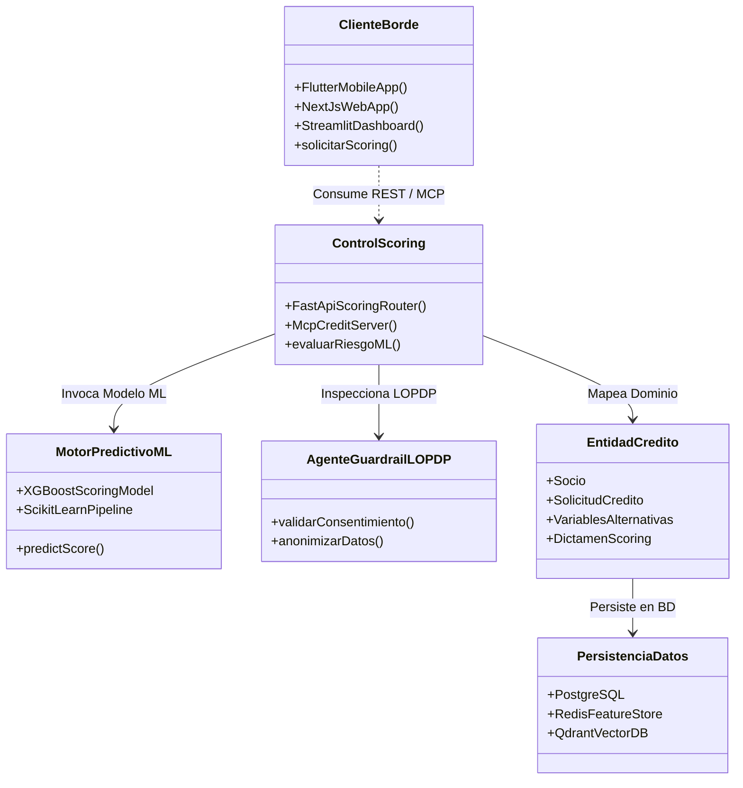
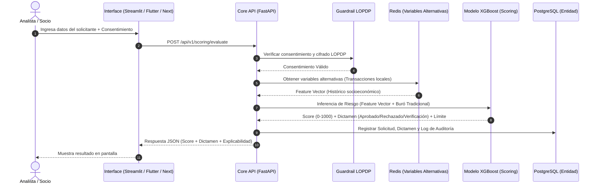
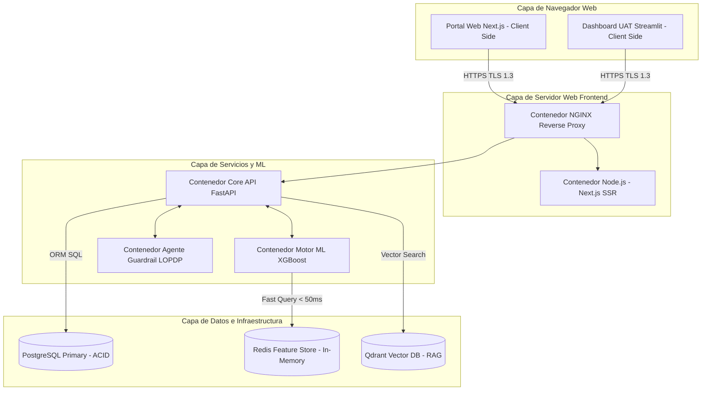
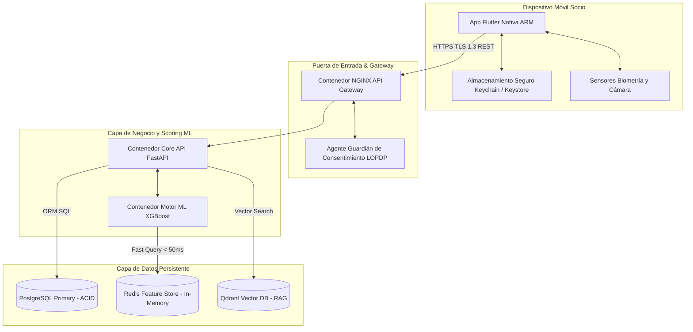

# Documento de Descripción Arquitectónica de Software (DAS)

**Proyecto**: Sistema de Scoring de Crédito Basado en Analítica Predictiva y Variables Alternativas  
**Cliente / Empresa**: Cooperativa de Ahorro y Crédito Padre Julián Lorente  
**Docente Responsable**: Armando Augusto Cabrera Silva  
**Marco de Trabajo**: Aprendizaje Basado en Retos (CBL) - Proyecto Bimestral Ascendere  
**Estándar de Documentación**: ISO/IEC/IEEE 42010:2022 | Modelo 4+1 Vistas de Philippe Kruchten  
**Organización / Repositorio**: Antera Labs / UTPL (`Antera Labs / Proyecto-Ascendere`)  
**Versión**: 1.0.0 (Infraestructura Simplificada Docker & Separación Web/Móvil)  

---

## 1. Información General, Contexto de Negocio y Control del Documento

### 1.1. Contexto del Reto Empresarial
La Cooperativa de Ahorro y Crédito Padre Julián Lorente requiere optimizar la evaluación de riesgo crediticio en la colocación de créditos de consumo y microcréditos en el sur del Ecuador. Actualmente, la dependencia exclusiva de burós de crédito tradicionales genera rechazos innecesarios de microempresarios y pequeños comerciantes locales que carecen de historial bancario formal, derivando en análisis manuales lentos y costosos.

**Objetivo General del Sistema**:
Optimizar la evaluación de riesgo y reducir el tiempo de respuesta en la colocación de créditos en un **40%**, manteniendo o mejorando la calidad de la cartera mediante analítica predictiva, variables alternativas locales y cumplimiento estricto de la **Ley Orgánica de Protección de Datos Personales (LOPDP) del Ecuador**.

### 1.2. Autores y Matriz de Responsabilidad del Equipo Multifuncional
El proyecto es ejecutado por una empresa de software simulada con asignación explícita de dominios arquitectónicos:

| Nombre | Rol de Equipo | Dominio Arquitectónico Principal | Estándar / Foco Primario |
| :--- | :--- | :--- | :--- |
| **Andrés** | Arquitecto de Software & Líder Técnico | Liderazgo arquitectónico, Integridad conceptual, Vistas 4+1, Gobernanza Docker/IaC | ISO/IEC/IEEE 42010:2022, Microsoft Arch Guide v2 |
| **Ronald** | Diseñador UX/UI | Capa de Presentación, Experiencia de Analista y Socio, Usabilidad | ISO/IEC 25010 (Usabilidad y Calidad en Uso) |
| **Josué** | Desarrollador FrontEnd | Objetos Borde (*Boundary*), Clientes Web (Next.js), Móvil (Flutter) y UAT (Streamlit) | ISO/IEC 9126 / 25010 (Eficiencia en UI) |
| **Anthony** | Desarrollador BackEnd | Objetos Control (*Control*), Microservicios de Scoring ML, Servidores MCP y APIs | ISO/IEC 12207 (Procesos de Software) |
| **Martín** | Administrador de Base de Datos (DBA) | Objetos Entidad (*Entity*), PostgreSQL, Feature Store (Redis) y RAG (Qdrant) | ISO/IEC 25012 (Calidad de Datos) |
| **Alberto** | Oficial de Seguridad & DevSecOps | Capa Transversal de Seguridad, Cumplimiento LOPDP y *Guardrail Agents* | ISO/IEC 27001, LOPDP Ecuador |

---

## 2. Mapa de Capacidades del Negocio (Ulrich Methodology)

Para la elicitación ágil de requisitos de la Cooperativa Padre Julián Lorente, la arquitectura se estructura en torno a 5 Capacidades del Negocio estables:

```
┌───────────────────────────────────────────────────────────────────────────────────────────┐
│                       MAPA DE CAPACIDADES DE ULRICH - COOPERATIVA LORENTE                 │
├───────────────────────────────────────────────────────────────────────────────────────────┤
│ 1. Gestión de Identidad, Consentimiento & LOPDP                                           │
│    • Captura y trazabilidad del consentimiento explícito del socio.                       │
│    • Anonimización y encriptación de datos sensibles socioeconómicos.                      │
├───────────────────────────────────────────────────────────────────────────────────────────┤
│ 2. Ingesta e Integración de Datos Híbridos                                                │
│    • Conexión con Buró Tradicional (Histórico crediticio formal).                         │
│    • Ingesta de Variables Alternativas Locales (Transacciones, estabilidad comercial).    │
├───────────────────────────────────────────────────────────────────────────────────────────┤
│ 3. Evaluación de Riesgo y Scoring Predictivo en Tiempo Real                               │
│    • Ejecución del modelo de Machine Learning (Scikit-Learn / XGBoost).                   │
│    • Cálculo del Score de crédito y probabilidad de mora.                                 │
├───────────────────────────────────────────────────────────────────────────────────────────┤
│ 4. Dictamen Automático y Ajuste de Condiciones                                            │
│    • Generación de veredicto (Aprobado, Rechazado, Sujeto a Verificación).                │
│    • Recomendación de límites de crédito, tasa y plazos ajustados al perfil.               │
├───────────────────────────────────────────────────────────────────────────────────────────┤
│ 5. Explicabilidad del Dictamen, Auditoría & UAT                                           │
│    • Justificación del dictamen al analista vía Malla Agéntica y RAG de políticas.        │
│    • Dashboard de analítica interactivo en Streamlit para validación con usuarios.         │
└───────────────────────────────────────────────────────────────────────────────────────────┘
```

---

## 3. Requerimientos Significativos para la Arquitectura (ASRs) y Calidad

### 3.1. Atributos de Calidad Priorizados (ISO/IEC 9126 / ISO/IEC 25010)
1. **Seguridad y Privacidad (ISO 25010 / LOPDP Ecuador)**: Garantizar confidencialidad e integridad con cifrado TLS 1.3 en tránsito, AES-256 en reposo, y *Guardrail Agents* para mitigar inyecciones de prompt y accesos no autorizados.
2. **Eficiencia en el Tiempo (*Performance Efficiency*)**: Tiempo de respuesta de scoring predictivo en tiempo real **< 300 ms**, reduciendo el tiempo total de colocación en un 40%.
3. **Mantenibilidad y Explicabilidad (*Maintainability & Analyzability*)**: Aislamiento del modelo de Machine Learning mediante microservicios y protocolo MCP, permitiendo recalibrar algoritmos sin rehacer la interfaz.
4. **Disponibilidad y Portabilidad Containerizada (*Availability & Portability*)**: Operatividad del 99.9% mediante arquitectura de contenedores Docker aislados, despliegue inmutable y reinicio automático de contenedores.
5. **Usabilidad (*Usability*)**: Interfaz táctil y web intuitiva (Flutter/Next.js) más tablero analítico (Streamlit) con tiempo de aprendizaje < 5 minutos para analistas de la cooperativa.

### 3.2. Árbol de Utilidad (*Utility Tree*)
```
Utilidad del Sistema de Scoring
├── Seguridad / LOPDP (Alto / Alto)
│   └── Escenario 1: Un socio ingresa una solicitud de microcrédito. El sistema verifica el consentimiento explícito registrado en la BD. Si no existe consentimiento, el Guardrail Agent bloquea la consulta al buró y registra la auditoría en < 30 ms.
├── Eficiencia de Tiempo (Alto / Alto)
│   └── Escenario 2: El analista envía los datos socioeconómicos de un comerciante. La API orquesta la lectura de Redis (Feature Store), invoca el modelo XGBoost y retorna el score, dictamen y límite sugerido en < 250 ms.
├── Mantenibilidad / Modificabilidad (Medio / Alto)
│   └── Escenario 3: El equipo de analítica recalibra el modelo de scoring con nuevas variables del sur del Ecuador. Gracias al desacoplamiento vía microservicios en Docker y protocolo MCP, el nuevo modelo se despliega sin detener la API core.
└── Disponibilidad en Contenedores Docker (Alto / Medio)
    └── Escenario 4: Si un contenedor de la API de scoring sufre una sobrecarga o fallo, el motor de contenedores ejecuta una reinicialización de salud (health check) y recupera la instancia en < 2 segundos sin pérdida de estado.
```

---

## 4. Estructura Interna: Arquitectura en Capas (Patrón BCE y Microsoft Arch Guide v2)

```
┌─────────────────────────────────────────────────────────────────────────┐
│ CAPA DE PRESENTACIÓN (Objetos BORDE / Boundary)                         │
│  • App Móvil Socios: Flutter (iOS / Android)                            │
│  • Web Socios / Portal: Next.js + Tailwind CSS + Shadcn UI              │
│  • Dashboard Analistas / UAT: Streamlit (Python)                        │
└────────────────────────────────────┬────────────────────────────────────┘
                                     │ HTTP REST / WebSockets / MCP
┌────────────────────────────────────▼────────────────────────────────────┐
│ CAPA DE NEGOCIO Y ANALÍTICA (Objetos CONTROL / Control)                 │
│  • Core API Microservicios: FastAPI (Python) / NestJS                   │
│  • Motor de Scoring ML: Scikit-Learn / XGBoost (Inferencia de Riesgo)   │
│  • Servidores MCP: Protocolo de Integración para Herramientas de IA     │
│  • Malla Agéntica Explicativa & RAG: Razonamiento de Políticas          │
│  • Security & LOPDP Guardrails: Agente de Validación                    │
└────────────────────────────────────┬────────────────────────────────────┘
                                     │ ORM / Feature Queries / Vectors
┌────────────────────────────────────▼────────────────────────────────────┐
│ CAPA DE PERSISTENCIA (Objetos ENTIDAD / Entity)                         │
│  • Modelos Transaccionales (Socios, Solicitudes, Dictámenes)            │
│  • Feature Store de Variables Alternativas Locales                      │
│  • Embeddings Vectoriales de Políticas de Crédito                       │
└────────────────────────────────────┬────────────────────────────────────┘
                                     │ Conexiones Nativas de Datos
┌────────────────────────────────────▼────────────────────────────────────┐
│ CAPA DE DATOS E INFRAESTRUCTURA CONTENEDORIZADA (Docker)                │
│  • Base Relacional Transaccional: PostgreSQL (ACID)                     │
│  • Feature Store / Caché: Redis (< 50 ms latency)                       │
│  • Base Vectorial RAG: Qdrant / pgvector                                │
│  • Infraestructura Docker: Docker Compose + GCP Cloud Run / AWS ECS     │
└─────────────────────────────────────────────────────────────────────────┘
```

---

## 5. Representación en el Modelo de 4+1 Vistas (ISO/IEC/IEEE 42010:2022)

### 5.1. Vista Lógica (*Logical View*)


### 5.2. Vista de Procesos (*Process View*)


### 5.3. Vista de Desarrollo (*Development View*)
```text
/
├── .github/
│   └── workflows/          # CI/CD Pipelines en GitHub Actions
│       ├── devsecops.yml   # SAST SonarQube + Auditoría LOPDP
│       └── deploy-docker.yml # Despliegue de Contenedores Docker / Cloud Run
├── docs/
│   └── DAS-Scoring-Credito.md # Presente Documento DAS
├── apps/
│   ├── mobile/             # App Móvil en Flutter (Josué/Ronald)
│   ├── web/                # Portal Web en Next.js (Josué/Ronald)
│   └── dashboard-uat/      # Dashboard Analítico en Streamlit (Josué)
├── services/
│   ├── core-api/           # Microservicios FastAPI en Docker (Anthony)
│   ├── ml-scoring-engine/  # Modelos Scikit-Learn/XGBoost en Python (Anthony)
│   └── mcp-servers/        # Servidores MCP de Integración de IA
├── database/
│   ├── migrations/         # DDL SQL PostgreSQL para Créditos (Martín)
│   └── feature-store/      # Esquemas Redis para Variables Alternativas (Martín)
└── infra/
    ├── docker/             # Dockerfiles y docker-compose.yml
    └── terraform/          # Infraestructura como Código Docker Cloud (Andrés)
```

### 5.4. Vista de Despliegue Web (*Web Application Archetype*)


### 5.5. Vista de Despliegue Móvil (*Rich Mobile Client Archetype*)


---

## 6. Malla Agéntica, DevSecOps y Gobernanza LOPDP

1. **Cumplimiento LOPDP Ecuador**:
   * Todos los datos personales identificables (PII) son anonimizados mediante *tokens* criptográficos antes de ser procesados por los modelos analíticos o la Malla Agéntica.
   * Se almacena un registro de auditoría inmutable con la hora, usuario y consentimiento asociado a cada dictamen.
2. **DevSecOps en GitHub Actions**:
   * **SonarQube**: Revisa la mantenibilidad del código Python/Dart/TypeScript.
   * **Guardrail Agents**: Verifican que ningún prompt exponga información financiera de los socios de la cooperativa.
3. **Infraestructura Contenedorizada Docker**:
   * Despliegue inmutable en contenedores Docker gestionados mediante Docker Compose y Cloud Run / ECS en red privada VPC.

---

## 7. Matriz de Entregables por Integrante

| Integrante | Entregable Directo en el Repositorio | Ruta en GitHub |
| :--- | :--- | :--- |
| **Andrés** | Documento DAS, Dockerfiles, Docker Compose, Terraform | `docs/`, `infra/docker/` |
| **Ronald** | Prototipos Figma, Sistema de Diseño UI | `apps/web/components/ui/` |
| **Josué** | Apps Flutter, Next.js y Dashboard Streamlit | `apps/mobile/`, `apps/web/`, `apps/dashboard-uat/` |
| **Anthony**| API FastAPI, Pipeline ML XGBoost y Servidores MCP | `services/core-api/`, `services/ml-scoring-engine/` |
| **Martín** | Esquemas SQL PostgreSQL, Redis Feature Store | `database/migrations/`, `database/feature-store/` |
| **Alberto**| Reglas SAST SonarQube, Guardrails LOPDP | `.github/workflows/devsecops.yml` |

---

## 8. Bibliografía de Referencia
1. **ISO/IEC/IEEE 42010:2022**: *Software, systems and enterprise — Architecture description*.
2. **ISO/IEC 25010:2011**: *System and software quality models (SQuaRE)*.
3. **Microsoft Corporation (2009)**: *Microsoft Application Architecture Guide* (2nd ed. / v2).
4. **Asamblea Nacional del Ecuador (2021)**: *Ley Orgánica de Protección de Datos Personales (LOPDP)*.
5. **Bass, L., Clements, P., & Kazman, R. (2012)**: *Software Architecture in Practice* (3rd ed.).
6. **Ulrich, W. (2010)**: *Business Architecture: Applying Business Capability Models*.
