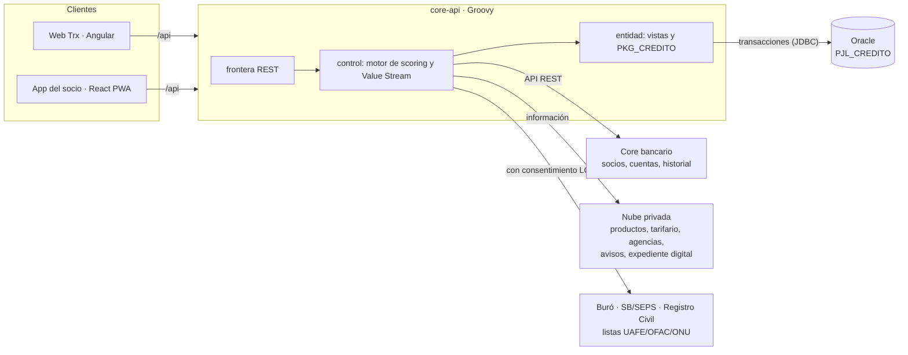

# PJL Crédito · Cooperativa de Ahorro y Crédito Padre Julián Lorente

Sistema de crédito que digitaliza el **Value Stream de 6 etapas** del SAD de Antera Labs (CU-01 a CU-06): desde la solicitud hasta la cobranza, con un motor de scoring explicable y la autorización LOPDP.

| Pieza | Tecnología | Para quién | Ruta |
|---|---|---|---|
| **Web Trx** | Angular 22 (standalone, signals) | Personal: asesores, analistas, riesgo, comité, operaciones, cartera y cobranza | `src/UIs/web` |
| **App del socio** | React 19 + Vite, PWA instalable | Socios: solicitar, seguir, aceptar y pagar | `src/UIs/movil` |
| **core-api** | Groovy 4 + Spring Boot 3.5 | API REST para las dos apps | `src/Services/core-api` |
| **Base de datos** | Oracle (relacional): vistas `V_*` + paquete `PKG_CREDITO` | Transacciones del crédito | `src/Database/oracle` |

Las dos apps son responsivas en teléfono, tablet y PC y usan la paleta del logo (`#16588E`, `#F5B500`, `#0E3A60`, `#1A212D`) con Manrope. El sistema visual está en [DESIGN.md](DESIGN.md).

## Inicio rápido

Solo hace falta Docker con Compose. Oracle Free necesita unos 2 GB de RAM.

```bash
cd dev/pjl-credito        # todos los comandos se ejecutan desde la raíz del proyecto
make up
```

| Qué | Dirección |
|---|---|
| Web Trx (personal) | http://localhost:8081 |
| App del socio | http://localhost:8082 |
| API (estado) | http://localhost:8080/actuator/health |
| Buzón de correo (Mailpit) | http://localhost:8025 |

Entra como `pespinosa` en la web o `1145525752` en la app; la clave de todas las cuentas demo es `Pjl.2026` (ver [Cuentas de demostración](#cuentas-de-demostración-clave-pjl2026)). Para contribuir, lee [CONTRIBUTION.md](CONTRIBUTION.md).

## Arquitectura (según el boceto de la reunión)



Reglas que pidió la cooperativa, y cómo se cumplen:

1. **Las vistas consumen de la base de datos.** Toda lectura del proceso sale de vistas Oracle (`V_BANDEJA_SOLICITUDES`, `V_EXPEDIENTE_SOLICITUD`, `V_KPI_ETAPAS`, `V_INDICADORES`, `V_CARTERA`, `V_TABLA_AMORTIZACION`, `V_PROVISIONES_RESUMEN`, `V_LINEA_TIEMPO`, `V_TARIFARIO`). La base trae datos de prueba.
2. **La API consume del core de la empresa.** `CoreBancarioCliente` obtiene socios, cuentas, saldos e historial interno (etapa 2.1), acredita los desembolsos (5.2) y debita los pagos hechos desde la app.
3. **Web y móvil: la información viene de la nube privada; las transacciones, de la base.** `/api/v1/info/**` (productos, tarifario publicado, simulador, agencias, avisos) lee de la nube privada con caché. Todo cambio de estado (solicitudes, consentimientos, evaluaciones, decisiones, desembolsos, pagos, cobranza, provisiones) se escribe en Oracle; las operaciones de dinero pasan por `PKG_CREDITO`.
4. **Oracle relacional:** 29 tablas con restricciones, columnas virtuales (totales patrimoniales y pérdida esperada), identidades, 9 vistas y un paquete PL/SQL.
5. **Nube privada:** contenido informativo y repositorio del expediente digital (los documentos subidos en la etapa 1.3).

Detalle por etapa, endpoints y tablas: [docs/ARQUITECTURA.md](docs/ARQUITECTURA.md).

## Levantar todo con Docker

```bash
make up
```

`make up` crea `deployments/docker-compose/.env` desde `.env.example` (si no existe), construye las imágenes y levanta Oracle, Mailpit, core-api, la Web Trx y la App del socio. Sin `make`, los mismos pasos son:

```bash
cp deployments/docker-compose/.env.example deployments/docker-compose/.env
docker compose -f deployments/docker-compose/docker-compose.yaml up -d --build
```

La primera vez, Oracle crea el esquema y carga los datos de prueba (1–2 minutos). La App del socio se puede instalar como app en Chrome o Android, y en Mailpit llegan los correos de «¿Olvidaste tu clave?».

El Compose está partido como en el monorepo de referencia, y los tres archivos están en `deployments/docker-compose/`:

| Archivo | Levanta |
|---|---|
| `docker-compose.yaml` | Todo: incluye los dos siguientes (proyecto `pjl-credito`) |
| `docker-compose.infrastructure.yaml` | Oracle (`localhost:1521`, servicio `FREEPDB1`) y Mailpit (`:8025`, SMTP `:1025`) |
| `docker-compose.services.yaml` | core-api (`:8080`), Web Trx (`:8081`) y App del socio (`:8082`), construidos desde `src/` |

Las variables (claves, secreto JWT, perfil, SMTP) se leen de `deployments/docker-compose/.env`, que Git ignora; la plantilla es `.env.example` en la misma carpeta.

### Tareas del día a día

`make help` las lista. Con [mise](https://mise.jdx.dev) también existen como `mise run <tarea>`, y en VS Code como *Terminal → Ejecutar tarea* (`.vscode/tasks.json`).

| Comando | Qué hace |
|---|---|
| `make up` | Construye y levanta todo |
| `make ps` | Estado de los contenedores |
| `make logs` | Sigue los registros de todos los servicios |
| `make down` | Detiene todo y conserva los datos |
| `make reset` | Vuelve a los datos iniciales (borra los volúmenes de Oracle y del expediente) |
| `make infra` | Solo Oracle y Mailpit, para desarrollar sin Compose |
| `make env` | Crea `deployments/docker-compose/.env` si no existe |
| `make test` | Pruebas de core-api y compilación de producción de las dos apps |
| `make test-api` · `make test-web` · `make test-movil` | Cada parte por separado |
| `make datos` | Regenera los datos de prueba |
| `make prepare` | Instala con mise el JDK, Node y Python fijados, y crea el `.env` |
| `make hooks` | Activa los hooks de Git de `.husky/` |

### Cuentas de demostración (clave `Pjl.2026`)

| Usuario | Rol | Para probar |
|---|---|---|
| `dmaldonado` | Asesora de negocios | Nueva solicitud (formulario de 8 pasos), KYC, documentos |
| `pespinosa` | Analista de crédito | Motor de evaluación, ajuste de condiciones |
| `mvaldivieso` | Analista de riesgo | Motor, monitoreo y provisiones |
| `ccarrion` | Comité de crédito | Resolución de casos en zona gris y montos altos |
| `lburneo` | Operaciones | Formalización y desembolso |
| `rceli` / `ajaramillo` | Cartera / Cobranza | Monitoreo, gestiones de cobranza, provisiones |
| `admin` | Administración | Todo |
| `1145525752` | Socia María Fernanda (app) | Aceptar su oferta, pagar su cuota, solicitar otro crédito |

Las pantallas de ingreso muestran estas cuentas solo cuando el backend corre con el perfil `simulador`.

### Recorrido sugerido

1. **Web Trx** como `pespinosa`: el panel muestra cuántas solicitudes hay en cada una de las 6 etapas. Abre la *Bandeja* en la etapa 2, entra a un expediente y pulsa **Ejecutar motor de evaluación**. Verás el score, los filtros, la capacidad de pago, los factores que explican el resultado y el dictamen.
2. Como `ccarrion`: en *Comité de crédito* resuelve un caso con su acta. La oferta llega al socio.
3. **App del socio** como `1145525752`: el arco muestra la etapa 5. Toca **Revisa y acepta tu oferta**.
4. Web Trx como `lburneo`: en ese expediente registra contrato, pagaré y garantías y pulsa **Desembolsar**. El dinero se acredita en la cuenta del core.
5. En la app: **Pagar cuota** debita la cuenta de ahorros y registra el pago en Oracle.
6. Como `ajaramillo`: en *Cartera y cobranza* registra una gestión. Como `rceli`: ejecuta el monitoreo (6.1) y calcula las provisiones (6.3).
7. Desde la app, **Solicitar** crea una solicitud nueva: firmas la autorización LOPDP, verificas tu identidad con una selfie, subes los documentos y la envías al motor.

## Desarrollo con recarga en caliente

Hay tres formas de trabajar; elige una.

**1. Solo Docker.** No instala nada en tu equipo: `make up` para usar el sistema y `make test` para probar. No sirve para recarga en caliente.

**2. Herramientas locales.** Con JDK 21, Node 22 y Python 3 instalados (`make prepare` los instala con mise, según `mise.toml`):

```bash
make infra                                          # Oracle y Mailpit en Docker
cd src/Services/core-api && ./gradlew bootRun       # API en :8080 (perfil "simulador" por defecto)
cd src/UIs/web && npm install && npx ng serve       # Web Trx en http://localhost:4200 (proxy de /api a :8080)
cd src/UIs/movil && npm install && npm run dev      # App del socio en http://localhost:5173 (proxy de /api a :8080)
```

Cada servidor va en su propia terminal. En VS Code, `pjl-credito.code-workspace` abre la raíz y cada app como carpeta propia, de modo que también funciona el `ng serve` de `src/UIs/web/.vscode`.

**3. Dev Container.** En VS Code: *Dev Containers: Reabrir en contenedor* (o GitHub Codespaces). Levanta Oracle y Mailpit con `docker-compose.infrastructure.yaml` más un contenedor `dev` con JDK 21, Gradle 8.14.3, Node 22 y Python 3. `.devcontainer/scripts/post-create.sh` instala las dependencias de las dos apps y de core-api. Dentro, core-api ya apunta a `oracle:1521` y `correo:1025`, y se reenvían los puertos 4200, 5173, 8080, 8025 y 1521. Los comandos son los de la opción 2, sin `make infra`. La primera creación tarda unos 15 minutos (descarga Gradle y las dependencias); las siguientes son inmediatas.

## Herramientas y versiones

Las versiones se fijan en dos archivos, como en el monorepo de referencia:

- **`mise.toml`**: runtimes y tareas.
- **`.config/herramientas.json`**: manifiesto de herramientas, en el formato de `dotnet-tools.json` (`version`, `isRoot`, `tools`).

| Herramienta | Versión | Fijada en |
|---|---|---|
| JDK | 21 (Temurin) | `mise.toml` · `src/Services/core-api/Dockerfile` |
| Gradle | 8.14.3 | `.config/herramientas.json` · wrapper de core-api · imagen `gradle:8.14.3-jdk21` |
| Node | 22 | `mise.toml` · `.config/herramientas.json` · imagen `node:22-alpine` de las dos apps |
| npm | 10.9.9 | `.config/herramientas.json` · `packageManager` de `src/UIs/web/package.json` |
| Python | 3 | `mise.toml` (generador de datos y resumen de pruebas) |
| Oracle | Free 23 (`gvenzl/oracle-free:23-slim-faststart`) | `docker-compose.infrastructure.yaml` |
| Mailpit | v1.21 | `docker-compose.infrastructure.yaml` |

Si cambias una versión en su origen (Dockerfile, wrapper o `package.json`), actualiza también `mise.toml` y `.config/herramientas.json`. `scripts/run-tests.sh` se detiene y dice qué no coincide.

## Pruebas y calidad

```bash
make test        # pruebas de core-api + compilación de producción de la Web Trx y la App del socio
make test-api    # solo las pruebas del motor de scoring y de la validación de cédula
```

`scripts/run-tests.sh` hace tres cosas:

1. Verifica el contrato de herramientas (sección anterior).
2. Usa JDK 21 y Node 22 locales si coinciden con `mise.toml`; si no, corre lo mismo en Docker con las imágenes del manifiesto. No deja `node_modules` ni archivos de root en el repo.
3. Resume el resultado (por ejemplo, `6 pruebas · 0 fallos`).

Las pruebas de core-api viven en `tests/Services/core-api/UnitTests`, fuera del código de runtime, y `build.gradle` las toma desde ahí.

**Hooks de Git** (opcionales: `make hooks`; se deshacen con `git config --unset core.hooksPath`):

- `pre-commit` bloquea los `.env` reales, exige que las copias de `tokens.css` sean idénticas a `assets/tokens.css` y valida el Compose si cambió.
- `pre-push` corre las pruebas de core-api si el push trae cambios del proyecto.

Solo actúan sobre archivos de `pjl-credito`, así que no molestan al resto del repositorio. `make hooks` no pisa un `core.hooksPath` que ya exista.

**Integración continua:** `.github/workflows/build-test.yml` instala los runtimes de `mise.toml`, corre `scripts/run-tests.sh todo`, valida el Compose y guarda los resultados de las pruebas. GitHub solo lee `.github/` en la raíz del repositorio, así que se ejecuta cuando `pjl-credito` es la raíz de su propio repo.

**Probar la API a mano:** `_httpclients/core-api/` tiene peticiones de solo lectura para REST Client (`auth.http`, `web-trx.http`, `movil.http` e `info.http`). Cada archivo hace su propio ingreso y reutiliza el token. El entorno se elige abajo a la derecha en VS Code: `core-api` (:8080 directo), `web-nginx` (:8081) o `movil-nginx` (:8082), definidos en `.vscode/settings.json`.

## Estructura

El repositorio sigue la organización de monorepo de referencia: el código de runtime en `src/`, las pruebas separadas en `tests/`, todo lo necesario para desplegar en `deployments/` y la automatización en `scripts/`.

```text
pjl-credito/
├── .config/                    herramientas.json: manifiesto de herramientas (imágenes, Gradle, npm, cachés)
├── .devcontainer/              Dockerfile, devcontainer.json, compose del servicio dev, scripts/
├── .github/workflows/          build-test.yml: CI con los runtimes de mise.toml
├── .husky/                     hooks de Git pre-commit y pre-push (make hooks)
├── .vscode/                    extensiones, ajustes (entornos de REST Client) y tareas
├── _httpclients/core-api/      peticiones .http de auth, Web Trx, app del socio e info
├── assets/                     marca (logo, paleta) y tokens de diseño fuente
├── deployments/
│   ├── configs/oracle/         script de carga inicial del contenedor Oracle
│   └── docker-compose/         compose base, infraestructura, servicios y .env.example
├── docs/                       ARQUITECTURA.md: Value Stream → pantallas → endpoints → tablas
├── scripts/                    run-tests.sh, instalar-hooks.sh y generador de datos de prueba
├── src/
│   ├── Database/               Oracle: oracle/ (01…05) y migraciones/
│   ├── Services/core-api/      Groovy · Spring Boot (patrón Borde-Control-Entidad del SAD)
│   └── UIs/
│       ├── web/                Web Trx (Angular)
│       └── movil/              App del socio (React PWA)
├── tests/
│   └── Services/core-api/UnitTests/   pruebas del motor de scoring y de la cédula
├── .editorconfig · .gitattributes · .gitignore
├── CONTRIBUTION.md             dónde va cada cambio y reglas del proyecto
├── DESIGN.md · PRODUCT.md      sistema visual y contexto de producto
├── Makefile                    tareas: prepare, up, down, reset, infra, test, datos, hooks
├── mise.toml                   runtimes fijados (JDK 21, Node 22, Python 3) y tareas
├── pjl-credito.code-workspace  espacio de trabajo de VS Code (raíz + cada app)
└── README.md
```

| Ruta | Finalidad |
|---|---|
| `.config/herramientas.json` | Manifiesto de herramientas (formato del `dotnet-tools.json` de referencia: `version`, `isRoot`, `tools`): imagen y caché de Gradle 8.14.3 y Node 22, y npm 10.9.9. Lo lee `scripts/run-tests.sh`. |
| `.devcontainer/` | Entorno de desarrollo en contenedor. `Dockerfile` (base `gradle:8.14.3-jdk21` + Node 22 + Python 3), `docker-compose.yaml` (servicio `dev`, que se suma a la infraestructura de `deployments/`), `.devcontainer/scripts/post-create.sh` (instala dependencias). |
| `.github/workflows/build-test.yml` | CI: instala los runtimes de `mise.toml`, corre `scripts/run-tests.sh` y valida el Compose. GitHub solo lo ejecuta si `pjl-credito` es la raíz del repositorio. |
| `.husky/pre-commit` | Bloquea `.env` reales, exige que las copias de `tokens.css` sean idénticas a `assets/tokens.css` y valida el Compose si cambió. |
| `.husky/pre-push` | Si el push trae cambios del proyecto, corre las pruebas de core-api. |
| `.vscode/` | Extensiones recomendadas, ajustes (incluye los entornos de REST Client) y tareas que envuelven el Makefile. |
| `_httpclients/core-api/` | Peticiones de solo lectura para REST Client: `auth.http`, `web-trx.http`, `movil.http`, `info.http`. |
| `mise.toml` | Runtimes fijados y tareas `mise run up`, `test`, `datos`, etc. (las mismas del Makefile). |
| `scripts/instalar-hooks.sh` | `make hooks`: apunta `core.hooksPath` a `.husky/` sin pisar una configuración existente. Se deshace con `git config --unset core.hooksPath`. |
| `assets/marca/` | Logo y paleta de la cooperativa. |
| `assets/tokens.css` | Fuente única de los tokens de diseño; se copia a `src/UIs/web/src/styles/` y `src/UIs/movil/src/estilos/`. |
| `deployments/configs/oracle/` | `10_cargar_esquema.sql`: lo ejecuta el contenedor Oracle al crearse; carga `src/Database/oracle` montado en `/opt/pjl/sql`. |
| `deployments/docker-compose/docker-compose.yaml` | Compose base: incluye infraestructura y servicios. Lo usan `make up`, `make down` y `make reset`. |
| `deployments/docker-compose/docker-compose.infrastructure.yaml` | Solo Oracle y Mailpit (`make infra`), para desarrollar sin Compose. |
| `deployments/docker-compose/docker-compose.services.yaml` | core-api, web y móvil, construidos desde `src/`. |
| `deployments/docker-compose/.env.example` | Plantilla de variables; se copia a `.env` en la misma carpeta (`make env`). |
| `docs/` | Arquitectura detallada por etapa, endpoints y tablas. |
| `scripts/run-tests.sh` | Pruebas de core-api y compilación de las dos apps (local o en Docker). |
| `scripts/generar_datos_prueba.py` | Escribe `src/Database/oracle/05_datos_prueba.sql` y los JSON de los simuladores de core-api desde una misma semilla. |
| `src/Database/oracle/` | 01 esquema · 02 catálogos y tarifario · 03 `PKG_CREDITO` · 04 vistas · 05 datos de prueba. |
| `src/Database/migraciones/` | Cambios para bases creadas antes de una versión. |
| `src/Services/core-api/` | API REST: `frontera/` controladores (`/api/v1/**`) · `control/` MotorScoring y servicios del Value Stream · `entidad/` vistas `V_*` y `PKG_CREDITO` · `integracion/` core bancario, externos y nube privada · `simulador/` perfil `simulador`. |
| `src/UIs/web/` | Web Trx: panel, bandeja, expediente, nueva solicitud, comité, cartera, provisiones, tarifario. |
| `src/UIs/movil/` | App del socio: inicio, solicitar, seguimiento, crédito y pago, simulador, perfil LOPDP. |
| `tests/Services/core-api/UnitTests/` | Pruebas JUnit del servicio; `build.gradle` las declara como su `sourceSet` de test. |

Cada pieza conserva su Dockerfile junto a su código (`src/Services/core-api`, `src/UIs/web`, `src/UIs/movil`), como los servicios del monorepo de referencia.

Del árbol de referencia se omiten, a propósito, las piezas propias de .NET o sin equivalente aquí: `.aspire/`, `*.slnx`, `global.json`, `nuget.config`, `Directory.*.props`, `stylecop.json` y `.csharpierrc.yaml`. Tampoco hay `version.json`, `.gitleaks.toml`, `.gitmodules`, `k8s/` ni `LICENSE`, porque el proyecto aún no define versionado, escaneo de secretos, submódulos, Kubernetes ni licencia.

## Datos de prueba

Son **sintéticos**: 60 socios del sur del Ecuador con cédulas válidas, 80 solicitudes repartidas en las 6 etapas, 40 créditos con pagos, mora temprana, judicial y cancelados, alertas, gestiones y provisiones. Se regeneran con:

```bash
make datos      # = python3 -I scripts/generar_datos_prueba.py
```

El generador escribe `05_datos_prueba.sql` y, desde la misma semilla, los datos de los simuladores (core, buró y nube privada), para que todo cuadre. **El tarifario se transcribió de la foto de la hoja de tasas**: hay que validar cada cifra con la cooperativa antes de usarlo en producción.

## Recuperar la clave (personal)

En el ingreso, **¿Olvidaste tu clave?** pide el usuario y envía por SMTP un enlace a `tb_usuario.correo`. El enlace lleva un token de 256 bits en el fragmento (`/restablecer#token=…`), vence en 30 minutos y sirve una sola vez; la base guarda solo su SHA-256 (`tb_recuperacion_clave`). La respuesta es la misma exista o no la cuenta, hay un límite de 3 enlaces por usuario y 10 pedidos por IP cada 15 minutos, la nueva clave pide 10 caracteres con letras y números sin contener el usuario, y al cambiarla llega un aviso al correo. Todo queda en `tb_auditoria`.

En desarrollo los correos llegan a Mailpit (http://localhost:8025). Las cuentas demo tienen correos `usuario@pjl-credito.test`.

## Seguridad y LOPDP

- JWT HS256 sin estado y roles verificados en cada endpoint (`@PreAuthorize`). El socio solo ve sus propios datos.
- Sin una autorización LOPDP vigente el motor no consulta el buró: la base lo exige además con la FK `tb_consulta_externa.id_consentimiento`. El socio puede revocarla desde su perfil.
- Bitácora en `tb_auditoria`, cédulas enmascaradas en el expediente y la app del socio (el panel y la bandeja del personal las muestran completas) y hash SHA-256 de cada documento del expediente.
- Claves con PBKDF2 o BCrypt (`DelegatingPasswordEncoder`); CSP y cabeceras de seguridad en nginx; CORS restringido.

## Para pasar a producción

Las variables siguientes van en `deployments/docker-compose/.env`, o en el gestor de secretos del entorno.

- `SPRING_PROFILES_ACTIVE=produccion` y `PJL_CORE_URL`, `PJL_EXTERNOS_URL` y `PJL_NUBE_URL` apuntando a los sistemas reales. Sin el perfil `simulador` desaparecen `/sim/**` y `/auth/demo`.
- `PJL_JWT_SECRET` propio, TLS delante de nginx y credenciales de Oracle desde un gestor de secretos.
- Ejecutar `src/Database/oracle/01…04` con el DBA (el `05` es solo de prueba). En una base creada antes del 2026-11-15, aplicar `src/Database/migraciones/2026-11-15_recuperacion_clave.sql`.
- Correo saliente con el SMTP de la cooperativa: `PJL_SMTP_HOST`, `PJL_SMTP_PORT`, `PJL_SMTP_USUARIO`, `PJL_SMTP_CLAVE`, `PJL_SMTP_AUTH=true`, `PJL_SMTP_TLS=true`, `PJL_CORREO_REMITENTE` y `PJL_WEB_URL` (la dirección pública de la Web Trx). Registrar el correo de cada usuario del personal en `tb_usuario.correo`.
- Pendiente de integrar con proveedores reales: biometría, firma electrónica del contrato y el pagaré, y notificaciones al socio.
