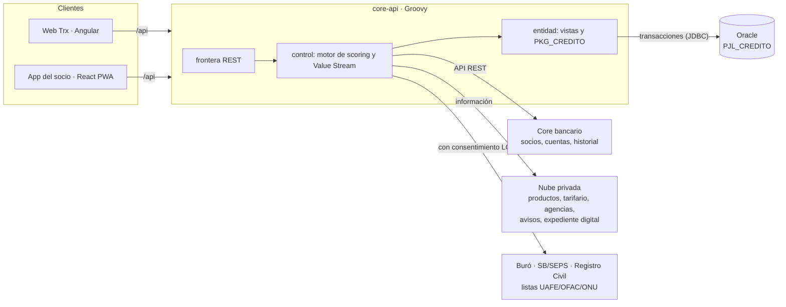

# PJL Crédito · Cooperativa de Ahorro y Crédito Padre Julián Lorente

Sistema de crédito que digitaliza el **Value Stream de 6 etapas** del SAD de Antera Labs (CU-01 a CU-06): desde la solicitud hasta la cobranza, con un motor de scoring explicable y la autorización LOPDP.

| Pieza | Tecnología | Para quién | Ruta |
|---|---|---|---|
| **Web Trx** | Angular 22 (standalone, signals) | Personal: asesores, analistas, riesgo, comité, operaciones, cartera y cobranza | `apps/web` |
| **App del socio** | React 19 + Vite, PWA instalable | Socios: solicitar, seguir, aceptar y pagar | `apps/movil` |
| **core-api** | Groovy 4 + Spring Boot 3.5 | API REST para las dos apps | `services/core-api` |
| **Base de datos** | Oracle (relacional): vistas `V_*` + paquete `PKG_CREDITO` | Transacciones del crédito | `database/oracle` |

Las dos apps son responsivas en teléfono, tablet y PC y usan la paleta del logo (`#16588E`, `#F5B500`, `#0E3A60`, `#1A212D`) con Manrope. El sistema visual está en [DESIGN.md](DESIGN.md).

## Arquitectura (según el boceto de la reunión)



Reglas que pidió la cooperativa, y cómo se cumplen:

1. **Las vistas consumen de la base de datos.** Toda lectura del proceso sale de vistas Oracle (`V_BANDEJA_SOLICITUDES`, `V_EXPEDIENTE_SOLICITUD`, `V_KPI_ETAPAS`, `V_INDICADORES`, `V_CARTERA`, `V_TABLA_AMORTIZACION`, `V_PROVISIONES_RESUMEN`, `V_LINEA_TIEMPO`, `V_TARIFARIO`). La base trae datos de prueba.
2. **La API consume del core de la empresa.** `CoreBancarioCliente` obtiene socios, cuentas, saldos e historial interno (etapa 2.1), acredita los desembolsos (5.2) y debita los pagos hechos desde la app.
3. **Web y móvil: la información viene de la nube privada; las transacciones, de la base.** `/api/v1/info/**` (productos, tarifario publicado, simulador, agencias, avisos) lee de la nube privada con caché. Todo cambio de estado (solicitudes, consentimientos, evaluaciones, decisiones, desembolsos, pagos, cobranza, provisiones) se escribe en Oracle; las operaciones de dinero pasan por `PKG_CREDITO`.
4. **Oracle relacional:** 29 tablas con restricciones, columnas virtuales (totales patrimoniales y pérdida esperada), identidades, 9 vistas y un paquete PL/SQL.
5. **Nube privada:** contenido informativo y repositorio del expediente digital (los documentos subidos en la etapa 1.3).

Detalle por etapa, endpoints y tablas: [docs/ARQUITECTURA.md](docs/ARQUITECTURA.md).

## Levantar todo con Docker

Requisito: Docker con Compose (Oracle Free necesita unos 2 GB de RAM).

```bash
cp .env.example .env
docker compose up -d --build
```

La primera vez, Oracle crea el esquema y carga los datos de prueba (1–2 minutos). Luego:

- Web Trx: http://localhost:8081
- App del socio: http://localhost:8082 (en Chrome o Android se puede instalar como app)
- API: http://localhost:8080/actuator/health
- Buzón de correo de desarrollo (Mailpit): http://localhost:8025. Ahí llegan los correos de «¿Olvidaste tu clave?».

Para volver a los datos iniciales: `docker compose down -v && docker compose up -d`.

### Cuentas de demostración (clave `Pjl.2026`)

| Usuario | Rol | Para probar |
|---|---|---|
| `dmaldonado` | Asesora de negocios | Nueva solicitud (formulario de 8 pasos), KYC, documentos |
| `pespinosa` | Analista de crédito | Motor de evaluación, ajuste de condiciones |
| `mvaldivieso` | Analista de riesgo | Motor, monitoreo y provisiones |
| `ccarrion` | Comité de crédito | Resolución de casos en zona gris y montos altos |
| `lburneo` | Operaciones | Formalización y desembolso |
| `rceli` / `ajaramillo` | Cartera / Cobranza | Monitoreo, gestiones de cobranza, provisiones |
| `admin` | Administración | Todo |
| `1145525752` | Socia María Fernanda (app) | Aceptar su oferta, pagar su cuota, solicitar otro crédito |

Las pantallas de ingreso muestran estas cuentas solo cuando el backend corre con el perfil `simulador`.

### Recorrido sugerido

1. **Web Trx** como `pespinosa`: el panel muestra cuántas solicitudes hay en cada una de las 6 etapas. Abre la *Bandeja* en la etapa 2, entra a un expediente y pulsa **Ejecutar motor de evaluación**. Verás el score, los filtros, la capacidad de pago, los factores que explican el resultado y el dictamen.
2. Como `ccarrion`: en *Comité de crédito* resuelve un caso con su acta. La oferta llega al socio.
3. **App del socio** como `1145525752`: el arco muestra la etapa 5. Toca **Revisa y acepta tu oferta**.
4. Web Trx como `lburneo`: en ese expediente registra contrato, pagaré y garantías y pulsa **Desembolsar**. El dinero se acredita en la cuenta del core.
5. En la app: **Pagar cuota** debita la cuenta de ahorros y registra el pago en Oracle.
6. Como `ajaramillo`: en *Cartera y cobranza* registra una gestión. Como `rceli`: ejecuta el monitoreo (6.1) y calcula las provisiones (6.3).
7. Desde la app, **Solicitar** crea una solicitud nueva: firmas la autorización LOPDP, verificas tu identidad con una selfie, subes los documentos y la envías al motor.

## Desarrollo sin Compose

El backend necesita JDK 21 y Oracle accesible; las apps necesitan Node 22.

```bash
# Oracle de desarrollo con el esquema cargado
docker compose up -d oracle

# API (perfil "simulador" por defecto)
cd services/core-api && ./gradlew bootRun

# Web Trx en http://localhost:4200 (proxy de /api a :8080)
cd apps/web && npm install && npx ng serve

# App del socio en http://localhost:5173 (proxy de /api a :8080)
cd apps/movil && npm install && npm run dev
```

Pruebas del motor y de la validación de cédula: `cd services/core-api && ./gradlew test`.

## Estructura

```text
apps/web/                 Web Trx (Angular): panel, bandeja, expediente, nueva solicitud, comité, cartera, provisiones, tarifario
apps/movil/               App del socio (React PWA): inicio, solicitar, seguimiento, crédito y pago, simulador, perfil LOPDP
services/core-api/        Groovy · Spring Boot (patrón Borde-Control-Entidad del SAD)
  frontera/               controladores REST (/api/v1/**)
  control/                MotorScoring, SolicitudServicio (CU-01…05), CarteraServicio (CU-06), consentimiento, autenticación
  entidad/                repositorios sobre vistas V_* y llamadas a PKG_CREDITO
  integracion/            clientes del core bancario, servicios externos y nube privada
  simulador/              simuladores de desarrollo (perfil "simulador")
database/oracle/          01 esquema · 02 catálogos y tarifario · 03 PKG_CREDITO · 04 vistas · 05 datos de prueba
database/docker/          script de carga inicial para el contenedor Oracle
database/herramientas/    generador de datos de prueba (Python)
diseno/                   tokens compartidos y logo
docs/ARQUITECTURA.md      Value Stream → pantallas → endpoints → tablas
```

## Datos de prueba

Son **sintéticos**: 60 socios del sur del Ecuador con cédulas válidas, 80 solicitudes repartidas en las 6 etapas, 40 créditos con pagos, mora temprana, judicial y cancelados, alertas, gestiones y provisiones. Se regeneran con:

```bash
python3 -I database/herramientas/generar_datos_prueba.py
```

El generador escribe `05_datos_prueba.sql` y, desde la misma semilla, los datos de los simuladores (core, buró y nube privada), para que todo cuadre. **El tarifario se transcribió de la foto de la hoja de tasas**: hay que validar cada cifra con la cooperativa antes de usarlo en producción.

## Recuperar la clave (personal)

En el ingreso, **¿Olvidaste tu clave?** pide el usuario y envía por SMTP un enlace a `tb_usuario.correo`. El enlace lleva un token de 256 bits en el fragmento (`/restablecer#token=…`), vence en 30 minutos y sirve una sola vez; la base guarda solo su SHA-256 (`tb_recuperacion_clave`). La respuesta es la misma exista o no la cuenta, hay un límite de 3 enlaces por usuario y 10 pedidos por IP cada 15 minutos, la nueva clave pide 10 caracteres con letras y números sin contener el usuario, y al cambiarla llega un aviso al correo. Todo queda en `tb_auditoria`.

En desarrollo los correos llegan a Mailpit (http://localhost:8025). Las cuentas demo tienen correos `usuario@pjl-credito.test`.

## Seguridad y LOPDP

- JWT HS256 sin estado y roles verificados en cada endpoint (`@PreAuthorize`). El socio solo ve sus propios datos.
- Sin una autorización LOPDP vigente el motor no consulta el buró: la base lo exige además con la FK `tb_consulta_externa.id_consentimiento`. El socio puede revocarla desde su perfil.
- Bitácora en `tb_auditoria`, cédulas enmascaradas en el expediente y la app del socio (el panel y la bandeja del personal las muestran completas) y hash SHA-256 de cada documento del expediente.
- Claves con PBKDF2 o BCrypt (`DelegatingPasswordEncoder`); CSP y cabeceras de seguridad en nginx; CORS restringido.

## Para pasar a producción

- `SPRING_PROFILES_ACTIVE=produccion` y `PJL_CORE_URL`, `PJL_EXTERNOS_URL` y `PJL_NUBE_URL` apuntando a los sistemas reales. Sin el perfil `simulador` desaparecen `/sim/**` y `/auth/demo`.
- `PJL_JWT_SECRET` propio, TLS delante de nginx y credenciales de Oracle desde un gestor de secretos.
- Ejecutar `database/oracle/01…04` con el DBA (el `05` es solo de prueba). En una base creada antes del 2026-11-15, aplicar `database/migraciones/2026-11-15_recuperacion_clave.sql`.
- Correo saliente con el SMTP de la cooperativa: `PJL_SMTP_HOST`, `PJL_SMTP_PORT`, `PJL_SMTP_USUARIO`, `PJL_SMTP_CLAVE`, `PJL_SMTP_AUTH=true`, `PJL_SMTP_TLS=true`, `PJL_CORREO_REMITENTE` y `PJL_WEB_URL` (la dirección pública de la Web Trx). Registrar el correo de cada usuario del personal en `tb_usuario.correo`.
- Pendiente de integrar con proveedores reales: biometría, firma electrónica del contrato y el pagaré, y notificaciones al socio.
