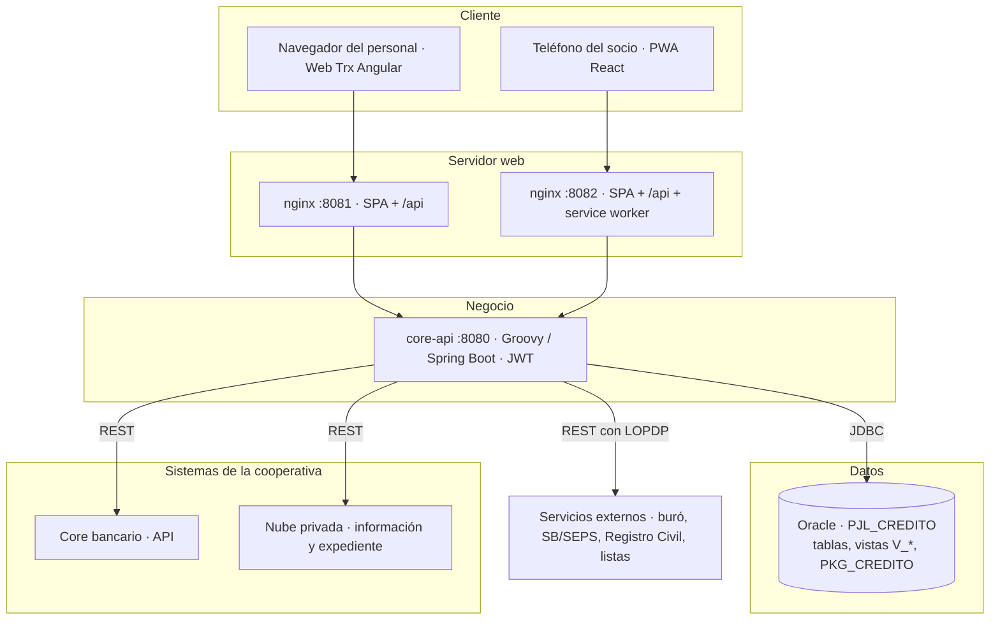

# Arquitectura · PJL Crédito

Implementa el SAD de Antera Labs (ISO/IEC/IEEE 42010, 4+1 vistas) con el stack que definió la cooperativa: React, Angular, Groovy y Oracle. El backend respeta el patrón **Borde-Control-Entidad** del SAD.

## Vista de despliegue

Las apps nunca hablan directo con Oracle, con el core ni con la nube privada: todo pasa por core-api. En desarrollo, los sistemas de la cooperativa y los externos son simuladores de core-api (`/sim/**`) alimentados por el mismo generador que la base.

## Value Stream → pantallas → API → base

| Etapa (SAD) | Subetapas | Web Trx (Angular) | App del socio (React) | Endpoint | Oracle |
|---|---|---|---|---|---|
| **1 · Solicitud y captación** (CU-01) | 1.1 Recepción · 1.2 KYC · 1.3 Documental | *Nueva solicitud* (las 10 secciones del formulario en papel, 8 pasos); *Expediente* → Validar identidad, Subir documentos | *Solicitar* (4 pasos con firma LOPDP); *Seguimiento* → selfie y documentos | `POST /solicitudes`, `POST /movil/solicitudes`, `…/identidad`, `…/documentos` | `tb_solicitud_credito`, `tb_actividad_economica`, `tb_conyuge`, `tb_referencia`, `tb_bien`, `tb_situacion_financiera`, `tb_consentimiento_lopdp`, `tb_validacion_kyc`, `tb_documento` |
| **2 · Recolección y consolidación** (CU-02) | 2.1 Internos (core) · 2.2 Externos · 2.3 Integración | *Expediente* → Ejecutar motor; pestaña *Datos y buró* | *Enviar a evaluación* | `POST /solicitudes/{id}/procesamiento`, `POST /movil/solicitudes/{id}/envio` | `tb_datos_internos`, `tb_consulta_externa` (FK obligatoria al consentimiento) |
| **3 · Evaluación y score** (CU-03) | 3.1 Filtros · 3.2 Capacidad · 3.3 Modelo · 3.4 Segmentación | Pestaña *Evaluación*: score sobre la rampa A–E, filtros, cuota/ingreso y factores | Arco de etapas | (dentro del procesamiento) | `tb_evaluacion` (factores en JSON) |
| **4 · Decisión crediticia** (CU-04) | 4.1 Matriz · 4.2 Comité · 4.3 Condiciones | *Comité de crédito*; ajuste de condiciones | Oferta en la hoja inferior | `POST …/resolucion-comite`, `PUT …/condiciones` | `tb_decision`, `tb_condicion_credito` |
| **5 · Formalización y desembolso** (CU-05) | 5.1 Aceptación · 5.2 Desembolso | Formalización y **Desembolsar** (acredita en el core) | **Acepto la oferta** | `POST /movil/solicitudes/{id}/aceptacion`, `POST …/formalizacion`, `POST …/desembolso` | `PKG_CREDITO.DESEMBOLSAR` → `tb_credito`, `tb_cuota` |
| **6 · Seguimiento y cobranza** (CU-06) | 6.1 Monitoreo · 6.2 Cobranza · 6.3 Provisiones | *Cartera y cobranza*, *Crédito*, *Provisiones* | *Tu crédito* y **Pagar cuota** (débito en el core) | `/cartera`, `…/pagos`, `…/gestiones`, `/cartera/monitoreo`, `/provisiones` | `PKG_CREDITO.REGISTRAR_PAGO`, `ACTUALIZAR_CARTERA`, `CALCULAR_PROVISIONES`; `tb_pago`, `tb_alerta_cartera`, `tb_gestion_cobranza`, `tb_provision` |

Cada transición queda registrada con `PKG_CREDITO.AVANZAR_ETAPA` en `tb_historial_solicitud`, que alimenta la línea de tiempo del personal y la del socio (`visible_socio`).

## Motor de evaluación (`MotorScoring.groovy`)

- **3.1 Filtros knock-out:** edad y plazo (de 18 a 75 años al vencimiento), flujo disponible positivo, sin deuda vencida en el sistema financiero, cuota/ingreso total ≤ 50 % y listas UAFE/OFAC/ONU satisfactorias.
- **3.2 Capacidad:** cuota francesa con la tasa del tarifario, relación cuota/ingreso, endeudamiento (pasivos/activos) y flujo disponible.
- **3.3 Modelo:** regresión logística (`logit-pjl-v1.2`) que da la PD. El score es 500 + 72,13 · ln((1 − PD)/PD), acotado entre 0 y 1000. Cada variable guarda su aporte para explicar el resultado.
- **3.4 Segmentación:** cortes A ≥ 720, B ≥ 650, C ≥ 580, D ≥ 500, E < 500.
- **4.1 Matriz:** A o B con monto ≤ $20,000.00 y cuota/ingreso ≤ 40 % → aprobación automática. E o un filtro fallido → rechazo. El resto (zona gris C/D, montos altos o ratio alto) → comité.
- **4.3 Condiciones:** tasa referencial más un ajuste por riesgo (A −0,50, B 0, C +0,75, D +1,50); cupo recortado para que la cuota/ingreso no pase de 40 %; garantía según el monto, el producto y los bienes declarados.

Los coeficientes son **ilustrativos**: deben recalibrarse con la cartera histórica de la cooperativa (SAD, capacidad 7).

## Seguridad

| Riesgo (OWASP) | Control |
|---|---|
| Control de acceso roto | Roles por endpoint con `@PreAuthorize`; en `/movil/**` todo se filtra por el `idSocio` del token (404 ante recursos ajenos) |
| Fallas criptográficas | JWT HS256 con secreto de 32 bytes o más; claves con PBKDF2 o BCrypt; hash SHA-256 de cada documento y de la firma LOPDP |
| Inyección | SQL con parámetros nombrados; filtros armados solo desde fragmentos fijos |
| Diseño inseguro | El consentimiento LOPDP es precondición del buró, también en la base (FK) |
| Configuración | CSP, `X-Frame-Options`, `nosniff` y `Referrer-Policy` en nginx; CORS cerrado; `/sim/**` solo con el perfil `simulador` |
| Registro y monitoreo | `tb_auditoria` (login, KYC, motor, comité, desembolso, pagos, consentimientos) |
