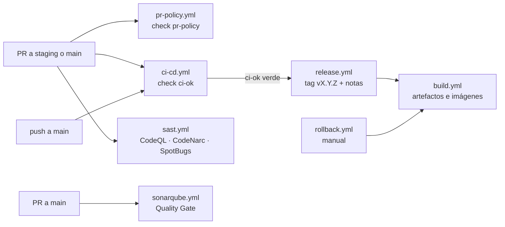

# DevOps · capa 7 del System-Monorepo

Pipelines CI/CD DevSecOps del repositorio (SAD § 8.2, capa 7: `/.github` y `/devops`). El flujo para quien contribuye está en [`CONTRIBUTING.md`](../CONTRIBUTING.md). Este documento explica cómo está armado, por qué y qué falta.

## Qué hay

| Ruta | Contenido |
|---|---|
| `.github/workflows/` | Los 7 workflows (abajo) |
| `.github/rulesets/` | Protección de `main`, `staging` y los tags `v*`, y nombres de rama permitidos |
| `.github/labeler.yml` | Etiquetas por carpeta, incluida `docs` |
| `.github/codeql/codeql-config.yml` | Consultas `security-extended` y rutas ignoradas |
| `devops/scripts/` | Lógica del pipeline, con pruebas: `node --test "devops/scripts/**/*.test.js"` |
| `devops/setup-repo.sh` | Configuración del repo en GitHub (idempotente) |

## Workflows

| Workflow | Cuándo | Qué hace |
|---|---|---|
| `pr-policy.yml` | PR a `staging`/`main` | Rama, título, issue opcional y vista previa de la promoción. Sin comentarios en el PR |
| `ci-cd.yml` | PR y push a `staging`/`main` | CI por proyecto afectado. En `main`, encadena el release |
| `sast.yml` | PR, push y semanal | CodeQL; para Groovy, CodeNarc y SpotBugs + FindSecBugs (SARIF a *Security*) |
| `sonarqube.yml` | PR a `main` y push a `main` | SonarQube Cloud con cobertura y Quality Gate |
| `release.yml` | Desde `ci-cd.yml` | Tag, GitHub Release con notas y sección Documentación |
| `build.yml` | Desde `release.yml` o `rollback.yml` | El único build de producción: archivos, imágenes, SHA256SUMS, procedencia |
| `rollback.yml` | Manual | Reactiva una versión anterior; revert de código opcional |

`GITHUB_TOKEN` no dispara otros workflows, por eso release y build se encadenan con `uses:` y `needs:`, no con eventos.

## Cumplimiento del SAD (§ 8.2, capa 7)

| Pide el SAD | Cómo se cumple | Estado |
|---|---|---|
| Workflows YAML (`.github/workflows/ci-cd.yml`) | `ci-cd.yml` como pipeline principal, más los workflows especializados | Hecho |
| Compilación | Solo en el release (`build.yml`), por decisión del equipo: los PRs no generan builds | Hecho |
| Pruebas unitarias/integración | `npm test` (Vitest) y `./gradlew test` en cada PR | Hecho (unitarias). Integración: pendiente del equipo |
| Análisis estático (SonarQube) | `sonarqube.yml` (SonarQube Cloud gratuito) | Hecho, falta el token (§ Puesta en marcha) |
| Reportes de calidad/seguridad (SAST) | CodeQL, CodeNarc y SpotBugs + FindSecBugs en *Security*; Sonar | Hecho |
| Reportes de cobertura | `test:coverage` (lcov) en SonarQube Cloud y como artefacto | Hecho (web). movil y core-api: pendiente |
| Reportes DAST | Requiere un entorno desplegado | Pendiente: no hay QA desplegado |
| Verificación de reglas de seguridad/LOPDP | Archivos sensibles (secretos, llaves, volcados), dependency review, secret scanning con push protection, Compose del release sin secretos por defecto | Hecho |
| Registro de artefactos | GitHub Releases (archivos) y GHCR (imágenes), con firma de procedencia | Hecho |
| Scripts de release y rollback | `devops/scripts/release.js`, `rollback.js`, `rollback-codigo.sh` | Hecho |
| Promoción controlada hacia QA y producción en la IaaS | Promoción `staging → main` con aprobación y checks; los artefactos quedan listos para la IaaS | Deploy pendiente (fuera de alcance) |

## Análisis por lenguaje

| Código | SAST | Calidad | Cobertura |
|---|---|---|---|
| Angular / React (`src/UIs`) | CodeQL | SonarQube Cloud | Vitest → lcov (web) |
| Groovy (`src/Services/core-api`) | SpotBugs + FindSecBugs (reporta) | CodeNarc (bloquea prioridad 1) | — (Sonar no analiza Groovy) |
| Python (`scripts/`) | CodeQL | SonarQube Cloud | — |
| Workflows de Actions | CodeQL | actionlint | — |
| Dockerfiles / Compose | Trivy (imágenes, en el release) | SonarQube Cloud | — |
| PL/SQL (Oracle) | — | — (solo planes de pago) | — |

## Decisiones

- **`main` es la rama por defecto** y el trabajo entra por `staging`. SonarQube Cloud gratuito solo analiza la rama principal y los PRs hacia ella, así que analiza justo lo que se publica.
- **Sin bot que comente:** `pr-policy` deja el resultado en su check. Sí ajusta títulos, el `Closes #N` del issue opcional y las etiquetas.
- **El build solo en el release.** Contrapartida: un error que solo aparece al compilar (p. ej. una plantilla de Angular) se detecta en `main` después de fusionar la promoción, no antes. Si pasa, el release sale sin artefactos. Si fue un fallo pasajero, basta con *Re-run failed jobs*; si es del código, se corrige con un hotfix, que publica la versión siguiente con sus artefactos.
- **Las herramientas del producto mandan.** Las versiones de JDK y Node salen de `mise.toml` (`jdx/mise-action`), y el CI corre `scripts/run-tests.sh contrato`, el mismo chequeo con que arranca `make test`.
- **CodeNarc bloquea desde el inicio solo la prioridad 1**, con un conjunto de reglas elegido a mano (basic, exceptions, imports, unnecessary). Línea base de core-api: 0 / 4 / 9 (prioridad 1 / 2 / 3).
- **SpotBugs + FindSecBugs solo reporta** hasta revisar el ruido. Analiza solo la categoría `SECURITY`, con confianza baja, y excluye la plomería que genera Groovy. Línea base: 1 hallazgo (`SERVLET_HEADER` en `UsuarioActual.groovy`).
- **Imágenes inmutables:** `vX.Y.Z` y el SHA del commit, nunca `latest`. Si la etiqueta ya existe en GHCR, se reutiliza en vez de subir otra. Trivy bloquea la publicación con vulnerabilidades críticas o altas que tengan corrección (`TRIVY_SEVERIDAD` para cambiarlo).
- **Jobs de release sin cachés:** un job que publica no restaura nada que un PR haya podido escribir.

## Hallazgos al montar el pipeline

1. **SpotBugs se caía en silencio.** El plugin `io.spring.dependency-management` aplica el BOM de Spring Boot también a las configuraciones de las herramientas, y bajaba `commons-lang3` de 3.21.0 a 3.17.0 (`NoClassDefFoundError`). Como el build usa `ignoreFailures`, salía en verde y sin hallazgos. Corregido en `build.gradle`: las herramientas resuelven las versiones que piden.
2. **FindSecBugs no ve el SQL armado con GString.** En Groovy dinámico, `jdbc.query(sql)` pasa por `CallSite`, y FindSecBugs no lo reconoce como sumidero. Por eso no reporta `Bd` ni los repositorios. Recomendación al backend: `@CompileStatic` en `entidad/` (la capa SQL). Con eso FindSecBugs ve las llamadas y reportará el SQL dinámico para revisarlo.
3. **`application.yml` trae secretos de desarrollo por defecto** (`PJL_JWT_SECRET`, `PJL_DB_PASSWORD`). Si el jar arranca sin esas variables, usa los valores de desarrollo. El Compose del release las exige (`${VAR:?}`). Recomendación: un perfil de producción sin valores por defecto.
4. **`dev/pjl-credito/.github/workflows/build-test.yml` no corre en este repo:** GitHub solo lee `.github/` de la raíz. Sirve si `pjl-credito` pasa a su propio repo. Aquí lo reemplaza `ci-cd.yml`.
5. **Prettier y las plantillas embebidas de Angular:** a veces hace falta correr `npm run format` dos veces para que quede estable.

## Puesta en marcha

1. **Arranque:** fusiona en `main` el PR que trae el pipeline. Mientras no exista `staging`, `pr-policy` lo acepta como arranque.
2. **Repo:** `devops/setup-repo.sh Antera-Labs/guidelines` (admin, con `gh auth login`).
3. **SonarQube Cloud** (plan Free; el repo es público):
   1. Entra a sonarcloud.io con GitHub, importa la organización `Antera-Labs` y el repo `guidelines`. La clave del proyecto queda como `Antera-Labs_guidelines`; si es otra, ajusta la variable `SONAR_PROJECT_KEY`.
   2. En el proyecto: *Administration → Analysis Method* → **apagar Automatic Analysis**.
   3. Genera un token (*My Account → Security*) y guárdalo: `gh secret set SONAR_TOKEN --repo Antera-Labs/guidelines`.
4. **GHCR:** tras el primer release, revisa en *Packages* que las imágenes sean públicas. Deberían heredar la visibilidad del repo; si no, cámbiala en la configuración de cada paquete, o el Compose del release no podrá descargarlas sin credenciales.

## Pendientes

| Pendiente | Qué falta |
|---|---|
| Deploy a la Nube Privada IaaS | Job `desplegar` en `release.yml` y `rollback.yml` (ya hay un lugar marcado), con environment `produccion` y aprobación |
| DAST | Un entorno de QA desplegado contra el que escanear |
| Pruebas | Reales en web y movil (web tiene un smoke test), cobertura de movil y JaCoCo de core-api |
| React Native | Hoy `src/UIs/movil` es React + Vite (PWA). Con el proyecto Android nativo, el release genera el `.apk` firmado; el `.ipa` requiere macOS y certificados de Apple |
| FindSecBugs bloqueante | `@CompileStatic` en la capa SQL, revisar hallazgos y pasar `ignoreFailures` a `false` |
| Dependabot de npm y Gradle | Hoy solo actualiza las GitHub Actions |
