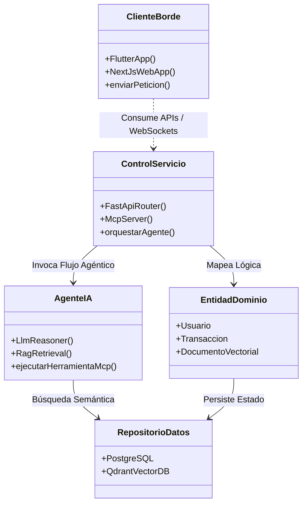
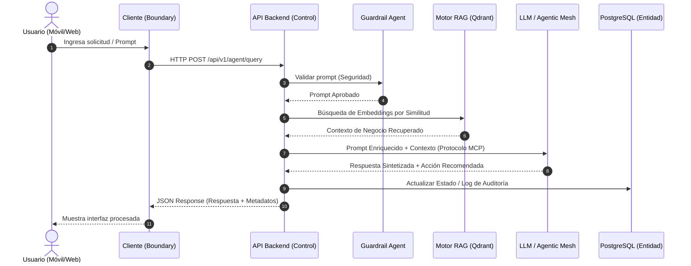
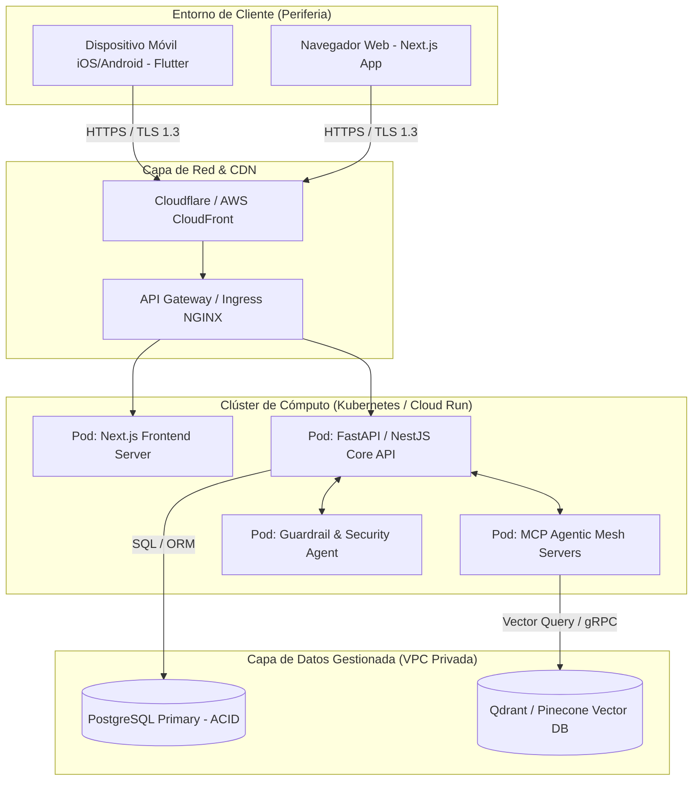

# Documento de Descripción Arquitectónica de Software (DAS)

**Proyecto**: Solución Móvil y Web Nativa en la Nube con Malla Agéntica de IA  
**Estándar de Documentación**: ISO/IEC/IEEE 42010:2011  
**Marco de Representación**: Modelo 4+1 Vistas de Philippe Kruchten  + DevOps Agenticos </br>
**Organización / Repositorio**: Antera Labs / UTPL (Retos Empresariales Ascendere)  
**Versión**: 1.0.0  

---

## 1. Información General y Control del Documento

### 1.1. Autores y Matriz de Responsabilidad del Equipo
Asignando dominios arquitectónicos según el rol especializado de cada integrante:

| Nombre | Rol de Equipo | Dominio Arquitectónico Principal | Estándar / Foco Primario |
| :--- | :--- | :--- | :--- |
| **Andrés** | Arquitecto de Software & Líder Técnico | Liderazgo arquitectónico, Integridad conceptual, Vistas 4+1, Gobernanza IaC | ISO/IEC/IEEE 42010, ISO/IEC 15288 |
| **Ronald** | Diseñador UX/UI | Capa de Presentación, Experiencia Conversacional / Multimodal | ISO/IEC 25010 (Usabilidad y Calidad en Uso) |
| **Josué** | Desarrollador FrontEnd | Objetos Borde (*Boundary*), Clientes Web (Next.js) y Móvil (Flutter) | ISO/IEC 9126 (Eficiencia en Cliente) |
| **Anthony** | Desarrollador BackEnd | Objetos Control (*Control*), Microservicios, Servidores MCP y APIs | ISO/IEC 12207 (Procesos de Software) |
| **Martín** | Administrador de Base de Datos (DBA) | Objetos Entidad (*Entity*), Persistencia Relacional y Motor Vectorial RAG | ISO/IEC 25012 (Calidad de Datos) |
| **Alberto** | Oficial de Seguridad & DevSecOps | Capa Transversal de Seguridad, DevSecOps y *Guardrail Agents* | ISO/IEC 27001, ISO/IEC 25010 (Seguridad) |

### 1.2. Historial de Revisiones
| Versión | Fecha | Autor | Descripción del Cambio |
| :--- | :--- | :--- | :--- |
| `1.0.0` | 12/10/2026 | Andrés (Arquitecto) | Estructuración inicial y completa del DAS bajo la ISO/IEC/IEEE 42010, integrando el Modelo 4+1 Vistas, Patrón BCE, Malla Agéntica y DevSecOps. |

---

## 2. Requerimientos Significativos para la Arquitectura (ASRs) y Calidad

### 2.1. Atributos de Calidad Priorizados (ISO/IEC 9126 / ISO/IEC 25010)
El diseño se orienta a satisfacer los Requerimientos Significativos para la Arquitectura:

1. **Eficiencia en el Tiempo**: Tiempos de respuesta finales < 300 ms en consultas con procesamiento del motor RAG.
2. **Seguridad**: Confidencialidad e integridad de la información mediante cifrado en tránsito (TLS 1.3), en reposo (AES-256) y mitigación de amenazas en IA (*prompt injection*) mediante agentes guardianes.
3. **Mantenibilidad y Modularidad**: Desacoplamiento de componentes mediante Clean Architecture y patrones BCE para aislar cambios en menos de 2 días persona.
4. **Disponibilidad y Confiabilidad**: Tolerancia a fallas del 99.9% mediante autoescalado horizontal en la nube e infraestructura de recuperación.
5. **Usabilidad**: Interfaz conversacional y táctil intuitiva con tiempo de aprendizaje menor a 5 minutos para usuarios no técnicos.

### 2.2. Árbol de Utilidad de Atributos de Calidad
Matriz de priorización (Importancia para el Negocio / Impacto Arquitectónico) y escenarios concretos:

```
Utilidad del Sistema
├── Eficiencia (Alto / Alto)
│   └── Escenario 1: El usuario envía una consulta compleja desde la app móvil. El motor RAG ejecuta la búsqueda semántica vectorial en Qdrant y sintetiza la respuesta con el LLM en menos de 300 ms bajo condiciones normales de carga.
├── Seguridad (Alto / Alto)
│   └── Escenario 2: Un usuario malintencionado intenta una inyección de prompt (prompt injection) en la interfaz conversacional. El Guardrail Agent intercepta la entrada, bloquea la solicitud y registra el evento de auditoría en < 50 ms.
├── Mantenibilidad (Medio / Alto)
│   └── Escenario 3: El equipo BackEnd reemplaza el proveedor del modelo LLM o la base de datos vectorial. Gracias al protocolo MCP y las interfaces de abstracción, el cambio se completa modificando únicamente la capa de controladores sin afectar el FrontEnd.
└── Disponibilidad (Alto / Medio)
    └── Escenario 4: Un nodo de microservicios en Kubernetes falla inesperadamente. El orquestador detecta la caída mediante health checks y redirige el tráfico a un pod secundario en menos de 2 segundos sin pérdida de sesión.
```

---

## 3. Estructura Interna: Arquitectura en Capas y Patrón BCE

El sistema organiza sus módulos internos en una **Arquitectura de 3 Capas + Capa de Datos/Infraestructura**, estructurada mediante el patrón **Borde-Control-Entidad**:

```
┌─────────────────────────────────────────────────────────────────────────┐
│ CAPA DE PRESENTACIÓN (Objetos BORDE / Boundary)                         │
│  • App Móvil Multiplataforma (Flutter)                                  │
│  • Plataforma Web Reactiva (Next.js + Tailwind CSS + Shadcn UI)         │
└────────────────────────────────────┬────────────────────────────────────┘
                                     │ HTTP / REST / WebSockets / MCP
┌────────────────────────────────────▼────────────────────────────────────┐
│ CAPA DE NEGOCIO (Objetos CONTROL / Control)                             │
│  • APIs de Microservicios (FastAPI / NestJS)                            │
│  • Servidores MCP (Model Context Protocol)                              │
│  • Malla Agéntica (Agentes de Razonamiento, RAG y Orquestación)         │
└────────────────────────────────────┬────────────────────────────────────┘
                                     │ ORM (Prisma/SQLAlchemy) / Vectors
┌────────────────────────────────────▼────────────────────────────────────┐
│ CAPA DE PERSISTENCIA (Objetos ENTIDAD / Entity)                         │
│  • Modelos del Dominio Transaccional                                    │
│  • Embeddings y Almacenamiento Semántico Vectorial                      │
└────────────────────────────────────┬────────────────────────────────────┘
                                     │ Conexiones Nativas de Datos
┌────────────────────────────────────▼────────────────────────────────────┐
│ CAPA DE DATOS E INFRAESTRUCTURA CLOUD                                   │
│  • Base de Datos Relacional (PostgreSQL)                                │
│  • Base de Datos Vectorial (Qdrant / Pinecone / pgvector)               │
│  • Nodos Cloud (Docker + Kubernetes / Cloud Run)                        │
└─────────────────────────────────────────────────────────────────────────┘
```

* **Objetos Borde**: Interfaces móviles y web administradas por Josué y Ronald, encargadas de capturar la interacción del usuario y presentar información.
* **Objetos Control**: Lógica de negocio y orquestación agéntica desarrollada por Anthony, administrando reglas de dominio y flujos de IA vía protocolo **MCP**.
* **Objetos Entidad**: Definiciones de estado e información del negocio modeladas por Martín para la persistencia física.

---

## 4. Representación en el Modelo de 4+1 Vistas Arquitectónicas

### 4.1. Vista Lógica
Muestra la descomposición funcional del sistema, el modelo de componentes y la organización en capas del dominio.



### 4.2. Vista de Procesos 
Modela la concurrencia, comunicación asíncrona y el flujo dinámico entre la app, el backend, el motor RAG y los servidores MCP.



### 4.3. Vista de Desarrollo / Implementación
Describe la organización estática del código en el monorepo de GitHub (`Antera Labs / Proyecto-Ascendere`) estructurado bajo principios de **Clean Architecture**:

```text
/
├── .github/
│   └── workflows/          # CI/CD Pipelines en GitHub Actions
│       ├── devsecops.yml   # Auditoría de SonarQube + Guardrail Agents
│       └── deploy.yml      # Despliegue en la Nube con Terraform
├── docs/
│   └── DAS.md              # Presente Documento de Arquitectura
├── apps/
│   ├── mobile/             # Aplicación Móvil en Flutter (Josué/Ronald)
│   └── web/                # Aplicación Web en Next.js (Josué/Ronald)
├── services/
│   ├── core-backend/       # Microservicios en FastAPI / NestJS (Anthony)
│   └── mcp-servers/        # Servidores de Protocolo MCP para Herramientas de IA
├── database/
│   ├── migrations/         # Migraciones SQL para PostgreSQL (Martín)
│   └── vector-schemas/     # Configuración de Índices Vectoriales HNSW (Qdrant)
└── infra/
    ├── docker/             # Dockerfiles y Docker Compose
    └── terraform/          # Infraestructura como Código para Cloud (Andrés)
```

### 4.4. Vista de Despliegue
Mapea la asignación de componentes de software sobre los nodos de infraestructura cloud-native en la nube:



### 4.5. +1 Vista de Escenarios
La arquitectura se valida mediante la traza de los casos de uso principales del reto empresarial sobre las cuatro vistas anteriores, asegurando la coherencia entre las capas de interfaz, control y persistencia.

---

## 5. Malla Agéntica, Gobernanza y DevSecOps

Alineados con el modelo operativo de la **Organización Agéntica (McKinsey)** [7]:

```
[ Requisitos / ASRs ] ──> [ Agente Analista (Especificación) ]
                                   │
[ Código Fuente ]     ──> [ Anthony & Josué + Agentic Coding ]
                                   │
[ Integración CI ]    ──> [ Critic Agent (Pruebas Unitarias/E2E) ]
                                   │
[ DevSecOps Pipeline ]──> [ Guardrail Agent (Seguridad & Políticas) ] ──> [ Despliegue Cloud ]
```

1. **Protocolo MCP**: Actúa como el estándar de integración abierta para conectar las herramientas del backend con los agentes sin acoplamientos rígidos.
2. **DevSecOps Agéntico**: Alberto supervisa la ejecución de **Agentes Guardianes (*Guardrail Agents*)** dentro del pipeline de **GitHub Actions**, auditando el código contra vulnerabilidades OWASP antes de cada fusión (*merge*).
3. **Escuadras Híbridas**: El equipo humano (perfiles T-shaped y M-shaped) supervisa las redes planas de agentes [7].
