# Documento de Arquitectura de Software (SAD)

**Proyecto**: Sistema de Scoring de Crédito Basado en Analítica Predictiva y Variables Alternativas  
**Cliente / Empresa**: Cooperativa de Ahorro y Crédito Padre Julián Lorente  
**Docente Responsable**: Armando Augusto Cabrera Silva  
**Marco de Trabajo**: Aprendizaje Basado en Retos (CBL) - Proyecto Bimestral Ascendere  
**Estándar de Documentación**: ISO/IEC/IEEE 42010:2022 | Modelo 4+1 Vistas de Philippe Kruchten  
**Organización / Repositorio**: Antera Labs / UTPL (`Antera Labs / Proyecto-Ascendere`)  
**Versión**: 1.4.0 (Oficial)  
**Estado**: Aprobado para Desarrollo y Prototipado UAT  

---

### Control y Metadatos del Documento

#### Aprobador(es) del Documento:
| **Nombre del Aprobador** | **Rol** |
| :--- | :--- |
| Armando Augusto Cabrera Silva | Docente Responsable & Evaluador del Reto (UTPL) |
| Andrés | Arquitecto de Software Principal & Líder Técnico (Antera Labs) |

#### Revisores del Documento:
| **Nombre del Revisor** | **Rol** |
| :--- | :--- |
| Andrés | Arquitecto de Software & Gobernanza Cloud |
| Anthony | Desarrollador BackEnd Lead & Malla Agéntica MCP |
| Martín | Administrador de Base de Datos Lead (DBA & Feature Store) |
| Alberto | Oficial de Seguridad & DevSecOps Lead (LOPDP Guardrails) |
| Josué | Desarrollador FrontEnd Lead (Next.js, Flutter, Streamlit) |
| Ronald | Diseñador UX/UI Lead (Figma & Sistema de Diseño) |

#### Resumen de Cambios:
| **Versión** | **Fecha** | **Creado por** | **Descripción Corta de los Cambios** |
| :--- | :--- | :--- | :--- |
| 0.1 | 12/10/2026 | Andrés | Borrador inicial del DAS bajo modelo 4+1 vistas. |
| 0.5 | 15/10/2026 | Equipo Antera | Separación de arquetipos de infraestructura Web y Móvil. |
| 1.0.0 | 19/10/2026 | Andrés | Versión oficial adaptada a la Plantilla SAD ISO/IEC/IEEE 42010. |
| 1.1.0 | 02/11/2026 | Anthony | Actualización de la Vista de Casos de Uso (CU-01 a CU-06, mapa de capacidades ArchiMate) y de la Vista Lógica (diagramas de clases DC-00 a DC-06 y diccionario de clases). |
| 1.2.0 | 25/11/2026 | Ronald | Actualización de la vista de implementación y diagrama de componentes de desarrollo e interpretación (Arquitectura EAI) |
| 1.3.0 | 25/11/2026 | Josué | Actualización de la Vista de Casos de Uso (CU-01 a CU-06) según el modelo ArchiMate v4 (Consulta AVAL), los diagramas de casos de uso corregidos V2 y la Especificación de Casos de Uso v4.0.0: el Score se obtiene del Buró AVAL (se elimina el scoring con LLM y RAG), CU-04 pasa al Asesor de Negocios y CU-05 y CU-06 se reestructuran en tres subcasos alineados a las subfases del modelo. |
| 1.4.0 | 25/11/2026 | Alberto | Actualización de la Vista de Procesos (sección 7) según el Diagrama de Secuencia v2: siete diagramas SD-00 a SD-06 trazados a CU-01…CU-06 y DC-01…DC-06, con tabla de trazabilidad, fragmentos de concurrencia y control (alt, opt, par, loop, break) y endpoints de la CoreAPI. Reemplaza el diagrama único de evaluación con XGBoost. |

---

## 1. INTRODUCCIÓN

### 1.1. Propósito
Este Documento de Arquitectura de Software (SAD) proporciona una visión integral, rigurosa y formal de la estructura del sistema de Scoring de Crédito para la Cooperativa de Ahorro y Crédito Padre Julián Lorente. Utiliza el Modelo de 4+1 Vistas de Philippe Kruchten y cumple strictly con el estándar internacional ISO/IEC/IEEE 42010:2022. Su objetivo es transmitir las decisiones arquitectónicas significativas a las partes interesadas (docente evaluador, directivos de la cooperativa, analistas de crédito y equipo de desarrollo), garantizando la trazabilidad entre los requisitos de negocio y la implementación en software.

### 1.2. Alcance
El sistema abarca la automatización inteligente del proceso de evaluación de riesgo crediticio para créditos de consumo y microcréditos. Integra la ingesta de información proveniente de burós tradicionales con variables alternativas locales (comportamiento transaccional, estabilidad de actividad comercial y patrones socioeconómicos regionales del sur del Ecuador). Incluye la clasificación de riesgo en tiempo real, la emisión de dictámenes automáticos (Aprobado, Rechazado o Sujeto a Verificación), la recomendación de límites crediticios y una interfaz de explicabilidad agéntica para el analista humano, todo operando bajo el estricto cumplimiento de la Ley Orgánica de Protección de Datos Personales (LOPDP) del Ecuador.

### 1.3. Referencias
| **#** | **Documento / Estándar** | **Resumen de Contenidos y Relevancia** |
| :--- | :--- | :--- |
| [REF1] | ISO/IEC/IEEE 42010:2022 | Estándar internacional para la especificación y organización de Descripciones Arquitectónicas. |
| [REF2] | ISO/IEC 25010:2011 (SQuaRE) | Modelo de calidad del producto de software (Seguridad, Eficiencia, Mantenibilidad, Usabilidad). |
| [REF3] | Ley Orgánica de Protección de Datos Personales (LOPDP) | Marco legal del Ecuador para la custodia, consentimiento y tratamiento de datos personales. |
| [REF4] | Microsoft Application Architecture Guide v2 | Directrices para la separación estricta entre capas lógicas (Layers) y físicas (Tiers). |
| [REF5] | Ulrich Business Capability Method | Metodología ágil para la elicitación de requisitos basada en el mapa de capacidades del negocio. |
| [REF6] | OWASP Top 10 Web (2021) / Mobile (2024) | Estándar de seguridad para la mitigación de riesgos en aplicaciones web y móviles. |

### 1.4. Visión General del Contenido del Documento
A continuación, el documento detalla la representación arquitectónica, los objetivos y restricciones, la especificación de casos de uso significativos y la descomposición del sistema a través de las 4+1 Vistas de Kruchten (Lógica, Procesos, Implementación, Despliegue y Casos de Uso). Posteriormente, aborda la Vista de Datos, la evaluación de atributos de calidad basados en el estándar ISO 25010 y las medidas de seguridad transversales bajo las directrices OWASP Web y Mobile.

---

## 2. REPRESENTACIÓN ARQUITECTÓNICA
La arquitectura del sistema sigue un enfoque modular, multicapa y desacoplado, diseñado para soportar analítica predictiva e integración agéntica de IA. Se organiza bajo el patrón Borde-Control-Entidad (BCE) e integra los arquetipos de diseño del Microsoft Application Architecture Guide v2:
* **Capa de Presentación (Objetos Borde / Boundary)**: Clientes independientes adaptados a su entorno (App Móvil en Flutter, Portal Web en Next.js y Dashboard Analítico UAT en Streamlit).
* **Capa de Negocio y Analítica (Objetos Control / Control)**: Microservicios asíncronos en FastAPI, Motor de ML (Scikit-Learn/XGBoost) y Servidores del Model Context Protocol (MCP) para la Malla Agéntica.
* **Capa de Persistencia y Datos (Objetos Entidad / Entity)**: Esquema híbrido compuesto por PostgreSQL (ACID), Redis (Feature Store en memoria para variables alternativas) y Qdrant (Base Vectorial RAG).
* **Capa de Infraestructura y Despliegue**: Empaquetamiento inmutable en Contenedores Docker con despliegue físico desacoplado para web y móvil.

---

## 3. OBJETIVOS Y RESTRICCIONES ARQUITECTÓNICAS
| **Atributo de Calidad** | **Meta Arquitectónica (ASR)** | **Mecanismo / Táctica de Diseño** |
| :--- | :--- | :--- |
| Eficiencia en Tiempo | Inferencia de scoring predictivo en < 300 ms. | Lectura de variables desde Redis Feature Store y ejecución asíncrona en FastAPI. |
| Reducción de Tiempo | Reducir tiempo de colocación de crédito en un 40%. | Dictamen automático en tiempo real para el 80% de solicitudes viables. |
| Seguridad / LOPDP | Cumplimiento estricto de la LOPDP Ecuador. | Guardrail Agents que verifican el consentimiento informado previo a la consulta. |
| Disponibilidad | Disponibilidad del 99.9% en operación. | Despliegue de contenedores Docker con balanceo NGINX y reinicio automático. |
| Mantenibilidad | Modificación del modelo ML sin alterar APIs. | Desacoplamiento del motor predictivo mediante protocolo abierto MCP. |
| Portabilidad | Ejecución idéntica en desarrollo y producción. | Contenedores Docker inmutables y scripts declarativos de Terraform. |

---

## 4. VISTA DE CASOS DE USO

Los casos de uso del sistema se derivan directamente del Mapa de Capacidades y Flujo de Valor del proceso crediticio de la Cooperativa (Consulta AVAL), modelado en ArchiMate 3.2 (Value Stream + Capability) en `modelo_score_crediticio_v4.archimate`: **6 etapas de negocio (CU-01 a CU-06), 18 subfases (tres por etapa) y sus capacidades asociadas**. Cada subfase del modelo se corresponde con un caso de uso base (CU-X.Y) y sus actividades con los subcasos «include» o «extend» de los diagramas. El Score crediticio no se calcula con un modelo propio: **se obtiene del Buró AVAL** en la validación de datos externos (CU-02) y se utiliza en la segmentación automática de riesgo (CU-03) y en la matriz de decisión (CU-04).

**Figura 4.0.** Vista General: Value Stream (Fases y Subfases) + Capability (Funcionalidades) — `modelo_score_crediticio_v4.archimate`

```mermaid
---
config:
  layout: dagre
  look: classic
  flowchart:
    curve: linear
    nodeSpacing: 14
    rankSpacing: 34
    padding: 8
    wrappingWidth: 2000
    subGraphTitleMargin:
      top: 4
      bottom: 34
---
flowchart TB
  %% Cuatro filas independientes con columnas del mismo ancho: fases, subfases, relación subfase-capacidad y capacidades.
  %% Mermaid no fija coordenadas: así las columnas quedan alineadas como en la figura original.
  classDef fase fill:#f4d08c,stroke:#a08a5a,color:#111
  classDef sub fill:#f5dca8,stroke:#a08a5a,color:#111
  classDef item fill:#f9ead6,stroke:#a08a5a,color:#111
  classDef aux fill:none,stroke:none
  classDef vacio fill:none,stroke:none,color:transparent
  subgraph R1[" "]
    direction LR
    P1>"<div style='min-width:1059px'>&nbsp;<br/>1. Solicitud y captación<br/>&nbsp;</div>"]:::fase
    P2>"<div style='min-width:1059px'>&nbsp;<br/>2. Recolección y consolidación de datos<br/>&nbsp;</div>"]:::fase
    P3>"<div style='min-width:1059px'>&nbsp;<br/>3. Evaluación y cálculo del score (AVAL)<br/>&nbsp;</div>"]:::fase
    P4>"<div style='min-width:1059px'>&nbsp;<br/>4. Decisión crediticia<br/>&nbsp;</div>"]:::fase
    P5>"<div style='min-width:1059px'>&nbsp;<br/>5. Formalización y desembolso<br/>&nbsp;</div>"]:::fase
    P6>"<div style='min-width:1059px'>&nbsp;<br/>6. Seguimiento y cobranza<br/>&nbsp;</div>"]:::fase
    P1 --> P2
    P2 --> P3
    P3 --> P4
    P4 --> P5
    P5 --> P6
  end
  subgraph R2[" "]
    direction LR
    S11>"<div style='min-width:295px'>&nbsp;<br/>1.1 Recepción de solicitud<br/>&nbsp;</div>"]:::sub
    S12>"<div style='min-width:295px'>&nbsp;<br/>1.2 Validación de identidad (KYC)<br/>&nbsp;</div>"]:::sub
    S13>"<div style='min-width:295px'>&nbsp;<br/>1.3 Recolección documental<br/>&nbsp;</div>"]:::sub
    S21>"<div style='min-width:295px'>&nbsp;<br/>2.1 Validación de Datos internos<br/>&nbsp;</div>"]:::sub
    S22>"<div style='min-width:295px'>&nbsp;<br/>2.2 Validación de Datos externos (AVAL)<br/>&nbsp;</div>"]:::sub
    S23>"<div style='min-width:295px'>&nbsp;<br/>2.3 Centralización y limpieza<br/>&nbsp;</div>"]:::sub
    S31>"<div style='min-width:295px'>&nbsp;<br/>3.1 Filtros de política (knock-out)<br/>&nbsp;</div>"]:::sub
    S32>"<div style='min-width:295px'>&nbsp;<br/>3.2 Análisis de capacidad de pago<br/>&nbsp;</div>"]:::sub
    S33>"<div style='min-width:295px'>&nbsp;<br/>3.3 Segmentación de riesgo (AVAL)<br/>&nbsp;</div>"]:::sub
    S41>"<div style='min-width:295px'>&nbsp;<br/>4.1 Matriz de decisión automatizada<br/>&nbsp;</div>"]:::sub
    S42>"<div style='min-width:295px'>&nbsp;<br/>4.2 Revisión manual / comité<br/>&nbsp;</div>"]:::sub
    S43>"<div style='min-width:295px'>&nbsp;<br/>4.3 Definición de condiciones por línea<br/>&nbsp;</div>"]:::sub
    S51>"<div style='min-width:295px'>&nbsp;<br/>5.1 Validación del expediente<br/>&nbsp;</div>"]:::sub
    S52>"<div style='min-width:295px'>&nbsp;<br/>5.2 Instrumentación y firma<br/>&nbsp;</div>"]:::sub
    S53>"<div style='min-width:295px'>&nbsp;<br/>5.3 Desembolso y legalización<br/>&nbsp;</div>"]:::sub
    S61>"<div style='min-width:295px'>&nbsp;<br/>6.1 Descarga y monitoreo de cartera<br/>&nbsp;</div>"]:::sub
    S62>"<div style='min-width:295px'>&nbsp;<br/>6.2 Gestión de cobranza y visitas<br/>&nbsp;</div>"]:::sub
    S63>"<div style='min-width:295px'>&nbsp;<br/>6.3 Previsiones y reportes diarios<br/>&nbsp;</div>"]:::sub
    S11 --> S12
    S12 --> S13
    S13 --> S21
    S21 --> S22
    S22 --> S23
    S23 --> S31
    S31 --> S32
    S32 --> S33
    S33 --> S41
    S41 --> S42
    S42 --> S43
    S43 --> S51
    S51 --> S52
    S52 --> S53
    S53 --> S61
    S61 --> S62
    S62 --> S63
  end
  subgraph R3[" "]
    direction LR
    C11["<div style='min-width:291px'><span style='font-size:40px'>↓ &nbsp; ⇡</span></div>"]:::aux
    C12["<div style='min-width:291px'><span style='font-size:40px'>↓ &nbsp; ⇡</span></div>"]:::aux
    C13["<div style='min-width:291px'><span style='font-size:40px'>↓ &nbsp; ⇡</span></div>"]:::aux
    C21["<div style='min-width:291px'><span style='font-size:40px'>↓ &nbsp; ⇡</span></div>"]:::aux
    C22["<div style='min-width:291px'><span style='font-size:40px'>↓ &nbsp; ⇡</span></div>"]:::aux
    C23["<div style='min-width:291px'><span style='font-size:40px'>↓ &nbsp; ⇡</span></div>"]:::aux
    C31["<div style='min-width:291px'><span style='font-size:40px'>↓ &nbsp; ⇡</span></div>"]:::aux
    C32["<div style='min-width:291px'><span style='font-size:40px'>↓ &nbsp; ⇡</span></div>"]:::aux
    C33["<div style='min-width:291px'><span style='font-size:40px'>↓ &nbsp; ⇡</span></div>"]:::aux
    C41["<div style='min-width:291px'><span style='font-size:40px'>↓ &nbsp; ⇡</span></div>"]:::aux
    C42["<div style='min-width:291px'><span style='font-size:40px'>↓ &nbsp; ⇡</span></div>"]:::aux
    C43["<div style='min-width:291px'><span style='font-size:40px'>↓ &nbsp; ⇡</span></div>"]:::aux
    C51["<div style='min-width:291px'><span style='font-size:40px'>↓ &nbsp; ⇡</span></div>"]:::aux
    C52["<div style='min-width:291px'><span style='font-size:40px'>↓ &nbsp; ⇡</span></div>"]:::aux
    C53["<div style='min-width:291px'><span style='font-size:40px'>↓ &nbsp; ⇡</span></div>"]:::aux
    C61["<div style='min-width:291px'><span style='font-size:40px'>↓ &nbsp; ⇡</span></div>"]:::aux
    C62["<div style='min-width:291px'><span style='font-size:40px'>↓ &nbsp; ⇡</span></div>"]:::aux
    C63["<div style='min-width:291px'><span style='font-size:40px'>↓ &nbsp; ⇡</span></div>"]:::aux
    C11 ~~~ C12
    C12 ~~~ C13
    C13 ~~~ C21
    C21 ~~~ C22
    C22 ~~~ C23
    C23 ~~~ C31
    C31 ~~~ C32
    C32 ~~~ C33
    C33 ~~~ C41
    C41 ~~~ C42
    C42 ~~~ C43
    C43 ~~~ C51
    C51 ~~~ C52
    C52 ~~~ C53
    C53 ~~~ C61
    C61 ~~~ C62
    C62 ~~~ C63
  end
  subgraph R4[" "]
    direction LR
    subgraph F11["F1.1 Recepción y Registro ▟<br/>Centralizado de Solicitud ▟<br/>&nbsp;"]
      direction TB
      I111["<div style='min-width:257px'>✓ Registro centralizado del ▟<br/>socio (atención simultánea) ▟<br/>&nbsp;</div>"]:::item
      I112["<div style='min-width:257px'>✓ Selección de línea (consumo ▟<br/>/ vivienda), monto y plazo ▟<br/>&nbsp;</div>"]:::item
      I113["<div style='min-width:257px'>✓ Validación de presupuesto de ▟<br/>línea y destino del crédito ▟<br/>&nbsp;</div>"]:::item
      I111 --> I112
      I112 --> I113
    end
    subgraph F12["F1.2 Validación de Identidad y ▟<br/>Autorización AVAL ▟<br/>&nbsp;"]
      direction TB
      I121["<div style='min-width:257px'>✓ Verificación de cédula de ▟<br/>identidad del socio ▟<br/>&nbsp;</div>"]:::item
      I122["<div style='min-width:257px'>✓ Validación biométrica y ▟<br/>autorización de consulta AVAL ▟<br/>&nbsp;</div>"]:::item
      I123["<div style='min-width:257px'>✓ Consulta en listas ▟<br/>restrictivas y control ▟<br/>(PLA/FT)</div>"]:::item
      I121 --> I122
      I122 --> I123
    end
    subgraph F13["F1.3 Simplificación y ▟<br/>Digitalización Documental ▟<br/>&nbsp;"]
      direction TB
      I131["<div style='min-width:257px'>✓ Recolección de justificación ▟<br/>de ingresos y roles de pago ▟<br/>&nbsp;</div>"]:::item
      I132["<div style='min-width:257px'>✓ Unificación de declaraciones ▟<br/>y seguros (reducción de 14 ▟<br/>docs)</div>"]:::item
      I133["<div style='min-width:257px'>✓ Registro digital de ▟<br/>respaldos y garantías ▟<br/>&nbsp;</div>"]:::item
      I131 --> I132
      I132 --> I133
    end
    subgraph F21["F2.1 Extracción de Datos ▟<br/>Internos de la Cooperativa ▟<br/>&nbsp;"]
      direction TB
      I211["<div style='min-width:257px'>✓ Consulta de historial ▟<br/>crediticio con la entidad ▟<br/>&nbsp;</div>"]:::item
      I212["<div style='min-width:257px'>✓ Evaluación de saldos, encaje ▟<br/>y ahorros del socio ▟<br/>&nbsp;</div>"]:::item
      I213["<div style='min-width:257px'>✓ Análisis de comportamiento ▟<br/>de pago y días de vencimiento ▟<br/>&nbsp;</div>"]:::item
      I211 --> I212
      I212 --> I213
    end
    subgraph F22["F2.2 Consulta a Buró AVAL y ▟<br/>Central de Riesgos ▟<br/>&nbsp;"]
      direction TB
      I221["<div style='min-width:257px'>✓ Consulta de score y reporte ▟<br/>crediticio en Buró AVAL ▟<br/>&nbsp;</div>"]:::item
      I222["<div style='min-width:257px'>✓ Consulta de endeudamiento y ▟<br/>central de riesgos (SB/SEPS) ▟<br/>&nbsp;</div>"]:::item
      I223["<div style='min-width:257px'>&nbsp;<br/>&nbsp;<br/>&nbsp;</div>"]:::vacio
      I221 --> I222
      I222 ~~~ I223
    end
    subgraph F23["F2.3 Centralización, Limpieza ▟<br/>y Estandarización ▟<br/>&nbsp;"]
      direction TB
      I231["<div style='min-width:257px'>✓ Depuración de registros e ▟<br/>inconsistencias (Interno + ▟<br/>AVAL)</div>"]:::item
      I232["<div style='min-width:257px'>✓ Prevención de pérdida de ▟<br/>datos en solicitudes ▟<br/>simultáneas</div>"]:::item
      I233["<div style='min-width:257px'>✓ Normalización de variables ▟<br/>para matrices automatizadas ▟<br/>&nbsp;</div>"]:::item
      I231 --> I232
      I232 --> I233
    end
    subgraph F31["F3.1 Motor de Reglas y ▟<br/>Políticas de Negocio ▟<br/>&nbsp;"]
      direction TB
      I311["<div style='min-width:257px'>✓ Validación de edad, ▟<br/>capacidad y vigencia de línea ▟<br/>&nbsp;</div>"]:::item
      I312["<div style='min-width:257px'>✓ Verificación de mora vigente ▟<br/>y vencimientos en AVAL ▟<br/>&nbsp;</div>"]:::item
      I313["<div style='min-width:257px'>✓ Control de umbral de ▟<br/>sobreendeudamiento del socio ▟<br/>&nbsp;</div>"]:::item
      I311 --> I312
      I312 --> I313
    end
    subgraph F32["F3.2 Cálculo Automatizado de ▟<br/>Indicadores Financieros ▟<br/>&nbsp;"]
      direction TB
      I321["<div style='min-width:257px'>✓ Cálculo automatizado de ▟<br/>ratio cuota / ingreso neto ▟<br/>&nbsp;</div>"]:::item
      I322["<div style='min-width:257px'>✓ Evaluación de endeudamiento ▟<br/>consolidado (Cooperativa + ▟<br/>AVAL)</div>"]:::item
      I323["<div style='min-width:257px'>✓ Determinación de flujo de ▟<br/>caja y liquidez disponible ▟<br/>&nbsp;</div>"]:::item
      I321 --> I322
      I322 --> I323
    end
    subgraph F33["F3.3 Clasificación y Rating de ▟<br/>Riesgo (AVAL) ▟<br/>&nbsp;"]
      direction TB
      I331["<div style='min-width:257px'>✓ Evaluación de puntos de ▟<br/>corte según Score AVAL ▟<br/>&nbsp;</div>"]:::item
      I332["<div style='min-width:257px'>✓ Asignación de categoría de ▟<br/>riesgo (A, B, C, D, E) ▟<br/>&nbsp;</div>"]:::item
      I333["<div style='min-width:257px'>&nbsp;<br/>&nbsp;<br/>&nbsp;</div>"]:::vacio
      I331 --> I332
      I332 ~~~ I333
    end
    subgraph F41["F4.1 Evaluación en Matriz de ▟<br/>Decisión Automatizada ▟<br/>&nbsp;"]
      direction TB
      I411["<div style='min-width:257px'>✓ Acceso directo de asesores a ▟<br/>matriz automatizada (Score ▟<br/>AVAL)</div>"]:::item
      I412["<div style='min-width:257px'>✓ Contrastación contra ▟<br/>política de riesgo y ▟<br/>presupuesto de línea</div>"]:::item
      I413["<div style='min-width:257px'>✓ Generación de dictamen ▟<br/>automático sin dependencia ▟<br/>externa</div>"]:::item
      I411 --> I412
      I412 --> I413
    end
    subgraph F42["F4.2 Gestión de Comité y ▟<br/>Revisión de Crédito ▟<br/>&nbsp;"]
      direction TB
      I421["<div style='min-width:257px'>✓ Análisis de casos en zona ▟<br/>gris o excepción de política ▟<br/>&nbsp;</div>"]:::item
      I422["<div style='min-width:257px'>✓ Evaluación y fallo de ▟<br/>aprobación para montos altos ▟<br/>&nbsp;</div>"]:::item
      I423["<div style='min-width:257px'>&nbsp;<br/>&nbsp;<br/>&nbsp;</div>"]:::vacio
      I421 --> I422
      I422 ~~~ I423
    end
    subgraph F43["F4.3 Estructuración de ▟<br/>Condiciones por Línea de ▟<br/>Crédito"]
      direction TB
      I431["<div style='min-width:257px'>✓ Diferenciación de tasa de ▟<br/>interés (consumo vs. vivienda) ▟<br/>&nbsp;</div>"]:::item
      I432["<div style='min-width:257px'>✓ Definición de plazo y cupo ▟<br/>aprobado según perfil AVAL ▟<br/>&nbsp;</div>"]:::item
      I433["<div style='min-width:257px'>✓ Establecimiento de garantías ▟<br/>y seguros requeridos ▟<br/>&nbsp;</div>"]:::item
      I431 --> I432
      I432 --> I433
    end
    subgraph F51["F5.1 Control Operativo del ▟<br/>Expediente Aprobado ▟<br/>&nbsp;"]
      direction TB
      I511["<div style='min-width:257px'>✓ Verificación de aprobación ▟<br/>(fábrica / comité) ▟<br/>&nbsp;</div>"]:::item
      I512["<div style='min-width:257px'>✓ Revisión de la ficha del ▟<br/>socio (datos, trabajo, ▟<br/>referencias)</div>"]:::item
      I513["<div style='min-width:257px'>✓ Control de situación ▟<br/>económica y declaraciones ▟<br/>(PEPS)</div>"]:::item
      I511 --> I512
      I512 --> I513
    end
    subgraph F52["F5.2 Instrumentación y Firma ▟<br/>de la Operación ▟<br/>&nbsp;"]
      direction TB
      I521["<div style='min-width:257px'>✓ Registro de la operación ▟<br/>según tipo (original / ▟<br/>renovación)</div>"]:::item
      I522["<div style='min-width:257px'>✓ Emisión de contrato, pagaré, ▟<br/>garantías y tabla de ▟<br/>amortización</div>"]:::item
      I523["<div style='min-width:257px'>✓ Firma del socio y validación ▟<br/>de firmas con cédula ▟<br/>&nbsp;</div>"]:::item
      I521 --> I522
      I522 --> I523
    end
    subgraph F53["F5.3 Desembolso y Legalización ▟<br/>&nbsp; ▟<br/>&nbsp;"]
      direction TB
      I531["<div style='min-width:257px'>✓ Acreditación en cuenta y ▟<br/>débito de valores ▟<br/>(desgravamen)</div>"]:::item
      I532["<div style='min-width:257px'>✓ Verificación del crédito ▟<br/>desembolsado ▟<br/>&nbsp;</div>"]:::item
      I533["<div style='min-width:257px'>✓ Legalización y carga de ▟<br/>pagarés al sistema ▟<br/>&nbsp;</div>"]:::item
      I531 --> I532
      I532 --> I533
    end
    subgraph F61["F6.1 Descarga, Filtrado y ▟<br/>Notificación de Cartera ▟<br/>&nbsp;"]
      direction TB
      I611["<div style='min-width:257px'>✓ Automatización de descarga ▟<br/>diaria de cartera (4 asesores) ▟<br/>&nbsp;</div>"]:::item
      I612["<div style='min-width:257px'>✓ Filtrado automático por ▟<br/>asesor, calificación de riesgo ▟<br/>y días de vencimiento</div>"]:::item
      I613["<div style='min-width:257px'>✓ Emisión de alertas y ▟<br/>notificaciones de cobranza ▟<br/>(sinergia proyecto externo)</div>"]:::item
      I611 --> I612
      I612 --> I613
    end
    subgraph F62["F6.2 Notificación en ▟<br/>Territorio, Renovaciones y ▟<br/>Recuperación"]
      direction TB
      I621["<div style='min-width:257px'>✓ Notificación de cobranza en ▟<br/>domicilio y seguimiento de ▟<br/>mora (~2 meses)</div>"]:::item
      I622["<div style='min-width:257px'>✓ Gestión de renovaciones y ▟<br/>acuerdos para socios sin ▟<br/>capacidad de pago</div>"]:::item
      I623["<div style='min-width:257px'>✓ Facilitación de recaudo en ▟<br/>notificación y cobranza ▟<br/>extrajudicial / judicial</div>"]:::item
      I621 --> I622
      I622 --> I623
    end
    subgraph F63["F6.3 Automatización de ▟<br/>Previsiones y ▟<br/>Retroalimentación al Score"]
      direction TB
      I631["<div style='min-width:257px'>✓ Cálculo automatizado de ▟<br/>previsiones (sin hojas de ▟<br/>cálculo)</div>"]:::item
      I632["<div style='min-width:257px'>✓ Generación automática de ▟<br/>reportes diarios de gestión y ▟<br/>pérdida esperada</div>"]:::item
      I633["<div style='min-width:257px'>✓ Retroalimentación de mora, ▟<br/>notificaciones y renovaciones ▟<br/>al score crediticio</div>"]:::item
      I631 --> I632
      I632 --> I633
    end
    F11 ~~~ F12
    F12 ~~~ F13
    F13 ~~~ F21
    F21 ~~~ F22
    F22 ~~~ F23
    F23 ~~~ F31
    F31 ~~~ F32
    F32 ~~~ F33
    F33 ~~~ F41
    F41 ~~~ F42
    F42 ~~~ F43
    F43 ~~~ F51
    F51 ~~~ F52
    F52 ~~~ F53
    F53 ~~~ F61
    F61 ~~~ F62
    F62 ~~~ F63
  end
  R1 ~~~ R2
  R2 ~~~ R3
  R3 ~~~ R4
  style R1 fill:transparent,stroke:transparent
  style R2 fill:transparent,stroke:transparent
  style R3 fill:transparent,stroke:transparent
  style R4 fill:transparent,stroke:transparent
  style F11 fill:#f5dca8,stroke:#a08a5a,color:#111
  style F12 fill:#f5dca8,stroke:#a08a5a,color:#111
  style F13 fill:#f5dca8,stroke:#a08a5a,color:#111
  style F21 fill:#f5dca8,stroke:#a08a5a,color:#111
  style F22 fill:#f5dca8,stroke:#a08a5a,color:#111
  style F23 fill:#f5dca8,stroke:#a08a5a,color:#111
  style F31 fill:#f5dca8,stroke:#a08a5a,color:#111
  style F32 fill:#f5dca8,stroke:#a08a5a,color:#111
  style F33 fill:#f5dca8,stroke:#a08a5a,color:#111
  style F41 fill:#f5dca8,stroke:#a08a5a,color:#111
  style F42 fill:#f5dca8,stroke:#a08a5a,color:#111
  style F43 fill:#f5dca8,stroke:#a08a5a,color:#111
  style F51 fill:#f5dca8,stroke:#a08a5a,color:#111
  style F52 fill:#f5dca8,stroke:#a08a5a,color:#111
  style F53 fill:#f5dca8,stroke:#a08a5a,color:#111
  style F61 fill:#f5dca8,stroke:#a08a5a,color:#111
  style F62 fill:#f5dca8,stroke:#a08a5a,color:#111
  style F63 fill:#f5dca8,stroke:#a08a5a,color:#111
  linkStyle 39,40,41,42,43,44,45,46,47,49,50,51,52,53,54,55,57,58,59,61,62,63,64,65,66,67,68,69,70,71,72,73,74 stroke:#5b4a1f,stroke-width:1.2px
```

### 4.1. Especificación de Casos de Uso
| **Código** | **Caso de Uso Clave** | **Actor Principal** | **Impacto y Requisito Arquitectónico** |
| :--- | :--- | :--- | :--- |
| CU-01 | Solicitud y Captación | SocioSolicitante (Socio Solicitante), AsesorNegocios (Asesor de Negocios - Captación) | Casos base: CU-1.1 Recepción de solicitud, CU-1.2 Validación de identidad (KYC), CU-1.3 Recolección documental. Actores secundarios / motores: BDSolicitudes (Base de Datos de Solicitudes — registro centralizado del socio), ServicioBiometricoRegCivil (Servicio Biométrico y Registro Civil), OficialCumplimientoPLAFT (Oficial de Cumplimiento / Listas PLA-FT), RepositorioExpedienteDigital (Repositorio de Expediente Digital). |
| CU-02 | Recolección y Consolidación de Datos | AnalistaCreditoDatos (Analista de Crédito / Datos) | Casos base: CU-2.1 Validar datos internos, CU-2.2 Validar datos externos (AVAL), CU-2.3 Centralizar y limpiar datos. Actores secundarios / motores: CoreCooperativaDatosInternos (Core de la Cooperativa — BD de Datos Internos), BuroAVALCentralRiesgos (Buró AVAL y Central de Riesgos (SB/SEPS)), MotorIntegracionDatosConsolidados (Motor de Integración y BD de Datos Consolidados). |
| CU-03 | Evaluación y Cálculo del Score (AVAL) | AnalistaRiesgoCrediticio (Analista de Riesgo Crediticio — recibe y supervisa la calificación de riesgo calculada automáticamente por el sistema) | Casos base: CU-3.1 Aplicar filtros de política (Automático por el Sistema), CU-3.2 Analizar capacidad de pago (Automático por el Sistema), CU-3.3 Segmentar riesgo (AVAL) (Automático por el Sistema). Actores secundarios / motores: MotorReglasPoliticas (Motor de Reglas y BD de Políticas), MotorFinancieroCapacidad (Motor Financiero y BD de Capacidad de Pago), MotorSegmentacionRiesgo (Motor de Segmentación y BD de Calificaciones de Riesgo (AVAL)). |
| CU-04 | Decisión Crediticia | AsesorNegocios (Asesor de Negocios — acceso directo a la matriz automatizada), ComiteCreditoJefeCredito (Comité de Crédito / Jefe de Crédito) | Casos base: CU-4.1 Evaluar en matriz de decisión automatizada, CU-4.2 Realizar revisión manual / comité, CU-4.3 Definir condiciones por línea. Actores secundarios / motores: MotorMatrizDecision (Motor de Matriz de Decisión (BD Dictámenes)), BDResolucionesActasComite (BD de Resoluciones y Actas de Comité), BDTarifarioCondiciones (BD de Tarifario y Condiciones por Línea de Crédito). |
| CU-05 | Formalización y Desembolso | OficialOperaciones (Oficial de Operaciones), SocioSolicitante (Socio Solicitante), JefeAgencia (Jefe de Agencia) | Casos base: CU-5.1 Validar expediente, CU-5.2 Instrumentar y firmar operación, CU-5.3 Desembolsar y legalizar crédito. Actores secundarios / motores: CoreCooperativa (Core de la Cooperativa — Ficha del Socio, Cuentas y Cartera), SistemaContratosBDGarantias (Sistema de Contratos y BD de Garantías). |
| CU-06 | Seguimiento y Cobranza | AnalistaCarteraRiesgos (Analista de Cartera y Riesgos — asesores de cartera), GestorCobranza (Gestor de Cobranza / Personal de Campo) | Casos base: CU-6.1 Descargar y monitorear cartera, CU-6.2 Gestionar cobranza y visitas, CU-6.3 Calcular previsiones y reportes diarios (Automático por el Sistema). Actores secundarios / motores: BDMonitoreoCarteraMotorAlertas (BD de Monitoreo de Cartera y Motor de Alertas), SocioDeudorSistemaCobranza (Socio Deudor y Sistema de Cobranza), SistemaContableProvisionesScore (Sistema Contable, BD de Provisiones y Score Crediticio). |

#### CU-01: Solicitud y Captación

| **Campo** | **Contenido** |
| :--- | :--- |
| **ID del Caso de Uso** | CU-01 |
| **Límite del Sistema** | CU-01 — Sistema de Originación y Captación Crediticia — Etapa 1: Solicitud y Captación |
| **Actor Principal** | SocioSolicitante (Socio Solicitante), AsesorNegocios (Asesor de Negocios - Captación) |
| **Actor Secundario / Motores del Sistema** | BDSolicitudes (Base de Datos de Solicitudes — registro centralizado del socio), ServicioBiometricoRegCivil (Servicio Biométrico y Registro Civil), OficialCumplimientoPLAFT (Oficial de Cumplimiento / Listas PLA-FT), RepositorioExpedienteDigital (Repositorio de Expediente Digital) |
| **Casos de Uso Base y Subcasos** | • CU-1.1 Recepción de solicitud: «include» Registro de datos del cliente, «include» Definición de monto y plazo, «include» Registro de destino del crédito<br> • CU-1.2 Validación de identidad (KYC): «include» Verificación de cédula de identidad, «include» Validación biométrica del solicitante, «include» Consulta en listas restrictivas (PLA/FT)<br> • CU-1.3 Recolección documental: «include» Recolección de ingresos y roles de pago, «include» Recepción de declaraciones tributarias, «extend» Registro de respaldos y garantías |
| **Prioridad** | Alta (Must) |

**Descripción**

Primera etapa del flujo de valor del proceso crediticio de la Cooperativa, en la que el SocioSolicitante y el AsesorNegocios realizan el caso de uso CU-1.1 Recepción de solicitud (registro de datos del cliente, definición de monto y plazo con selección de línea de consumo o vivienda, y registro de destino del crédito con validación del presupuesto de línea) registrando la información de forma centralizada en la BDSolicitudes, lo que permite la atención simultánea del socio. A continuación, se ejecuta el caso de uso CU-1.2 Validación de identidad (KYC) mediante la verificación de cédula de identidad y la validación biométrica del solicitante en el ServicioBiometricoRegCivil, que incluye la autorización de la consulta al Buró AVAL, junto con la consulta en listas restrictivas (PLA/FT) por el OficialCumplimientoPLAFT. Finalmente, se ejecuta el caso de uso CU-1.3 Recolección documental mediante la recolección de ingresos y roles de pago, la recepción de declaraciones tributarias (con declaraciones y seguros unificados para reducir la cantidad de documentos solicitados) y el registro de respaldos y garantías en el RepositorioExpedienteDigital. **Entregables de la etapa:** solicitud registrada, cliente validado y expediente digital.

**Precondiciones**

- El SocioSolicitante acude o ingresa al canal de atención de la Cooperativa para presentar su solicitud junto al AsesorNegocios.

- La BDSolicitudes, el ServicioBiometricoRegCivil, el OficialCumplimientoPLAFT y el RepositorioExpedienteDigital deben encontrarse operativos.

**Flujo Principal (Escenario de Éxito)**

| **Paso** | **Flujo de Interacción (Cadena de Entidades y Subcasos del Flujo de Valor)** |
| :--- | :--- |
| **1** | El SocioSolicitante inicia el caso de uso recepción de solicitud proporcionando la información para el registro de datos del cliente, la definición de monto y plazo y el registro de destino del crédito ante el AsesorNegocios. |
| **2** | El AsesorNegocios ejecuta la recepción de solicitud completando el registro de datos del cliente, la definición de monto y plazo y el registro de destino del crédito en la BDSolicitudes. |
| **3** | La BDSolicitudes almacena el registro de datos del cliente, la definición de monto y plazo y el registro de destino del crédito y habilita el caso de uso validación de identidad (KYC) al AsesorNegocios. |
| **4** | El AsesorNegocios inicia el caso de uso validación de identidad (KYC) solicitando la verificación de cédula de identidad y la validación biométrica del solicitante en el ServicioBiometricoRegCivil. |
| **5** | El ServicioBiometricoRegCivil procesa automáticamente la verificación de cédula de identidad y la validación biométrica del solicitante, registra la autorización de consulta al Buró AVAL y remite la validación de identidad (KYC) al OficialCumplimientoPLAFT. |
| **6** | El OficialCumplimientoPLAFT completa la validación de identidad (KYC) realizando la consulta en listas restrictivas (PLA/FT) y habilita el caso de uso recolección documental al SocioSolicitante. |
| **7** | El SocioSolicitante realiza el caso de uso recolección documental entregando la recolección de ingresos y roles de pago, la recepción de declaraciones tributarias y el registro de respaldos y garantías en el RepositorioExpedienteDigital. |

**Postcondiciones**

- Queda registrada la recepción de solicitud con el registro de datos del cliente, la definición de monto y plazo y el registro de destino del crédito en la BDSolicitudes (CU-1.1).

- Queda completada la validación de identidad (KYC) mediante la verificación de cédula de identidad, la validación biométrica del solicitante y la consulta en listas restrictivas (PLA/FT) (CU-1.2).

- Queda almacenado el expediente digital con la recolección de ingresos y roles de pago, declaraciones tributarias y respaldos y garantías en el RepositorioExpedienteDigital (CU-1.3).

#### CU-02: Recolección y Consolidación de Datos

| **Campo** | **Contenido** |
| :--- | :--- |
| **ID del Caso de Uso** | CU-02 |
| **Límite del Sistema** | CU-02 — Sistema de Recolección y Consolidación de Datos — Etapa 2: Recolección y Consolidación de Datos |
| **Actor Principal** | AnalistaCreditoDatos (Analista de Crédito / Datos) |
| **Actor Secundario / Motores del Sistema** | CoreCooperativaDatosInternos (Core de la Cooperativa — BD de Datos Internos), BuroAVALCentralRiesgos (Buró AVAL y Central de Riesgos (SB/SEPS)), MotorIntegracionDatosConsolidados (Motor de Integración y BD de Datos Consolidados) |
| **Casos de Uso Base y Subcasos** | • CU-2.1 Validar datos internos: «include» Consulta de historial con la entidad, «include» Evaluación de saldos y ahorros, «include» Análisis de comportamiento de pago interno<br> • CU-2.2 Validar datos externos (AVAL): «include» Consulta a buró de crédito (AVAL), «include» Consulta a central de riesgos (SB/SEPS)<br> • CU-2.3 Centralizar y limpiar datos: «include» Depuración de registros e inconsistencias, «extend» Imputación de valores faltantes, «include» Normalización y estandarización de variables |
| **Prioridad** | Alta (Must) |

**Descripción**

Segunda etapa del flujo de valor en la que el AnalistaCreditoDatos ejecuta el caso de uso CU-2.1 Validar datos internos consultando en el CoreCooperativaDatosInternos el historial crediticio del socio con la entidad, la evaluación de saldos, encaje y ahorros, y el análisis de comportamiento de pago y días de vencimiento, obteniendo el perfil interno. Seguidamente ejecuta el caso de uso CU-2.2 Validar datos externos (AVAL) mediante la consulta al buró de crédito (score y reporte crediticio del Buró AVAL) y la consulta de endeudamiento en la central de riesgos (SB/SEPS), obteniendo el reporte y Score AVAL. Finalmente, el MotorIntegracionDatosConsolidados ejecuta el caso de uso CU-2.3 Centralizar y limpiar datos, realizando la depuración de registros e inconsistencias (interno y AVAL), la imputación de valores faltantes y la normalización y estandarización de variables para las matrices automatizadas, previniendo la pérdida de datos cuando existen solicitudes simultáneas. **Entregable de la etapa:** dataset consolidado.

**Precondiciones**

- Deben haberse completado la recepción de solicitud, la validación de identidad (KYC), con la autorización de consulta AVAL, y la recolección documental del CU-01.

- El CoreCooperativaDatosInternos, el BuroAVALCentralRiesgos y el MotorIntegracionDatosConsolidados deben encontrarse operativos.

**Flujo Principal (Escenario de Éxito)**

| **Paso** | **Flujo de Interacción (Cadena de Entidades y Subcasos del Flujo de Valor)** |
| :--- | :--- |
| **1** | El AnalistaCreditoDatos inicia el caso de uso validar datos internos solicitando la consulta de historial con la entidad, la evaluación de saldos y ahorros y el análisis de comportamiento de pago interno en el CoreCooperativaDatosInternos. |
| **2** | El CoreCooperativaDatosInternos procesa la consulta de historial con la entidad, la evaluación de saldos y ahorros y el análisis de comportamiento de pago interno y entrega el perfil interno al AnalistaCreditoDatos. |
| **3** | El AnalistaCreditoDatos inicia el caso de uso validar datos externos (AVAL) solicitando la consulta a buró de crédito y la consulta a central de riesgos (SB/SEPS) al BuroAVALCentralRiesgos. |
| **4** | El BuroAVALCentralRiesgos procesa la consulta a buró de crédito y la consulta a central de riesgos (SB/SEPS) y remite el reporte y Score AVAL al MotorIntegracionDatosConsolidados. |
| **5** | El MotorIntegracionDatosConsolidados ejecuta automáticamente el caso de uso centralizar y limpiar datos realizando la depuración de registros e inconsistencias, la imputación de valores faltantes y la normalización y estandarización de variables y entrega el dataset consolidado al AnalistaCreditoDatos. |

**Postcondiciones**

- Queda validado el perfil interno con el historial con la entidad, los saldos y ahorros y el comportamiento de pago interno en el CoreCooperativaDatosInternos (CU-2.1).

- Queda validado el reporte y Score AVAL con la consulta a buró de crédito y a central de riesgos (SB/SEPS) en el BuroAVALCentralRiesgos (CU-2.2).

- Queda almacenado el dataset consolidado, depurado, imputado y normalizado, en el MotorIntegracionDatosConsolidados (CU-2.3).

#### CU-03: Evaluación y Cálculo del Score (AVAL)

| **Campo** | **Contenido** |
| :--- | :--- |
| **ID del Caso de Uso** | CU-03 |
| **Límite del Sistema** | CU-03 — Sistema de Evaluación y Cálculo del Score (AVAL) — Etapa 3: Evaluación y Cálculo del Score |
| **Actor Principal** | AnalistaRiesgoCrediticio (Analista de Riesgo Crediticio — recibe y supervisa la calificación de riesgo calculada automáticamente por el sistema) |
| **Actor Secundario / Motores del Sistema** | MotorReglasPoliticas (Motor de Reglas y BD de Políticas), MotorFinancieroCapacidad (Motor Financiero y BD de Capacidad de Pago), MotorSegmentacionRiesgo (Motor de Segmentación y BD de Calificaciones de Riesgo (AVAL)) |
| **Casos de Uso Base y Subcasos** | • CU-3.1 Aplicar filtros de política (Automático por el Sistema): «include» Validación de edad y capacidad mínima, «include» Verificación de mora vigente, «include» Control de umbral de sobreendeudamiento<br> • CU-3.2 Analizar capacidad de pago (Automático por el Sistema): «include» Cálculo de ratio cuota / ingreso, «include» Evaluación de nivel de endeudamiento, «include» Determinación de flujo de caja disponible<br> • CU-3.3 Segmentar riesgo (AVAL) (Automático por el Sistema): «include» Evaluación de puntos de corte (cut-offs), «include» Asignación a categoría de riesgo (A, B, C, D, E) |
| **Prioridad** | Alta (Must) |

**Descripción**

Tercera etapa del flujo de valor en la cual la evaluación se ejecuta de manera completamente automática por el sistema, sin que el AnalistaRiesgoCrediticio inicie ni calcule manualmente ninguna de sus actividades. El MotorReglasPoliticas inicia automáticamente el caso de uso CU-3.1 Aplicar filtros de política (validación de edad, capacidad mínima y vigencia de línea, verificación de mora vigente y vencimientos en AVAL y control del umbral de sobreendeudamiento), obteniendo el resultado aprobado / rechazado previo, y encadena el expediente hacia el MotorFinancieroCapacidad para ejecutar el caso de uso CU-3.2 Analizar capacidad de pago (cálculo del ratio cuota / ingreso neto, evaluación del endeudamiento consolidado Cooperativa + AVAL y determinación del flujo de caja y la liquidez disponible), obteniendo los indicadores financieros. Seguidamente, el MotorSegmentacionRiesgo ejecuta el caso de uso CU-3.3 Segmentar riesgo (AVAL), evaluando los puntos de corte (cut-offs) sobre el Score AVAL obtenido en la etapa 2 y asignando la categoría de riesgo (A, B, C, D, E). El Score no se calcula con un modelo propio de la Cooperativa: se toma el Score AVAL del buró. **Entregable de la etapa:** calificación de riesgo AVAL.

**Precondiciones**

- El dataset consolidado, con el perfil interno y el reporte y Score AVAL, debe encontrarse integrado y limpio tras el CU-02.

- El MotorReglasPoliticas, el MotorFinancieroCapacidad y el MotorSegmentacionRiesgo deben encontrarse operativos.

**Flujo Principal (Escenario de Éxito)**

| **Paso** | **Flujo de Interacción (Cadena de Entidades y Subcasos del Flujo de Valor)** |
| :--- | :--- |
| **1** | El MotorReglasPoliticas inicia y ejecuta automáticamente por el sistema el caso de uso aplicar filtros de política realizando la validación de edad y capacidad mínima, la verificación de mora vigente y el control de umbral de sobreendeudamiento y transfiere el expediente con el resultado aprobado / rechazado previo al MotorFinancieroCapacidad. |
| **2** | El MotorFinancieroCapacidad ejecuta automáticamente por el sistema el caso de uso analizar capacidad de pago realizando el cálculo de ratio cuota / ingreso, la evaluación de nivel de endeudamiento y la determinación de flujo de caja disponible y envía los indicadores financieros al MotorSegmentacionRiesgo. |
| **3** | El MotorSegmentacionRiesgo ejecuta automáticamente por el sistema el caso de uso segmentar riesgo (AVAL) mediante la evaluación de puntos de corte (cut-offs) según el Score AVAL y la asignación a categoría de riesgo (A, B, C, D, E) y entrega la calificación de riesgo al AnalistaRiesgoCrediticio. |

**Postcondiciones**

- El MotorReglasPoliticas deja ejecutado automáticamente el caso de uso CU-3.1 Aplicar filtros de política (validación de edad y capacidad mínima, verificación de mora vigente y control de umbral de sobreendeudamiento) con el resultado aprobado / rechazado previo.

- El MotorFinancieroCapacidad deja calculado automáticamente el caso de uso CU-3.2 Analizar capacidad de pago (ratio cuota / ingreso, nivel de endeudamiento y flujo de caja disponible).

- El MotorSegmentacionRiesgo deja ejecutado automáticamente el caso de uso CU-3.3 Segmentar riesgo (AVAL) y entrega la categoría de riesgo (A, B, C, D, E) al AnalistaRiesgoCrediticio.

#### CU-04: Decisión Crediticia

| **Campo** | **Contenido** |
| :--- | :--- |
| **ID del Caso de Uso** | CU-04 |
| **Límite del Sistema** | CU-04 — Sistema de Dictamen y Comité de Crédito — Etapa 4: Decisión Crediticia |
| **Actor Principal** | AsesorNegocios (Asesor de Negocios — acceso directo a la matriz automatizada), ComiteCreditoJefeCredito (Comité de Crédito / Jefe de Crédito) |
| **Actor Secundario / Motores del Sistema** | MotorMatrizDecision (Motor de Matriz de Decisión (BD Dictámenes)), BDResolucionesActasComite (BD de Resoluciones y Actas de Comité), BDTarifarioCondiciones (BD de Tarifario y Condiciones por Línea de Crédito) |
| **Casos de Uso Base y Subcasos** | • CU-4.1 Evaluar en matriz de decisión automatizada: «include» Cruce de score vs. monto solicitado, «include» Contrastación contra política de riesgo, «include» Generación de dictamen automático<br> • CU-4.2 Realizar revisión manual / comité: «extend» Análisis de casos en zona gris, «extend» Evaluación y fallo para montos altos<br> • CU-4.3 Definir condiciones por línea: «include» Asignación de tasa de interés según riesgo, «include» Definición de plazo y cupo aprobado, «include» Establecimiento de garantías requeridas |
| **Prioridad** | Alta (Must) |

**Descripción**

Cuarta etapa del flujo de valor en la que el AsesorNegocios accede directamente a la matriz automatizada y ejecuta el caso de uso CU-4.1 Evaluar en matriz de decisión automatizada en el MotorMatrizDecision, realizando el cruce del Score AVAL contra el monto solicitado, la contrastación contra la política de riesgo y el presupuesto de línea y la generación del dictamen automático sin dependencia externa, obteniendo la recomendación. Cuando el caso se encuentra en zona gris, constituye una excepción de política o corresponde a un monto alto, el ComiteCreditoJefeCredito ejecuta el caso de uso CU-4.2 Realizar revisión manual / comité (análisis de casos en zona gris y evaluación y fallo para montos altos), registrando la resolución en la BDResolucionesActasComite. Finalmente, el AsesorNegocios ejecuta el caso de uso CU-4.3 Definir condiciones por línea en la BDTarifarioCondiciones, realizando la asignación de la tasa de interés según el riesgo (diferenciada entre consumo y vivienda), la definición del plazo y cupo aprobado según el perfil AVAL y el establecimiento de garantías y seguros requeridos. **Entregable de la etapa:** oferta crediticia por línea.

**Precondiciones**

- Debe haberse obtenido la calificación de riesgo AVAL (categoría A, B, C, D, E) y el resultado aprobado / rechazado previo de los filtros de política del CU-03.

- El MotorMatrizDecision, la BDResolucionesActasComite y la BDTarifarioCondiciones deben encontrarse operativos.

**Flujo Principal (Escenario de Éxito)**

| **Paso** | **Flujo de Interacción (Cadena de Entidades y Subcasos del Flujo de Valor)** |
| :--- | :--- |
| **1** | El AsesorNegocios inicia el caso de uso evaluar en matriz de decisión automatizada accediendo directamente al MotorMatrizDecision para el cruce de score vs. monto solicitado, la contrastación contra política de riesgo y la generación de dictamen automático. |
| **2** | El MotorMatrizDecision ejecuta automáticamente el cruce de score vs. monto solicitado, la contrastación contra política de riesgo y la generación de dictamen automático y deriva los casos en zona gris, de excepción de política o de montos altos al ComiteCreditoJefeCredito. |
| **3** | El ComiteCreditoJefeCredito realiza el caso de uso revisión manual / comité mediante el análisis de casos en zona gris y la evaluación y fallo para montos altos y registra la resolución en la BDResolucionesActasComite. |
| **4** | La BDResolucionesActasComite almacena la resolución del comité y habilita el caso de uso definir condiciones por línea al AsesorNegocios. |
| **5** | El AsesorNegocios inicia el caso de uso definir condiciones por línea realizando la asignación de tasa de interés según riesgo, la definición de plazo y cupo aprobado y el establecimiento de garantías requeridas en la BDTarifarioCondiciones. |
| **6** | La BDTarifarioCondiciones almacena la tasa de interés, el plazo y cupo aprobado y las garantías requeridas y entrega la oferta crediticia por línea al AsesorNegocios. |

**Postcondiciones**

- Queda registrada la evaluación en matriz de decisión automatizada con el cruce de score vs. monto solicitado, la contrastación contra política de riesgo y el dictamen automático en el MotorMatrizDecision (CU-4.1).

- Queda registrada, cuando aplique, la resolución del comité con el análisis de casos en zona gris y el fallo para montos altos en la BDResolucionesActasComite (CU-4.2).

- Queda definida la oferta crediticia por línea con la tasa de interés según riesgo, el plazo y cupo aprobado y las garantías requeridas en la BDTarifarioCondiciones (CU-4.3).

#### CU-05: Formalización y Desembolso

| **Campo** | **Contenido** |
| :--- | :--- |
| **ID del Caso de Uso** | CU-05 |
| **Límite del Sistema** | CU-05 — Sistema de Formalización y Desembolso — Etapa 5: Formalización y Desembolso |
| **Actor Principal** | OficialOperaciones (Oficial de Operaciones), SocioSolicitante (Socio Solicitante), JefeAgencia (Jefe de Agencia) |
| **Actor Secundario / Motores del Sistema** | CoreCooperativa (Core de la Cooperativa — Ficha del Socio, Cuentas y Cartera), SistemaContratosBDGarantias (Sistema de Contratos y BD de Garantías) |
| **Casos de Uso Base y Subcasos** | • CU-5.1 Validar expediente: «include» Verificación de aprobación (fábrica / comité), «include» Revisión de la ficha del socio, «include» Control de situación económica y declaraciones (PEPS)<br> • CU-5.2 Instrumentar y firmar operación: «include» Registro de la operación según tipo, «include» Emisión de contrato, pagaré, garantías y tabla de amortización, «include» Firma del socio y validación de firmas<br> • CU-5.3 Desembolsar y legalizar crédito: «include» Acreditación en cuenta y débito de valores, «include» Verificación del crédito desembolsado, «include» Legalización y carga de pagarés |
| **Prioridad** | Alta (Must) |

**Descripción**

Quinta etapa del flujo de valor donde el OficialOperaciones ejecuta el caso de uso CU-5.1 Validar expediente, revisando sin modificar la ficha del socio en el CoreCooperativa (identificación y contacto, laboral, situación económica, obligaciones y referencias, cumplimiento PEPS y soporte), verificando la aprobación de fábrica o comité y controlando la situación económica y las declaraciones; no rehace el análisis de capacidad de pago de la etapa 3 y, si hay inconsistencias, devuelve el expediente al asesor antes del desembolso. Posteriormente, ejecuta el caso de uso CU-5.2 Instrumentar y firmar operación en el SistemaContratosBDGarantias, registrando la operación según su tipo (original, novación, refinanciamiento o reestructuración), emitiendo el contrato, el pagaré, las garantías y la tabla de amortización y obteniendo la firma del SocioSolicitante con validación de firmas contra la cédula. Finalmente, ejecuta el caso de uso CU-5.3 Desembolsar y legalizar crédito en el CoreCooperativa, realizando la acreditación en la cuenta del socio con débito automático de valores (desgravamen), la verificación del estado desembolsado y, con el JefeAgencia, la legalización y carga de pagarés al sistema al cierre del día. Después del desembolso no se revisa nada en esta etapa; los errores se corrigen o se reingresan solo antes del desembolso. **Pendientes de confirmación según el modelo:** (a) si los créditos con garantía real (hipotecaria / prendaria) requieren un paso de constitución o inscripción antes del desembolso; (b) el alcance del campo Monto Esperado (posible perfil transaccional PLA/FT). **Entregable de la etapa:** crédito desembolsado.

**Precondiciones**

- Deben haberse completado la evaluación en matriz de decisión automatizada, la revisión manual / comité (cuando aplique) y la definición de condiciones por línea (oferta crediticia) del CU-04.

- El CoreCooperativa y el SistemaContratosBDGarantias deben encontrarse operativos.

**Flujo Principal (Escenario de Éxito)**

| **Paso** | **Flujo de Interacción (Cadena de Entidades y Subcasos del Flujo de Valor)** |
| :--- | :--- |
| **1** | El OficialOperaciones inicia el caso de uso validar expediente verificando la aprobación (fábrica / comité), revisando la ficha del socio y controlando la situación económica y declaraciones (PEPS) en el CoreCooperativa sin modificar su información. |
| **2** | El CoreCooperativa presenta la ficha del socio y confirma el expediente validado al OficialOperaciones, quien habilita el caso de uso instrumentar y firmar operación o, si hay inconsistencias, devuelve el expediente al asesor antes del desembolso. |
| **3** | El OficialOperaciones inicia el caso de uso instrumentar y firmar operación registrando la operación según tipo y emitiendo el contrato, el pagaré, las garantías y la tabla de amortización en el SistemaContratosBDGarantias. |
| **4** | El SistemaContratosBDGarantias genera el contrato, el pagaré, las garantías y la tabla de amortización y los entrega al SocioSolicitante para su firma. |
| **5** | El SocioSolicitante firma los documentos de la operación y el OficialOperaciones valida las firmas con la cédula, dejando la operación firmada. |
| **6** | El OficialOperaciones inicia el caso de uso desembolsar y legalizar crédito autorizando en el CoreCooperativa la acreditación en cuenta y el débito de valores y verificando el crédito desembolsado. |
| **7** | El CoreCooperativa ejecuta automáticamente por el sistema la acreditación en la cuenta del socio y el débito de valores (desgravamen) y entrega el crédito desembolsado y los pagarés al JefeAgencia para su legalización. |
| **8** | El JefeAgencia realiza la legalización de los pagarés y su carga al sistema, con escaneo al cierre del día, en el SistemaContratosBDGarantias. |

**Postcondiciones**

- Queda validado el expediente con la verificación de aprobación, la revisión de la ficha del socio y el control de situación económica y declaraciones (PEPS) en el CoreCooperativa (CU-5.1).

- Queda registrada la operación firmada con el contrato, el pagaré, las garantías y la tabla de amortización en el SistemaContratosBDGarantias (CU-5.2).

- Queda acreditado el crédito en la cuenta del socio con el débito de valores, verificado el estado desembolsado y cargados al sistema los pagarés legalizados (CU-5.3).

#### CU-06: Seguimiento y Cobranza

| **Campo** | **Contenido** |
| :--- | :--- |
| **ID del Caso de Uso** | CU-06 |
| **Límite del Sistema** | CU-06 — Sistema de Seguimiento, Cobranza y Previsiones — Etapa 6: Seguimiento y Cobranza |
| **Actor Principal** | AnalistaCarteraRiesgos (Analista de Cartera y Riesgos (asesores de cartera)), GestorCobranza (Gestor de Cobranza / Personal de Campo) |
| **Actor Secundario / Motores del Sistema** | BDMonitoreoCarteraMotorAlertas (BD de Monitoreo de Cartera y Motor de Alertas), SocioDeudorSistemaCobranza (Socio Deudor y Sistema de Cobranza), SistemaContableProvisionesScore (Sistema Contable, BD de Provisiones y Score Crediticio) |
| **Casos de Uso Base y Subcasos** | • CU-6.1 Descargar y monitorear cartera: «include» Descarga diaria de cartera, «include» Filtrado por asesor, riesgo y días de mora, «include» Emisión de alertas y notificaciones de cobranza<br> • CU-6.2 Gestionar cobranza y visitas: «include» Notificación presencial en domicilio (mora ~4 meses), «extend» Evaluación de renovaciones / reestructuración por incapacidad de pago, «extend» Gestión de recaudo y cobranza extrajudicial / judicial<br> • CU-6.3 Calcular previsiones y reportes diarios (Automático por el Sistema): «include» Cálculo automatizado de previsiones, «include» Reportes diarios de gestión y pérdida esperada, «include» Retroalimentación de mora y renovaciones al score |
| **Prioridad** | Alta (Must) |

**Descripción**

Sexta etapa del flujo de valor en la que el AnalistaCarteraRiesgos ejecuta el caso de uso CU-6.1 Descargar y monitorear cartera mediante la descarga diaria de cartera para los asesores, el filtrado automático por asesor, calificación de riesgo y días de mora (identificando atrasos críticos de hasta ~4 meses) y la emisión de alertas y notificaciones de cobranza y recordatorios preventivos, en articulación con la iniciativa Chatbot PJL de la Cooperativa sin atar el caso de uso a una implementación tecnológica específica. Seguidamente, el GestorCobranza ejecuta el caso de uso CU-6.2 Gestionar cobranza y visitas con la notificación presencial en el domicilio del deudor cuando acumula alrededor de 4 meses sin pagar, la evaluación de renovaciones (novación, refinanciamiento o reestructuración, conectadas con la subfase 5.2) para socios sin capacidad de pago y la gestión de recaudo y cobranza extrajudicial / judicial. Finalmente, el sistema ejecuta automáticamente el caso de uso CU-6.3 Calcular previsiones y reportes diarios, realizando el cálculo automatizado de previsiones contables sin hojas de cálculo manuales, la generación de reportes diarios de gestión y pérdida esperada y la retroalimentación de los días de mora acumulados, las notificaciones entregadas y las renovaciones al score crediticio para futuras evaluaciones. **Entregable de la etapa:** previsión y score actualizado.

**Precondiciones**

- Debe haberse completado el desembolso y la legalización del crédito (carga de pagarés) del CU-05, quedando la operación en la cartera activa.

- La BDMonitoreoCarteraMotorAlertas, el SocioDeudorSistemaCobranza y el SistemaContableProvisionesScore deben encontrarse operativos.

**Flujo Principal (Escenario de Éxito)**

| **Paso** | **Flujo de Interacción (Cadena de Entidades y Subcasos del Flujo de Valor)** |
| :--- | :--- |
| **1** | El AnalistaCarteraRiesgos inicia el caso de uso descargar y monitorear cartera solicitando la descarga diaria de cartera, el filtrado por asesor, riesgo y días de mora y la emisión de alertas y notificaciones de cobranza en la BDMonitoreoCarteraMotorAlertas. |
| **2** | La BDMonitoreoCarteraMotorAlertas ejecuta automáticamente la descarga diaria, el filtrado y la emisión de alertas y notificaciones y entrega la cartera filtrada, con los atrasos críticos identificados, al GestorCobranza. |
| **3** | El GestorCobranza inicia el caso de uso gestionar cobranza y visitas realizando la notificación presencial en domicilio, la evaluación de renovaciones o reestructuración por incapacidad de pago y la gestión de recaudo y cobranza extrajudicial / judicial con el SocioDeudorSistemaCobranza. |
| **4** | El SocioDeudorSistemaCobranza registra la notificación entregada, la renovación o el acuerdo de pago y el recaudo realizado y devuelve el resultado de recuperación o renovación al AnalistaCarteraRiesgos. |
| **5** | El AnalistaCarteraRiesgos inicia el caso de uso calcular previsiones y reportes diarios y el SistemaContableProvisionesScore ejecuta automáticamente el cálculo de previsiones, los reportes diarios de gestión y pérdida esperada y la retroalimentación de mora y renovaciones al score crediticio. |

**Postcondiciones**

- Queda descargada y filtrada la cartera activa y emitidas las alertas y notificaciones de cobranza en la BDMonitoreoCarteraMotorAlertas (CU-6.1).

- Quedan registradas la notificación en domicilio, la evaluación de renovaciones y la gestión de recaudo y cobranza extrajudicial / judicial, con el resultado de recuperación o renovación (CU-6.2).

- Quedan calculadas las previsiones, generados los reportes diarios de gestión y pérdida esperada y retroalimentado el score crediticio con la mora, las notificaciones y las renovaciones (CU-6.3).

### 4.2. Diagramas de Casos de Uso

**Figura 4.1.** CU-01: Solicitud y Captación

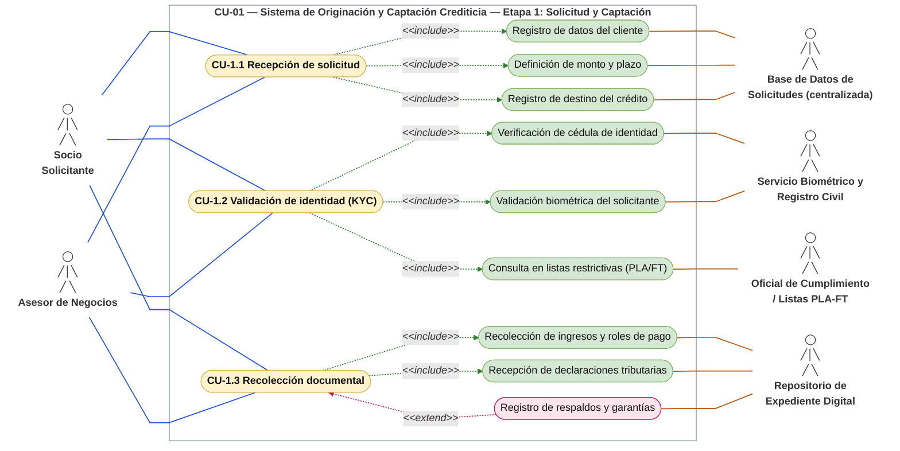

**Figura 4.2.** CU-02: Recolección y Consolidación de Datos

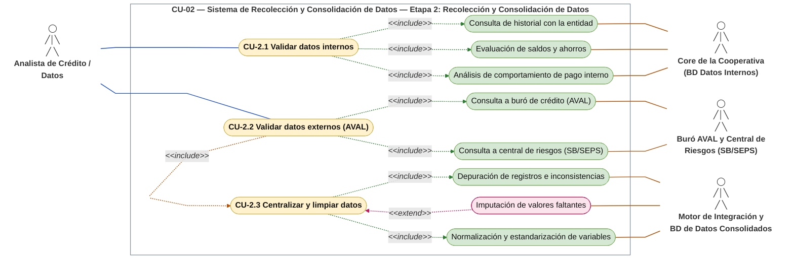

**Figura 4.3.** CU-03: Evaluación y Cálculo del Score (AVAL)

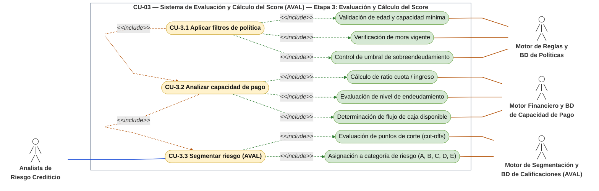

**Figura 4.4.** CU-04: Decisión Crediticia

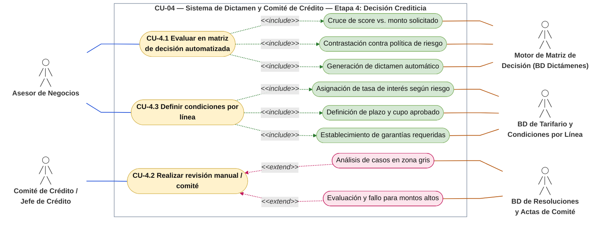

**Figura 4.5.** CU-05: Formalización y Desembolso

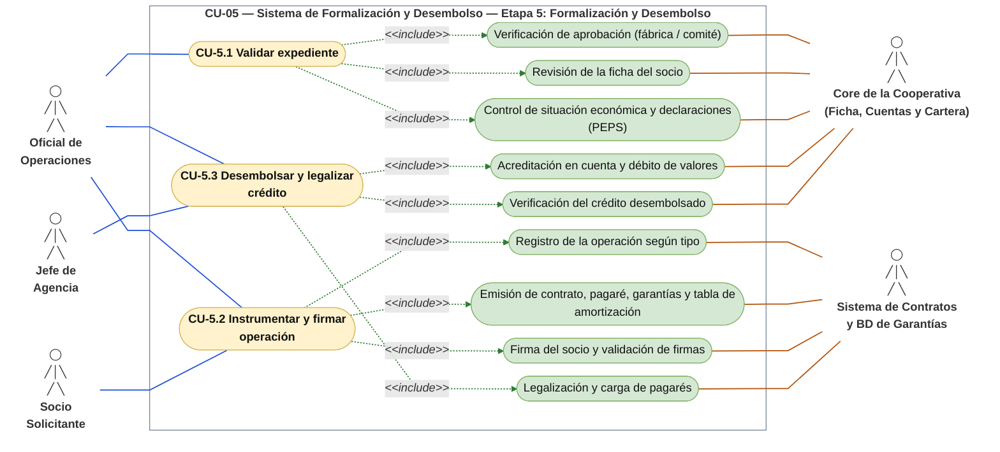

**Figura 4.6.** CU-06: Seguimiento y Cobranza

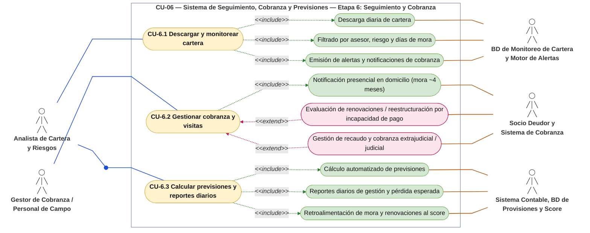

---

## 6. VISTA LÓGICA

### 6.1. Visión General
La Vista Lógica representa la descomposición funcional del sistema en componentes de software y sus abstracciones de dominio. Aplica el patrón Borde-Control-Entidad (BCE) para garantizar que las responsabilidades de interfaz, lógica de cálculo e ingesta de datos permanezcan desacopladas.

### 6.2. Diagrama de Clases

**Figura 6.0.** DC-00: Diagrama de Clases General Integrado (6 Etapas)

```mermaid
---
config:
  layout: dagre
  look: classic
  flowchart:
    curve: linear
    nodeSpacing: 40
    rankSpacing: 34
    padding: 12
    wrappingWidth: 700
---
flowchart TB
  classDef actor fill:#dbeafe,stroke:#1d4ed8,color:#111
  classDef ent fill:#fef3c7,stroke:#d97706,color:#111
  classDef aux fill:none,stroke:none
  %% R y los enlaces ~~~ son invisibles: solo mantienen alineados los seis carriles, como en la figura original.
  subgraph L6["<b>DC-06: 6. Seguimiento y cobranza</b>"]
    A6("<div style='text-align:left'><i>«Actor Principal»</i><br/><b>AnalistaCarteraRiesgos / GestorCobranza</b><hr/>+ supervisarMonitoreoCarteraActiva(): MonitoreoCarteraActiva<br/>+ recibirProvisionesContables(): CalculoProvisionesContables</div>"):::actor
    E61("<div style='text-align:left'><i>«Entity / CU-6.1 (Automático)»</i><br/><b>MonitoreoCarteraActiva</b><hr/>- idMonitoreoCartera: UUID «PK»<br/>- ejecucionScoreDeComportamiento: Integer<br/>- emisionAlertasTempranasDeDeterioro: String(50)<hr/>+ ejecutarScoreDeComportamiento(): Integer<br/>+ emitirAlertasTempranasDeDeterioro(): String</div>"):::ent
    E62("<div style='text-align:left'><i>«Entity / CU-6.2»</i><br/><b>EjecucionGestionCobranza</b><hr/>- idEjecucionCobranza: UUID «PK»<br/>- gestionDeCobranzaPreventiva: Boolean<br/>- gestionDeCobranzaTemprana: Boolean<br/>- gestionDeCobranzaJudicial: Boolean<hr/>+ ejecutarGestionDeCobranzaPreventiva(): Boolean<br/>+ ejecutarGestionDeCobranzaTemprana(): Boolean</div>"):::ent
    E63("<div style='text-align:left'><i>«Entity / CU-6.3 (Automático)»</i><br/><b>CalculoProvisionesContables</b><hr/>- idCalculoProvisiones: UUID «PK»<br/>- estimacionParametrosPD_LGD_EAD: String(100)<br/>- calculoPerdidaEsperada_PDxLGDxEAD: Decimal(12,2)<hr/>+ estimarParametrosPD_LGD_EAD(): String<br/>+ calcularPerdidaEsperada_PDxLGDxEAD(): Decimal</div>"):::ent
  end
  subgraph L5["<b>DC-05: 5. Formalización y desembolso</b>"]
    A5("<div style='text-align:left'><i>«Actor Principal»</i><br/><b>ClienteSolicitante / OficialOperaciones</b><hr/>+ gestionarAceptacionDelCliente(): GestionAceptacionCliente<br/>+ recibirFondosYTablaDeAmortizacion(): EjecucionDesembolsoCredito</div>"):::actor
    E51("<div style='text-align:left'><i>«Entity / CU-5.1»</i><br/><b>GestionAceptacionCliente</b><hr/>- idGestionAceptacion: UUID «PK»<br/>- firmaDeContratoYPagare: Boolean<br/>- constitucionFormalDeGarantias: Boolean<hr/>+ firmarContratoYPagare(): Boolean<br/>+ constituirFormalmenteGarantias(): Boolean</div>"):::ent
    E52("<div style='text-align:left'><i>«Entity / CU-5.2 (Automático)»</i><br/><b>EjecucionDesembolsoCredito</b><hr/>- idEjecucionDesembolso: UUID «PK»<br/>- acreditacionDeFondosEnCuenta: Boolean<br/>- generacionDeTablaDeAmortizacion: Boolean<hr/>+ acreditarFondosEnCuenta(): Boolean<br/>+ generarTablaDeAmortizacion(): Boolean</div>"):::ent
  end
  subgraph L4["<b>DC-04: 4. Decisión crediticia</b>"]
    A4("<div style='text-align:left'><i>«Actor Principal»</i><br/><b>AnalistaCredito / ComiteCredito</b><hr/>+ recibirDictamenMatriz(): EvaluacionMatrizDecision<br/>+ derivarARevisionManualComite(): RevisionManualComite</div>"):::actor
    E41("<div style='text-align:left'><i>«Entity / CU-4.1 (Automático)»</i><br/><b>EvaluacionMatrizDecision</b><hr/>- idEvaluacionMatriz: UUID «PK»<br/>- cruceScoreVsMontoSolicitado: String(100)<br/>- contrastacionContraPoliticaRiesgo: Boolean<br/>- generacionDictamenAutomatico: String(40)<hr/>+ cruzarScoreVsMontoSolicitado(): String<br/>+ contrastarContraPoliticaDeRiesgo(): Boolean</div>"):::ent
    E42("<div style='text-align:left'><i>«Entity / CU-4.2»</i><br/><b>RevisionManualComite</b><hr/>- idRevisionManualComite: UUID «PK»<br/>- analisisCasosEnZonaGris: String(150)<br/>- evaluacionYFalloParaMontosAltos: String(150)<hr/>+ analizarCasosEnZonaGris(): String<br/>+ evaluarYEmitirFalloParaMontosAltos(): String</div>"):::ent
    E43("<div style='text-align:left'><i>«Entity / CU-4.3»</i><br/><b>DefinicionCondicionesCrediticias</b><hr/>- idDefinicionCondiciones: UUID «PK»<br/>- asignacionTasaInteresSegunRiesgo: Decimal(5,2)<br/>- definicionPlazoYCupoAprobado: String(100)<br/>- establecimientoGarantiasRequeridas: String(150)<hr/>+ asignarTasaDeInteresSegunRiesgo(): Decimal<br/>+ definirPlazoYCupoAprobado(): String</div>"):::ent
  end
  subgraph L3["<b>DC-03: 3. Evaluación y cálculo del score</b>"]
    A3("<div style='text-align:left'><i>«Actor Principal»</i><br/><b>AnalistaRiesgoCrediticio</b><hr/>+ recibirCalificacionYScoreDelSistema(): SegmentacionRiesgoCrediticio</div>"):::actor
    E31("<div style='text-align:left'><i>«Entity / CU-3.1 (Automático)»</i><br/><b>FiltroPolitica</b><hr/>- idFiltroPolitica: UUID «PK»<br/>- validacionEdadYCapacidadMinima: Boolean<br/>- verificacionMoraVigente: Boolean<br/>- controlUmbralSobreendeudamiento: Boolean<hr/>+ validarEdadYCapacidadMinima(): Boolean<br/>+ verificarMoraVigente(): Boolean</div>"):::ent
    E32("<div style='text-align:left'><i>«Entity / CU-3.2 (Automático)»</i><br/><b>AnalisisCapacidadDePago</b><hr/>- idAnalisisCapacidadPago: UUID «PK»<br/>- calculoRatioCuotaIngreso: Decimal(5,4)<br/>- evaluacionNivelDeEndeudamiento: Decimal(5,4)<br/>- determinacionFlujoDeCajaDisponible: Decimal(12,2)<hr/>+ calcularRatioCuotaIngreso(): Decimal<br/>+ evaluarNivelDeEndeudamiento(): Decimal</div>"):::ent
    E33("<div style='text-align:left'><i>«Entity / CU-3.3 (Automático LLM y RAG)»</i><br/><b>AplicacionModeloScoring</b><hr/>- idAplicacionScoring: UUID «PK»<br/>- inferenciaAutomaticaLLMYRAG: String(100)<br/>- calculoProbabilidadDefaultPD: Decimal(6,5)<br/>- transformacionAPuntajeCrediticioScore: Integer<hr/>+ inferirAutomaticamenteConLLMYRAG(): String<br/>+ calcularProbabilidadDefaultPD(): Decimal</div>"):::ent
    E34("<div style='text-align:left'><i>«Entity / CU-3.4 (Automático)»</i><br/><b>SegmentacionRiesgoCrediticio</b><hr/>- idSegmentacionRiesgo: UUID «PK»<br/>- evaluacionPuntosDeCorteCutOffs: Integer<br/>- asignacionACategoriaDeRiesgoABCDE: String(5)<hr/>+ evaluarPuntosDeCorteCutOffs(): Integer<br/>+ asignarCategoriaDeRiesgoABCDE(): String</div>"):::ent
  end
  subgraph L2["<b>DC-02: 2. Recolección y consolidación de datos</b>"]
    A2("<div style='text-align:left'><i>«Actor Principal»</i><br/><b>AnalistaCreditoDatos</b><hr/>+ solicitarRecoleccionDatosInternos(): RecoleccionDatosInternos<br/>+ solicitarConsultaDatosExternos(): ConsultaDatosExternos</div>"):::actor
    E21("<div style='text-align:left'><i>«Entity / CU-2.1»</i><br/><b>RecoleccionDatosInternos</b><hr/>- idRecoleccionInterna: UUID «PK»<br/>- consultaHistorialConLaEntidad: String(150)<br/>- evaluacionSaldosYAhorros: Decimal(12,2)<br/>- analisisComportamientoPagoInterno: String(100)<hr/>+ consultarHistorialConLaEntidad(): String<br/>+ evaluarSaldosYAhorros(): Decimal</div>"):::ent
    E22("<div style='text-align:left'><i>«Entity / CU-2.2»</i><br/><b>ConsultaDatosExternos</b><hr/>- idConsultaExterna: UUID «PK»<br/>- consultaABuroDeCredito: String(150)<br/>- consultaACentralDeRiesgosSBSEPS: String(150)<hr/>+ consultarBuroDeCredito(): String<br/>+ consultarCentralDeRiesgosSBSEPS(): String</div>"):::ent
    E23("<div style='text-align:left'><i>«Entity / CU-2.3 (Automático)»</i><br/><b>IntegracionYLimpiezaDatos</b><hr/>- idIntegracionLimpieza: UUID «PK»<br/>- idRecoleccionInterna: UUID «FK»<br/>- idConsultaExterna: UUID «FK»<br/>- depuracionRegistrosEInconsistencias: Boolean<hr/>+ depurarRegistrosEInconsistencias(): Boolean<br/>+ imputarValoresFaltantes(): Boolean</div>"):::ent
  end
  subgraph L1["<b>DC-01: 1. Solicitud y captación</b>"]
    A1("<div style='text-align:left'><i>«Actor Principal»</i><br/><b>ClienteSolicitante / AsesorNegocios</b><hr/>+ iniciarRecepcionDeSolicitud(): RecepcionDeSolicitud<br/>+ realizarRecoleccionDocumental(): RecoleccionDocumental</div>"):::actor
    E11("<div style='text-align:left'><i>«Entity / CU-1.1»</i><br/><b>RecepcionDeSolicitud</b><hr/>- idRecepcionSolicitud: UUID «PK»<br/>- registroDatosDelCliente: String(150)<br/>- definicionMontoYPlazo: String(100)<br/>- registroDestinoDelCredito: String(120)<hr/>+ registrarDatosDelCliente(): Void<br/>+ definirMontoYPlazo(): Void</div>"):::ent
    E12("<div style='text-align:left'><i>«Entity / CU-1.2»</i><br/><b>ValidacionDeIdentidadKYC</b><hr/>- idValidacionKYC: UUID «PK»<br/>- idRecepcionSolicitud: UUID «FK»<br/>- verificacionCedulaDeIdentidad: Boolean<br/>- validacionBiometricaDelSolicitante: Boolean<hr/>+ verificarCedulaDeIdentidad(): Boolean<br/>+ validarBiometriaDelSolicitante(): Boolean</div>"):::ent
    E13("<div style='text-align:left'><i>«Entity / CU-1.3»</i><br/><b>RecoleccionDocumental</b><hr/>- idRecoleccionDocumental: UUID «PK»<br/>- idRecepcionSolicitud: UUID «FK»<br/>- recoleccionIngresosYRolesDePago: String(255)<br/>- recepcionDeclaracionesTributarias: String(255)<hr/>+ recolectarIngresosYRolesDePago(): Boolean<br/>+ recibirDeclaracionesTributarias(): Boolean</div>"):::ent
  end
  R((" ")):::aux
  R ~~~ A1
  R ~~~ A2
  R ~~~ A3
  R ~~~ A4
  R ~~~ A5
  R ~~~ A6
  A6 ~~~ E61
  E61 -->|"1..1"| E62
  E62 -->|"1..1"| E63
  A5 ~~~ E51
  E51 -->|"1..1"| E52
  A4 ~~~ E41
  E41 -->|"1..1"| E42
  E42 -->|"1..1"| E43
  A3 ~~~ E31
  E31 -->|"1..1"| E32
  E32 -->|"1..1"| E33
  E33 -->|"1..1"| E34
  A2 ~~~ E21
  E21 -->|"1..1"| E22
  E22 -->|"1..1"| E23
  A1 ~~~ E11
  E11 -->|"1..1"| E12
  E12 -->|"1..1"| E13
  E21 ~~~ E13
  E13 ==>|"<b>1 .. 1..*</b>"| E21
  E31 ~~~ E23
  E23 ==>|"<b>1 .. 1..*</b>"| E31
  E41 ~~~ E34
  E34 ==>|"<b>1 .. 1..*</b>"| E41
  E51 ~~~ E43
  E43 ==>|"<b>1 .. 1..*</b>"| E51
  E61 ~~~ E52
  E52 ==>|"<b>1 .. 1..*</b>"| E61
  E21 ~~~ E32
  E41 ~~~ E52
  E52 ~~~ E62
  linkStyle 7,8,10,12,13,15,16,17,19,20,22,23 stroke:#b45309,stroke-width:1.5px
  style L1 fill:transparent,stroke:#475569
  style L2 fill:transparent,stroke:#475569
  style L3 fill:transparent,stroke:#475569
  style L4 fill:transparent,stroke:#475569
  style L5 fill:transparent,stroke:#475569
  style L6 fill:transparent,stroke:#475569
```

**Figura 6.1.** DC-01: 1. Solicitud y captación

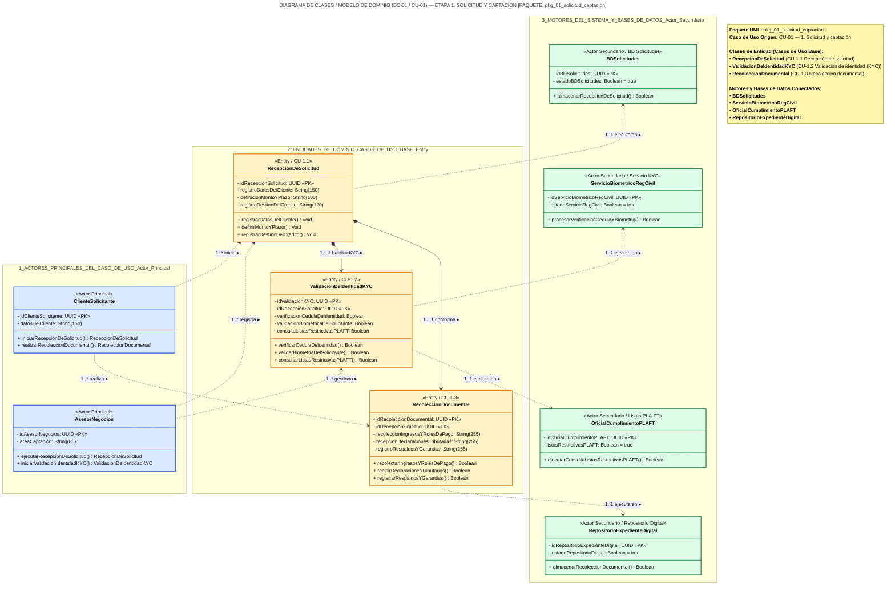

**Figura 6.2.** DC-02: 2. Recolección y consolidación de datos

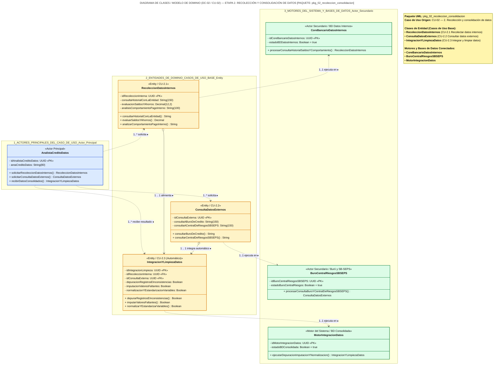

**Figura 6.3.** DC-03: 3. Evaluación y cálculo del score

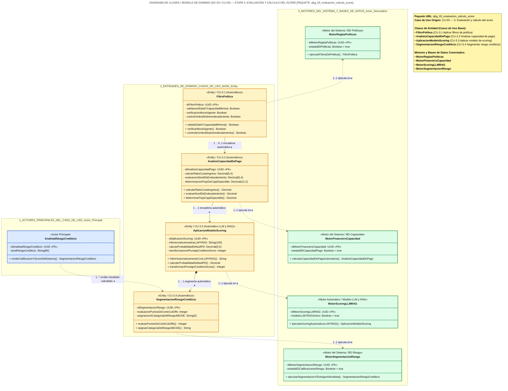

**Figura 6.4.** DC-04: 4. Decisión crediticia

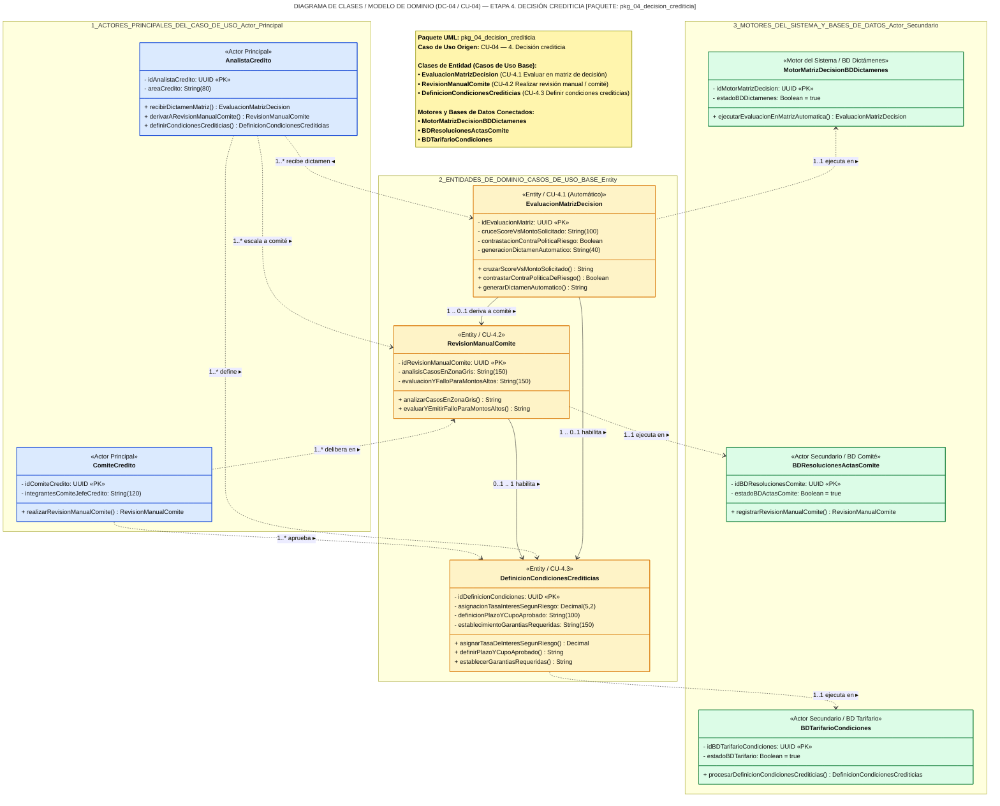

**Figura 6.5.** DC-05: 5. Formalización y desembolso

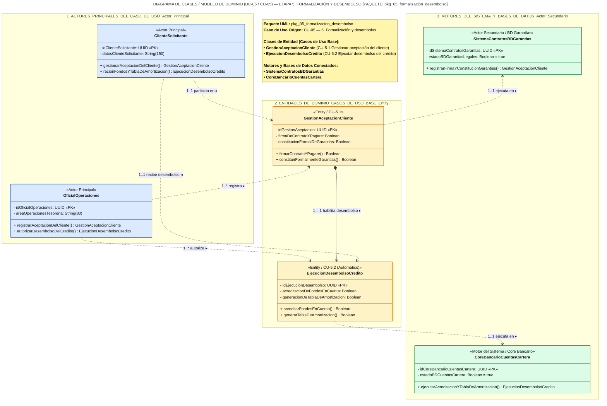

**Figura 6.6.** DC-06: 6. Seguimiento y cobranza

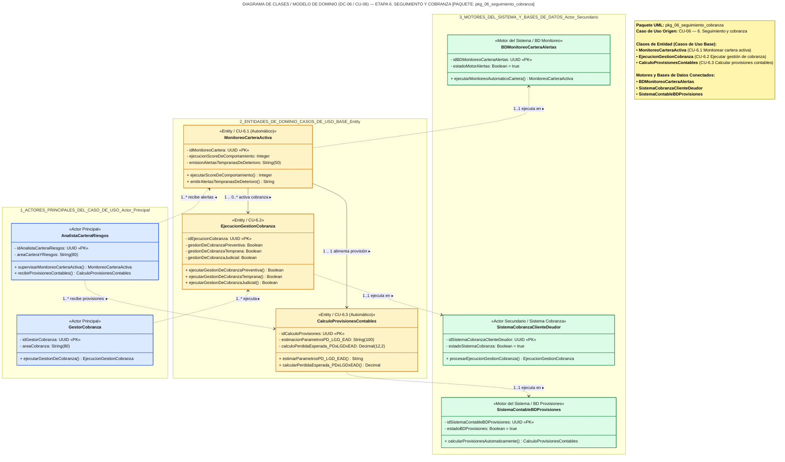

### 6.3. Diccionario de Clases
Modelo de dominio estandarizado en **5 columnas uniformes (`Entidad`, `Atributos`, `Operación`, `Tipo de relación`, `Entidad relacionada`)** para las **6 etapas del flujo de valor crediticio (`CU-01` a `CU-06`)**, reflejando en `DC-03` el cálculo automático de scoring con **LLM y RAG**.

#### Etapa 1: Solicitud y Captación (`DC-01` / `CU-01`)

| Entidad | Atributos | Operación | Tipo de relación | Entidad relacionada |
| :--- | :--- | :--- | :--- | :--- |
| **ClienteSolicitante**<br>`«Actor Principal»` | `- idClienteSolicitante: UUID «PK»`<br>`- datosDelCliente: String(150)` | `+ iniciarRecepcionDeSolicitud(): RecepcionDeSolicitud`<br>`+ realizarRecoleccionDocumental(): RecoleccionDocumental` | • Asociación (`1 .. 1..* inicia ▸`)<br>• Asociación (`1 .. 1..* realiza ▸`) | • `RecepcionDeSolicitud`<br>• `RecoleccionDocumental` |
| **AsesorNegocios**<br>`«Actor Principal»` | `- idAsesorNegocios: UUID «PK»`<br>`- areaCaptacion: String(80)` | `+ ejecutarRecepcionDeSolicitud(): RecepcionDeSolicitud`<br>`+ iniciarValidacionIdentidadKYC(): ValidacionDeIdentidadKYC` | • Asociación (`1 .. 1..* registra ▸`)<br>• Asociación (`1 .. 1..* gestiona ▸`) | • `RecepcionDeSolicitud`<br>• `ValidacionDeIdentidadKYC` |
| **RecepcionDeSolicitud**<br>`«Entity / CU-1.1»` | `- idRecepcionSolicitud: UUID «PK»`<br>`- registroDatosDelCliente: String(150)`<br>`- definicionMontoYPlazo: String(100)`<br>`- registroDestinoDelCredito: String(120)` | `+ registrarDatosDelCliente(): Void`<br>`+ definirMontoYPlazo(): Void`<br>`+ registrarDestinoDelCredito(): Void` | • Asociación (`1 .. 1 ejecuta en ▸`)<br>• Composición (`1 .. 1 habilita KYC ▸`)<br>• Composición (`1 .. 1 conforma ▸`) | • `BDSolicitudes`<br>• `ValidacionDeIdentidadKYC`<br>• `RecoleccionDocumental` |
| **ValidacionDeIdentidadKYC**<br>`«Entity / CU-1.2»` | `- idValidacionKYC: UUID «PK»`<br>`- idRecepcionSolicitud: UUID «FK»`<br>`- verificacionCedulaDeIdentidad: Boolean`<br>`- validacionBiometricaDelSolicitante: Boolean`<br>`- consultaListasRestrictivasPLAFT: Boolean` | `+ verificarCedulaDeIdentidad(): Boolean`<br>`+ validarBiometriaDelSolicitante(): Boolean`<br>`+ consultarListasRestrictivasPLAFT(): Boolean` | • Asociación (`1 .. 1 ejecuta en ▸`)<br>• Asociación (`1 .. 1 ejecuta en ▸`) | • `ServicioBiometricoRegCivil`<br>• `OficialCumplimientoPLAFT` |
| **RecoleccionDocumental**<br>`«Entity / CU-1.3»` | `- idRecoleccionDocumental: UUID «PK»`<br>`- idRecepcionSolicitud: UUID «FK»`<br>`- recoleccionIngresosYRolesDePago: String(255)`<br>`- recepcionDeclaracionesTributarias: String(255)`<br>`- registroRespaldosYGarantias: String(255)` | `+ recolectarIngresosYRolesDePago(): Boolean`<br>`+ recibirDeclaracionesTributarias(): Boolean`<br>`+ registrarRespaldosYGarantias(): Boolean` | • Asociación (`1 .. 1 ejecuta en ▸`) | • `RepositorioExpedienteDigital` |
| **BDSolicitudes**<br>`«Actor Secundario / BD Solicitudes»` | `- idBDSolicitudes: UUID «PK»`<br>`- estadoBDSolicitudes: Boolean = true` | `+ almacenarRecepcionDeSolicitud(): Boolean` | • Asociación entrante (`1 .. 1..* custodia`) | • `RecepcionDeSolicitud` |
| **ServicioBiometricoRegCivil**<br>`«Actor Secundario / Servicio KYC»` | `- idServicioBiometricoRegCivil: UUID «PK»`<br>`- estadoServicioRegCivil: Boolean = true` | `+ procesarVerificacionCedulaYBiometria(): Boolean` | • Asociación entrante (`1 .. 1..* valida`) | • `ValidacionDeIdentidadKYC` |
| **OficialCumplimientoPLAFT**<br>`«Actor Secundario / Listas PLA-FT»` | `- idOficialCumplimientoPLAFT: UUID «PK»`<br>`- listasRestrictivasPLAFT: Boolean = true` | `+ ejecutarConsultaListasRestrictivasPLAFT(): Boolean` | • Asociación entrante (`1 .. 1..* controla`) | • `ValidacionDeIdentidadKYC` |
| **RepositorioExpedienteDigital**<br>`«Actor Secundario / Repositorio Digital»` | `- idRepositorioExpedienteDigital: UUID «PK»`<br>`- estadoRepositorioDigital: Boolean = true` | `+ almacenarRecoleccionDocumental(): Boolean` | • Asociación entrante (`1 .. 1..* almacena`) | • `RecoleccionDocumental` |

#### Etapa 2: Recolección y Consolidación de Datos (`DC-02` / `CU-02`)

| Entidad | Atributos | Operación | Tipo de relación | Entidad relacionada |
| :--- | :--- | :--- | :--- | :--- |
| **AnalistaCreditoDatos**<br>`«Actor Principal»` | `- idAnalistaCreditoDatos: UUID «PK»`<br>`- areaCreditoDatos: String(80)` | `+ solicitarRecoleccionDatosInternos(): RecoleccionDatosInternos`<br>`+ solicitarConsultaDatosExternos(): ConsultaDatosExternos`<br>`+ recibirDatosConsolidados(): IntegracionYLimpiezaDatos` | • Asociación (`1 .. 1..* solicita ▸`)<br>• Asociación (`1 .. 1..* solicita ▸`)<br>• Asociación (`1 .. 1..* recibe resultado ◂`) | • `RecoleccionDatosInternos`<br>• `ConsultaDatosExternos`<br>• `IntegracionYLimpiezaDatos` |
| **RecoleccionDatosInternos**<br>`«Entity / CU-2.1»` | `- idRecoleccionInterna: UUID «PK»`<br>`- consultaHistorialConLaEntidad: String(150)`<br>`- evaluacionSaldosYAhorros: Decimal(12,2)`<br>`- analisisComportamientoPagoInterno: String(100)` | `+ consultarHistorialConLaEntidad(): String`<br>`+ evaluarSaldosYAhorros(): Decimal`<br>`+ analizarComportamientoPagoInterno(): String` | • Asociación (`1 .. 1 ejecuta en ▸`)<br>• Agregación (`1 .. 1 alimenta ▸`) | • `CoreBancarioDatosInternos`<br>• `IntegracionYLimpiezaDatos` |
| **ConsultaDatosExternos**<br>`«Entity / CU-2.2»` | `- idConsultaExterna: UUID «PK»`<br>`- consultaABuroDeCredito: String(150)`<br>`- consultaACentralDeRiesgosSBSEPS: String(150)` | `+ consultarBuroDeCredito(): String`<br>`+ consultarCentralDeRiesgosSBSEPS(): String` | • Asociación (`1 .. 1 ejecuta en ▸`)<br>• Agregación (`1 .. 1 integra automático ▸`) | • `BuroCentralRiesgosSBSEPS`<br>• `IntegracionYLimpiezaDatos` |
| **IntegracionYLimpiezaDatos**<br>`«Entity / CU-2.3 (Automático)»` | `- idIntegracionLimpieza: UUID «PK»`<br>`- idRecoleccionInterna: UUID «FK»`<br>`- idConsultaExterna: UUID «FK»`<br>`- depuracionRegistrosEInconsistencias: Boolean`<br>`- imputacionValoresFaltantes: Boolean`<br>`- normalizacionYEstandarizacionVariables: Boolean` | `+ depurarRegistrosEInconsistencias(): Boolean`<br>`+ imputarValoresFaltantes(): Boolean`<br>`+ normalizarYEstandarizarVariables(): Boolean` | • Agregación entrante (`1 .. 1 integra`)<br>• Asociación (`1 .. 1 ejecuta en ▸`) | • `RecoleccionDatosInternos` / `ConsultaDatosExternos`<br>• `MotorIntegracionDatos` |
| **CoreBancarioDatosInternos**<br>`«Actor Secundario / BD Datos Internos»` | `- idCoreBancarioDatosInternos: UUID «PK»`<br>`- estadoBDDatosInternos: Boolean = true` | `+ procesarConsultaHistorialSaldosYComportamiento(): RecoleccionDatosInternos` | • Asociación entrante (`1 .. 1..* provee`) | • `RecoleccionDatosInternos` |
| **BuroCentralRiesgosSBSEPS**<br>`«Actor Secundario / Buró y SB-SEPS»` | `- idBuroCentralRiesgosSBSEPS: UUID «PK»`<br>`- estadoBuroCentralRiesgos: Boolean = true` | `+ procesarConsultaBuroYCentralDeRiesgosSBSEPS(): ConsultaDatosExternos` | • Asociación entrante (`1 .. 1..* provee`) | • `ConsultaDatosExternos` |
| **MotorIntegracionDatos**<br>`«Motor del Sistema / BD Consolidada»` | `- idMotorIntegracionDatos: UUID «PK»`<br>`- estadoBDConsolidada: Boolean = true` | `+ ejecutarDepuracionImputacionYNormalizacion(): IntegracionYLimpiezaDatos` | • Asociación entrante (`1 .. 1..* consolida`) | • `IntegracionYLimpiezaDatos` |

#### Etapa 3: Evaluación y Cálculo del Score (`DC-03` / `CU-03`)

| Entidad | Atributos | Operación | Tipo de relación | Entidad relacionada |
| :--- | :--- | :--- | :--- | :--- |
| **AnalistaRiesgoCrediticio**<br>`«Actor Principal»` | `- idAnalistaRiesgoCrediticio: UUID «PK»`<br>`- areaRiesgoCrediticio: String(80)` | `+ recibirCalificacionYScoreDelSistema(): SegmentacionRiesgoCrediticio` | • Asociación (`1 .. 1..* recibe resultado calculado ◂`) | • `SegmentacionRiesgoCrediticio` |
| **FiltroPolitica**<br>`«Entity / CU-3.1 (Automático)»` | `- idFiltroPolitica: UUID «PK»`<br>`- validacionEdadYCapacidadMinima: Boolean`<br>`- verificacionMoraVigente: Boolean`<br>`- controlUmbralSobreendeudamiento: Boolean` | `+ validarEdadYCapacidadMinima(): Boolean`<br>`+ verificarMoraVigente(): Boolean`<br>`+ controlarUmbralSobreendeudamiento(): Boolean` | • Asociación (`1 .. 1 ejecuta en ▸`)<br>• Asociación (`1 .. 0..1 encadena automático ▸`) | • `MotorReglasPoliticas`<br>• `AnalisisCapacidadDePago` |
| **AnalisisCapacidadDePago**<br>`«Entity / CU-3.2 (Automático)»` | `- idAnalisisCapacidadPago: UUID «PK»`<br>`- calculoRatioCuotaIngreso: Decimal(5,4)`<br>`- evaluacionNivelDeEndeudamiento: Decimal(5,4)`<br>`- determinacionFlujoDeCajaDisponible: Decimal(12,2)` | `+ calcularRatioCuotaIngreso(): Decimal`<br>`+ evaluarNivelDeEndeudamiento(): Decimal`<br>`+ determinarFlujoCajaDisponible(): Decimal` | • Asociación (`1 .. 1 ejecuta en ▸`)<br>• Asociación (`1 .. 1 encadena automático ▸`) | • `MotorFinancieroCapacidad`<br>• `AplicacionModeloScoring` |
| **AplicacionModeloScoring**<br>`«Entity / CU-3.3 (Automático LLM y RAG)»` | `- idAplicacionScoring: UUID «PK»`<br>`- inferenciaAutomaticaLLMYRAG: String(100)`<br>`- calculoProbabilidadDefaultPD: Decimal(6,5)`<br>`- transformacionAPuntajeCrediticioScore: Integer` | `+ inferirAutomaticamenteConLLMYRAG(): String`<br>`+ calcularProbabilidadDefaultPD(): Decimal`<br>`+ transformarAPuntajeCrediticioScore(): Integer` | • Asociación (`1 .. 1 ejecuta en ▸`)<br>• Composición (`1 .. 1 segmenta automático ▸`) | • `MotorScoringLLMRAG`<br>• `SegmentacionRiesgoCrediticio` |
| **SegmentacionRiesgoCrediticio**<br>`«Entity / CU-3.4 (Automático)»` | `- idSegmentacionRiesgo: UUID «PK»`<br>`- evaluacionPuntosDeCorteCutOffs: Integer`<br>`- asignacionACategoriaDeRiesgoABCDE: String(5)` | `+ evaluarPuntosDeCorteCutOffs(): Integer`<br>`+ asignarCategoriaDeRiesgoABCDE(): String` | • Asociación (`1 .. 1 ejecuta en ▸`)<br>• Asociación (`1 .. 1..* entrega resultado a ▸`) | • `MotorSegmentacionRiesgo`<br>• `AnalistaRiesgoCrediticio` |
| **MotorReglasPoliticas**<br>`«Motor del Sistema / BD Políticas»` | `- idMotorReglasPoliticas: UUID «PK»`<br>`- estadoBDPoliticas: Boolean = true` | `+ ejecutarFiltrosDePolitica(): FiltroPolitica` | • Asociación entrante (`1 .. 1..* evalúa`) | • `FiltroPolitica` |
| **MotorFinancieroCapacidad**<br>`«Motor del Sistema / BD Capacidad»` | `- idMotorFinancieroCapacidad: UUID «PK»`<br>`- estadoBDCapacidadPago: Boolean = true` | `+ calcularCapacidadDePagoAutomatica(): AnalisisCapacidadDePago` | • Asociación entrante (`1 .. 1..* calcula`) | • `AnalisisCapacidadDePago` |
| **MotorScoringLLMRAG**<br>`«Motor Automático / Modelo LLM y RAG»` | `- idMotorScoringLLMRAG: UUID «PK»`<br>`- modeloLLMYRAGActivo: Boolean = true` | `+ ejecutarScoringAutomaticoLLMYRAG(): AplicacionModeloScoring` | • Asociación entrante (`1 .. 1..* calcula`) | • `AplicacionModeloScoring` |
| **MotorSegmentacionRiesgo**<br>`«Motor del Sistema / BD Riesgo»` | `- idMotorSegmentacionRiesgo: UUID «PK»`<br>`- estadoBDCalificacionesRiesgo: Boolean = true` | `+ ejecutarSegmentacionYEntregarAlAnalista(): SegmentacionRiesgoCrediticio` | • Asociación entrante (`1 .. 1..* clasifica`) | • `SegmentacionRiesgoCrediticio` |

#### Etapa 4: Decisión Crediticia (`DC-04` / `CU-04`)

| Entidad | Atributos | Operación | Tipo de relación | Entidad relacionada |
| :--- | :--- | :--- | :--- | :--- |
| **AnalistaCredito**<br>`«Actor Principal»` | `- idAnalistaCredito: UUID «PK»`<br>`- areaCredito: String(80)` | `+ recibirDictamenMatriz(): EvaluacionMatrizDecision`<br>`+ derivarARevisionManualComite(): RevisionManualComite`<br>`+ definirCondicionesCrediticias(): DefinicionCondicionesCrediticias` | • Asociación (`1 .. 1..* recibe dictamen ◂`)<br>• Asociación (`1 .. 1..* escala a comité ▸`)<br>• Asociación (`1 .. 1..* define ▸`) | • `EvaluacionMatrizDecision`<br>• `RevisionManualComite`<br>• `DefinicionCondicionesCrediticias` |
| **ComiteCredito**<br>`«Actor Principal»` | `- idComiteCredito: UUID «PK»`<br>`- integrantesComiteJefeCredito: String(120)` | `+ realizarRevisionManualComite(): RevisionManualComite` | • Asociación (`1 .. 1..* delibera en ▸`)<br>• Asociación (`1 .. 1..* aprueba ▸`) | • `RevisionManualComite`<br>• `DefinicionCondicionesCrediticias` |
| **EvaluacionMatrizDecision**<br>`«Entity / CU-4.1 (Automático)»` | `- idEvaluacionMatriz: UUID «PK»`<br>`- cruceScoreVsMontoSolicitado: String(100)`<br>`- contrastacionContraPoliticaRiesgo: Boolean`<br>`- generacionDictamenAutomatico: String(40)` | `+ cruzarScoreVsMontoSolicitado(): String`<br>`+ contrastarContraPoliticaDeRiesgo(): Boolean`<br>`+ generarDictamenAutomatico(): String` | • Asociación (`1 .. 1 ejecuta en ▸`)<br>• Asociación (`1 .. 0..1 deriva a comité ▸`)<br>• Asociación (`1 .. 0..1 habilita ▸`) | • `MotorMatrizDecisionBDDictamenes`<br>• `RevisionManualComite`<br>• `DefinicionCondicionesCrediticias` |
| **RevisionManualComite**<br>`«Entity / CU-4.2»` | `- idRevisionManualComite: UUID «PK»`<br>`- analisisCasosEnZonaGris: String(150)`<br>`- evaluacionYFalloParaMontosAltos: String(150)` | `+ analizarCasosEnZonaGris(): String`<br>`+ evaluarYEmitirFalloParaMontosAltos(): String` | • Asociación (`1 .. 1 ejecuta en ▸`)<br>• Asociación (`0..1 .. 1 habilita ▸`) | • `BDResolucionesActasComite`<br>• `DefinicionCondicionesCrediticias` |
| **DefinicionCondicionesCrediticias**<br>`«Entity / CU-4.3»` | `- idDefinicionCondiciones: UUID «PK»`<br>`- asignacionTasaInteresSegunRiesgo: Decimal(5,2)`<br>`- definicionPlazoYCupoAprobado: String(100)`<br>`- establecimientoGarantiasRequeridas: String(150)` | `+ asignarTasaDeInteresSegunRiesgo(): Decimal`<br>`+ definirPlazoYCupoAprobado(): String`<br>`+ establecerGarantiasRequeridas(): String` | • Asociación (`1 .. 1 ejecuta en ▸`) | • `BDTarifarioCondiciones` |

#### Etapa 5: Formalización y Desembolso (`DC-05` / `CU-05`)

| Entidad | Atributos | Operación | Tipo de relación | Entidad relacionada |
| :--- | :--- | :--- | :--- | :--- |
| **ClienteSolicitante**<br>`«Actor Principal»` | `- idClienteSolicitante: UUID «PK»`<br>`- datosClienteSolicitante: String(150)` | `+ gestionarAceptacionDelCliente(): GestionAceptacionCliente`<br>`+ recibirFondosYTablaDeAmortizacion(): EjecucionDesembolsoCredito` | • Asociación (`1 .. 1 participa en ▸`)<br>• Asociación (`1 .. 1 recibe desembolso ◂`) | • `GestionAceptacionCliente`<br>• `EjecucionDesembolsoCredito` |
| **OficialOperaciones**<br>`«Actor Principal»` | `- idOficialOperaciones: UUID «PK»`<br>`- areaOperacionesTesoreria: String(80)` | `+ registrarAceptacionDelCliente(): GestionAceptacionCliente`<br>`+ autorizarDesembolsoDelCredito(): EjecucionDesembolsoCredito` | • Asociación (`1 .. 1..* registra ▸`)<br>• Asociación (`1 .. 1..* autoriza ▸`) | • `GestionAceptacionCliente`<br>• `EjecucionDesembolsoCredito` |
| **GestionAceptacionCliente**<br>`«Entity / CU-5.1»` | `- idGestionAceptacion: UUID «PK»`<br>`- firmaDeContratoYPagare: Boolean`<br>`- constitucionFormalDeGarantias: Boolean` | `+ firmarContratoYPagare(): Boolean`<br>`+ constituirFormalmenteGarantias(): Boolean` | • Asociación (`1 .. 1 ejecuta en ▸`)<br>• Composición (`1 .. 1 habilita desembolso ▸`) | • `SistemaContratosBDGarantias`<br>• `EjecucionDesembolsoCredito` |
| **EjecucionDesembolsoCredito**<br>`«Entity / CU-5.2 (Automático)»` | `- idEjecucionDesembolso: UUID «PK»`<br>`- acreditacionDeFondosEnCuenta: Boolean`<br>`- generacionDeTablaDeAmortizacion: Boolean` | `+ acreditarFondosEnCuenta(): Boolean`<br>`+ generarTablaDeAmortizacion(): Boolean` | • Asociación (`1 .. 1 ejecuta en ▸`) | • `CoreBancarioCuentasCartera` |

#### Etapa 6: Seguimiento y Cobranza (`DC-06` / `CU-06`)

| Entidad | Atributos | Operación | Tipo de relación | Entidad relacionada |
| :--- | :--- | :--- | :--- | :--- |
| **AnalistaCarteraRiesgos**<br>`«Actor Principal»` | `- idAnalistaCarteraRiesgos: UUID «PK»`<br>`- areaCarteraYRiesgos: String(80)` | `+ supervisarMonitoreoCarteraActiva(): MonitoreoCarteraActiva`<br>`+ recibirProvisionesContables(): CalculoProvisionesContables` | • Asociación (`1 .. 1..* recibe alertas ◂`)<br>• Asociación (`1 .. 1..* recibe provisiones ◂`) | • `MonitoreoCarteraActiva`<br>• `CalculoProvisionesContables` |
| **GestorCobranza**<br>`«Actor Principal»` | `- idGestorCobranza: UUID «PK»`<br>`- areaCobranza: String(80)` | `+ ejecutarGestionDeCobranza(): EjecucionGestionCobranza` | • Asociación (`1 .. 1..* ejecuta ▸`) | • `EjecucionGestionCobranza` |
| **MonitoreoCarteraActiva**<br>`«Entity / CU-6.1 (Automático)»` | `- idMonitoreoCartera: UUID «PK»`<br>`- ejecucionScoreDeComportamiento: Integer`<br>`- emisionAlertasTempranasDeDeterioro: String(50)` | `+ ejecutarScoreDeComportamiento(): Integer`<br>`+ emitirAlertasTempranasDeDeterioro(): String` | • Asociación (`1 .. 1 ejecuta en ▸`)<br>• Asociación (`1 .. 0..* activa cobranza ▸`)<br>• Asociación (`1 .. 1 alimenta provisión ▸`) | • `BDMonitoreoCarteraAlertas`<br>• `EjecucionGestionCobranza`<br>• `CalculoProvisionesContables` |
| **EjecucionGestionCobranza**<br>`«Entity / CU-6.2»` | `- idEjecucionCobranza: UUID «PK»`<br>`- gestionDeCobranzaPreventiva: Boolean`<br>`- gestionDeCobranzaTemprana: Boolean`<br>`- gestionDeCobranzaJudicial: Boolean` | `+ ejecutarGestionDeCobranzaPreventiva(): Boolean`<br>`+ ejecutarGestionDeCobranzaTemprana(): Boolean`<br>`+ ejecutarGestionDeCobranzaJudicial(): Boolean` | • Asociación (`1 .. 1 ejecuta en ▸`) | • `SistemaCobranzaClienteDeudor` |
| **CalculoProvisionesContables**<br>`«Entity / CU-6.3 (Automático)»` | `- idCalculoProvisiones: UUID «PK»`<br>`- estimacionParametrosPD_LGD_EAD: String(100)`<br>`- calculoPerdidaEsperada_PDxLGDxEAD: Decimal(12,2)` | `+ estimarParametrosPD_LGD_EAD(): String`<br>`+ calcularPerdidaEsperada_PDxLGDxEAD(): Decimal` | • Asociación (`1 .. 1 ejecuta en ▸`) | • `SistemaContableBDProvisiones` |

---

## 7. VISTA DE PROCESOS

### 7.1. Visión General
La Vista de Procesos aborda el comportamiento dinámico en tiempo de ejecución, la concurrencia y la sincronización de tareas asíncronas durante el ciclo de vida del otorgamiento de crédito. Se modela con **siete diagramas de secuencia UML**: un diagrama de vista general (`SD-00`) y un diagrama por cada etapa del flujo de valor crediticio (`SD-01` a `SD-06`). Cada diagrama se traza a los casos de uso `CU-01` a `CU-06` (Vista de Casos de Uso), a los paquetes de clases `DC-01` a `DC-06` (Vista Lógica) y a las capacidades de negocio `F1.1` a `F6.3`.

Los participantes respetan el patrón Borde-Control-Entidad (BCE) de la Vista Lógica: «actor» principal (socio, asesor y personal de crédito), «actor» secundario / sistema externo (Registro Civil, listas PLA/FT, buró de crédito, central de riesgos SB/SEPS, Core Bancario, sistemas de contratos, cobranza y contabilidad), «boundary» (interfaces Next.js, Flutter y Streamlit), «control» (CoreAPI en FastAPI, GuardrailLOPDP y motores de reglas, financiero, de scoring LLM + RAG, de matriz de decisión y de segmentación), «entity» (clases de dominio de los diagramas DC) y «database» (PostgreSQL, Feature Store en Redis y repositorios de cada etapa). Toda interacción de una interfaz con el dominio pasa por la CoreAPI mediante la API REST `/api/v1`; ninguna interfaz invoca directamente a una entidad o a un sistema externo.

La notación distingue mensajes síncronos (flecha de punta llena), mensajes asíncronos (flecha abierta) y retornos (línea discontinua), y utiliza los fragmentos combinados `alt` (alternativa), `opt` (opcional, asociado a las relaciones «extend» de los casos de uso), `par` (paralelo), `loop` (repetición) y `break` (interrupción del flujo). Los principios de ejecución que se repiten en todos los diagramas son:
* **Consentimiento LOPDP previo**: el GuardrailLOPDP registra el consentimiento y cifra los datos antes de registrar la solicitud (SD-01) y vuelve a verificarlo antes de consultar el buró (SD-02); sin consentimiento la CoreAPI responde `403` y el flujo se detiene.
* **Encadenamiento por eventos**: cada etapa entrega un resultado que habilita la siguiente; en particular, el evento «DatosConsolidados» de SD-02 dispara automáticamente SD-03, sin que el analista inicie ni calcule el modelo.
* **Pasos automáticos**: integración y limpieza de datos (CU-2.3), toda la evaluación y cálculo del score (CU-3.1 a CU-3.4), la evaluación en matriz de decisión (CU-4.1), el monitoreo de cartera (CU-6.1) y el cálculo de provisiones (CU-6.3) se ejecutan sin intervención humana; las personas intervienen en captación, comité, definición de condiciones, formalización y cobranza.
* **Concurrencia**: las consultas al buró de crédito y a la central de riesgos SB/SEPS se ejecutan en paralelo (SD-02), y el monitoreo de cartera se ejecuta en un ciclo programado por el scheduler de la CoreAPI (SD-06).
* **Trazabilidad y auditoría**: la solicitud, el expediente, el dictamen, las actas de comité, las alertas y las provisiones quedan persistidos en sus repositorios, con log de auditoría en PostgreSQL.

### 7.2. Procesos y Flujos Clave (Diagramas de Secuencia)
La Tabla 7.1 resume qué cubre cada diagrama, con qué elementos de las demás vistas se relaciona y cómo se encadena con el siguiente. A continuación se describe cada diagrama y se presenta su figura.

**Tabla 7.1.** Trazabilidad de los diagramas de secuencia

| **Diagrama** | **Etapa y casos de uso** | **Paquete de clases y capacidades** | **Inicio → resultado / siguiente flujo** |
| :--- | :--- | :--- | :--- |
| SD-00 | Vista general del flujo · Etapas 1 a 6 (CU-01 a CU-06) | DC-00 · Vista de Procesos 7.2 | Solicitud del socio con consentimiento → dictamen, desembolso, alertas, provisiones y cobranza (43 mensajes). |
| SD-01 | Solicitud y captación (CU-1.1, CU-1.2, CU-1.3) | DC-01 `pkg_01_solicitud_captacion` · F1.1, F1.2, F1.3 | ClienteSolicitante solicita el crédito → expediente completo; habilita SD-02. |
| SD-02 | Recolección y consolidación de datos (CU-2.1, CU-2.2, CU-2.3) | DC-02 `pkg_02_recoleccion_consolidacion` · F2.1, F2.2, F2.3 | AnalistaCreditoDatos solicita la recolección → datos consolidados; el evento «DatosConsolidados» dispara SD-03. |
| SD-03 | Evaluación y cálculo del score, automático (CU-3.1 a CU-3.4) | DC-03 `pkg_03_evaluacion_calculo_score` · F3.1, F3.2, F3.3 | Evento «DatosConsolidados» → PD, Score (0–1000), categoría A–E y explicación; habilita SD-04. |
| SD-04 | Decisión crediticia (CU-4.1, CU-4.2, CU-4.3) | DC-04 `pkg_04_decision_crediticia` · F4.1, F4.2, F4.3 | `recibirResultadoScoring(score, categoría)` → dictamen final y condiciones aprobadas; habilita SD-05. |
| SD-05 | Formalización y desembolso (CU-5.1, CU-5.2) | DC-05 `pkg_05_formalizacion_desembolso` · F5.1, F5.2 | OficialOperaciones presenta condiciones y contrato → crédito activo en cartera; habilita SD-06. |
| SD-06 | Seguimiento y cobranza (CU-6.1, CU-6.2, CU-6.3) | DC-06 `pkg_06_seguimiento_cobranza` · F6.1, F6.2, F6.3 | Scheduler de cierre diario → score de comportamiento, alertas, gestión de cobranza y provisiones contables. |

#### SD-00: Vista General del Ciclo de Vida del Otorgamiento de Crédito
Resume de extremo a extremo el flujo de valor con diez participantes: Socio / Asesor de Negocios, Personal de crédito (analistas, comité, oficial y gestor), la Interfaz (Next.js, Flutter, Streamlit), la CoreAPI (FastAPI), el GuardrailLOPDP, los servicios externos (Registro Civil, PLA/FT, buró y SB/SEPS), el Core Bancario, el Feature Store (Redis), el MotorScoringLLMRAG y PostgreSQL. La CoreAPI orquesta todos los mensajes y cada etapa referencia su diagrama detallado (`ref SD-01` a `SD-06`).
* **Etapa 1 (mensajes 1–8)**: el socio ingresa sus datos y el consentimiento; la interfaz invoca `POST /api/v1/solicitudes`; la CoreAPI verifica consentimiento y cifrado con el GuardrailLOPDP, valida identidad (KYC) y listas PLA/FT, registra la solicitud y el expediente digital en PostgreSQL y responde `201 Created` con el `idSolicitud`.
* **Etapa 2 (9–14)**: la CoreAPI consulta historial, saldos y pagos en el Core Bancario y el buró y la central de riesgos SB/SEPS; integra, depura, imputa y normaliza los datos y publica las variables alternativas en el Feature Store.
* **Etapa 3 (15–21)**: aplica filtros knock-out y capacidad de pago, obtiene el feature vector (histórico socioeconómico), el MotorScoringLLMRAG devuelve la PD, el Score (0–1000) y la explicación (RAG), y se segmenta el riesgo A–E con los cut-offs oficiales.
* **Etapa 4 (22–29)**: la matriz de decisión genera el dictamen, que se registra con log de auditoría; la interfaz recibe el JSON con score, dictamen y explicabilidad. En el fragmento `opt [dictamen = Verificación o monto alto]` el comité registra su fallo (`POST /api/v1/decisiones/{id}/comite`); luego se definen tasa, plazo, cupo y garantías (`PUT /api/v1/decisiones/{id}/condiciones`).
* **Etapa 5 (30–36)**: el socio firma contrato y pagaré, el personal autoriza el desembolso (`POST /api/v1/desembolsos`) y el Core Bancario acredita los fondos y entrega el comprobante y el cronograma.
* **Etapa 6 (37–43)**: en un `loop` periódico (cierre diario / mensual) se lee la cartera activa, se calculan el score de comportamiento, las alertas tempranas y las provisiones (PD × LGD × EAD), se registran en PostgreSQL y se notifican para la gestión de cobranza.

**Figura 7.0.** SD-00: Vista general — ciclo de vida del otorgamiento de crédito

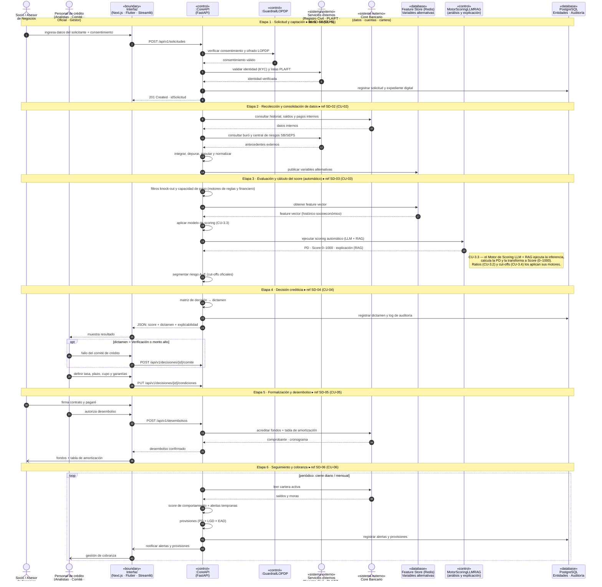

#### SD-01: Solicitud y Captación (CU-01)
Participan ClienteSolicitante, AsesorNegocios, InterfazCaptacion (Next.js / Flutter), CoreAPI, GuardrailLOPDP, RecepcionDeSolicitud, BDSolicitudes, ValidacionDeIdentidadKYC, ServicioBiometricoRegCivil, OficialCumplimientoPLAFT, RecoleccionDocumental y RepositorioExpedienteDigital.
* **CU-1.1 Recepción de solicitud (F1.1)**: el cliente invoca `solicitarCredito(monto, plazo, destino)`; el asesor ejecuta la recepción y la interfaz envía `POST /api/v1/solicitudes`. El GuardrailLOPDP registra el consentimiento (`idCliente`, `finalidad`) y cifra los datos. Fragmento `alt`: con consentimiento, RecepcionDeSolicitud registra los datos del cliente, define monto y plazo, registra el destino, almacena en BDSolicitudes y devuelve el `idRecepcionSolicitud` (`201 Created`, habilita KYC); sin consentimiento LOPDP la respuesta es `403 · consentimiento requerido`.
* **CU-1.2 Validación de identidad KYC (F1.2)**: `POST /api/v1/solicitudes/{id}/kyc`. ValidacionDeIdentidadKYC verifica cédula y biometría con el ServicioBiometricoRegCivil y consulta listas restrictivas PLA/FT con el OficialCumplimientoPLAFT. Fragmento `alt`: identidad válida y sin coincidencias → `200 OK`, habilita la recolección documental; identidad no válida o coincidencia en listas → `422`, solicitud bloqueada y derivada a Cumplimiento.
* **CU-1.3 Recolección documental (F1.3)**: el cliente carga sus archivos (`POST /api/v1/solicitudes/{id}/documentos`); RecoleccionDocumental recolecta ingresos y roles de pago, recibe declaraciones tributarias y, en el fragmento `opt «extend» [existen respaldos o garantías]`, registra respaldos y garantías; almacena en el RepositorioExpedienteDigital y responde `201 Created`. El expediente completo habilita SD-02.

**Figura 7.1.** SD-01: Etapa 1 — Solicitud y captación

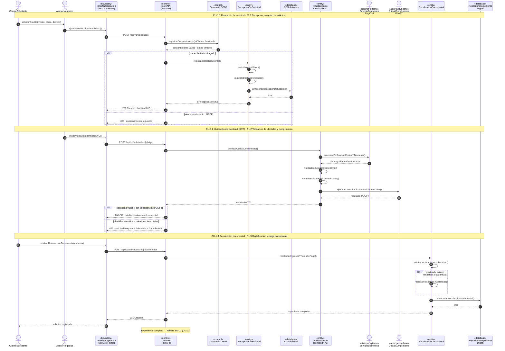

#### SD-02: Recolección y Consolidación de Datos (CU-02)
Participan AnalistaCreditoDatos, InterfazAnalista (Streamlit / Next.js), CoreAPI, GuardrailLOPDP, RecoleccionDatosInternos, CoreBancarioDatosInternos, ConsultaDatosExternos, BuroCentralRiesgosSBSEPS, IntegracionYLimpiezaDatos y MotorIntegracionDatos.
* **CU-2.1 Recolectar datos internos (F2.1)**: `POST /api/v1/solicitudes/{id}/datos-internos`. RecoleccionDatosInternos consulta el historial con la entidad en el Core Bancario (historial, saldos, pagos), evalúa saldos y ahorros, analiza el comportamiento de pago interno y devuelve el `idRecoleccionInterna`.
* **CU-2.2 Consultar datos externos (F2.2)**: `POST /api/v1/solicitudes/{id}/datos-externos`. El GuardrailLOPDP verifica el consentimiento para la consulta al buró; ConsultaDatosExternos ejecuta en un fragmento `par` la consulta al buró de crédito y a la central de riesgos SB/SEPS, recibe el reporte de buró y la calificación SB/SEPS y devuelve el `idConsultaExterna`.
* **CU-2.3 Integrar y limpiar datos (F2.3, automático)**: `integrar(idRecoleccionInterna, idConsultaExterna)` depura registros e inconsistencias, imputa valores faltantes (`opt «extend» [existen valores faltantes]`) y normaliza y estandariza las variables; el MotorIntegracionDatos persiste los datos consolidados y se devuelve el `idIntegracionLimpieza`. El evento «DatosConsolidados» dispara SD-03 automáticamente.

**Figura 7.2.** SD-02: Etapa 2 — Recolección y consolidación de datos

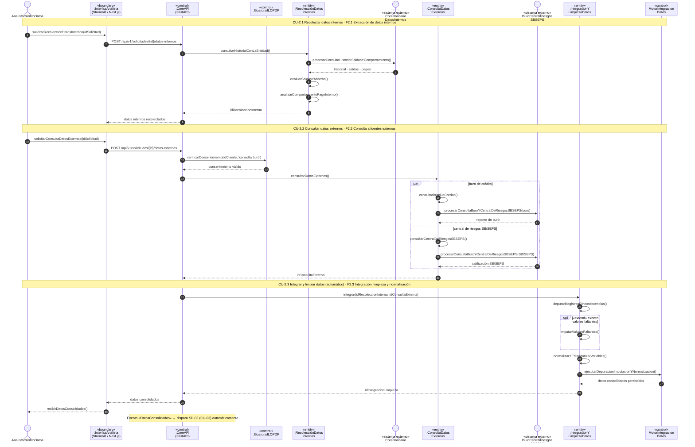

#### SD-03: Evaluación y Cálculo del Score (CU-03)
Flujo completamente automático. Participan AnalistaRiesgoCrediticio, InterfazAnalista, CoreAPI, FiltroPolitica, MotorReglasPoliticas, AnalisisCapacidadDePago, MotorFinancieroCapacidad, AplicacionModeloScoring, Feature Store (Redis), MotorScoringLLMRAG, SegmentacionRiesgoCrediticio y MotorSegmentacionRiesgo. La CoreAPI inicia con `iniciarEvaluacionAutomatica(idSolicitud)` al recibir el evento «DatosConsolidados»; el analista no inicia ni calcula el modelo.
* **CU-3.1 Aplicar filtros de política knock-out (F3.1)**: FiltroPolitica valida edad y capacidad mínima con las reglas y umbrales vigentes del MotorReglasPoliticas, verifica mora vigente y controla el umbral de sobreendeudamiento. Fragmento `break [no supera filtros knock-out]`: dictamen Rechazado (filtro de política), notificación de rechazo al analista y fin de la evaluación.
* **CU-3.2 Analizar capacidad de pago (F3.2)**: AnalisisCapacidadDePago calcula el ratio cuota/ingreso, obtiene del MotorFinancieroCapacidad ingresos, cuotas y obligaciones, evalúa el nivel de endeudamiento, determina el flujo de caja disponible y devuelve los indicadores financieros.
* **CU-3.3 Aplicar modelo de scoring**: AplicacionModeloScoring obtiene el feature vector de variables alternativas del Feature Store, infiere con LLM y RAG, calcula la probabilidad de default (PD) y la transforma a Score (0–1000) mediante `ejecutarScoringAutomaticoLLMYRAG(indicadores, featureVector)` en el MotorScoringLLMRAG. La explicación con referencia a la política (RAG) acompaña al Score.
* **CU-3.4 Segmentar riesgo crediticio (F3.3)**: SegmentacionRiesgoCrediticio evalúa los puntos de corte (cut-offs) sobre el score, asigna la categoría de riesgo A–E y el MotorSegmentacionRiesgo persiste la calificación. El analista recibe el JSON con score, categoría y explicabilidad, que habilita SD-04.

**Figura 7.3.** SD-03: Etapa 3 — Evaluación y cálculo del score (automático)

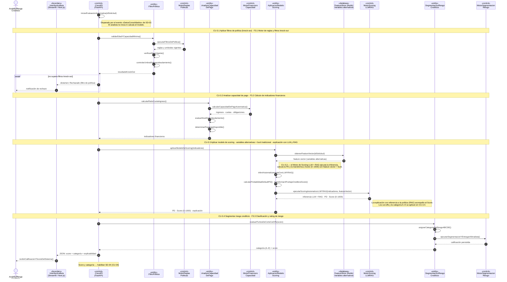

#### SD-04: Decisión Crediticia (CU-04)
Participan AnalistaCredito, ComiteCredito, InterfazAnalista, CoreAPI, EvaluacionMatrizDecision, MotorMatrizDecisionBDDictamenes, RevisionManualComite, BDResolucionesActasComite, DefinicionCondicionesCrediticias y BDTarifarioCondiciones. Inicia cuando la CoreAPI recibe `recibirResultadoScoring(score, categoría)`.
* **CU-4.1 Evaluar en matriz de decisión (F4.1, automático)**: EvaluacionMatrizDecision cruza el score con el monto solicitado, obtiene la matriz y la política de riesgo, contrasta contra la política y genera el dictamen automático (Aprobado / Rechazado / Verificación), que llega al analista con su explicabilidad.
* **CU-4.2 Revisión manual / comité (F4.2)**: fragmento `opt «extend» [dictamen = Verificación (zona gris) o monto alto]`. El analista deriva el caso (`POST /api/v1/decisiones/{id}/comite`), el comité lo recibe y emite su fallo (`PUT /api/v1/decisiones/{id}/comite/fallo`); RevisionManualComite analiza el caso, registra el acta en BDResolucionesActasComite y la CoreAPI ejecuta `actualizarDictamenFinal(fallo)`. **Regla**: el dictamen final es el fallo del comité si hubo revisión y, si no, el de la matriz; «Verificación» nunca llega a CU-4.3 sin fallo del comité.
* **CU-4.3 Definir condiciones crediticias (F4.3)**: fragmento `alt`. Si el dictamen final es Aprobado, `PUT /api/v1/decisiones/{id}/condiciones`: DefinicionCondicionesCrediticias asigna la tasa de interés según la categoría de riesgo con el tarifario vigente, define plazo y cupo aprobado y establece las garantías requeridas. Si es Rechazado, se notifica el rechazo al solicitante. Las condiciones aprobadas habilitan SD-05.

**Figura 7.4.** SD-04: Etapa 4 — Decisión crediticia

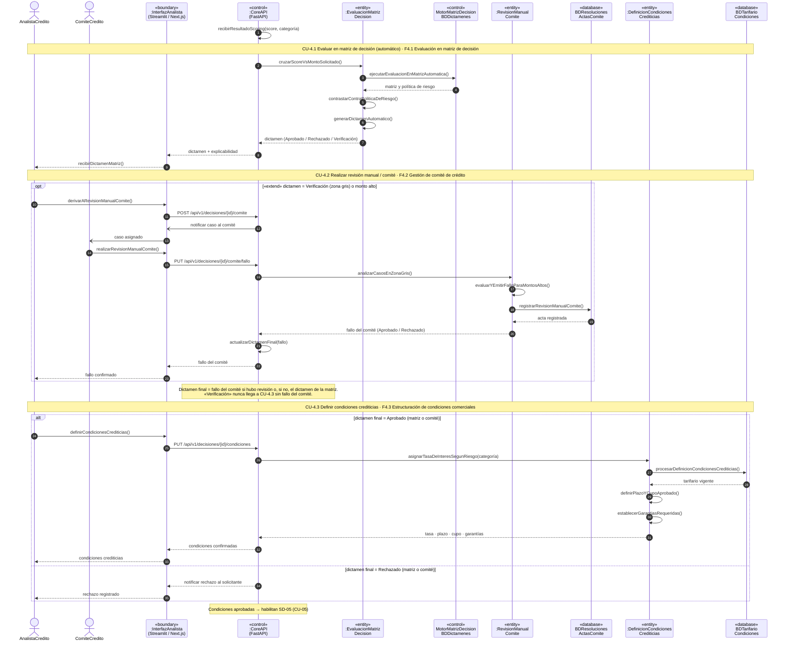

#### SD-05: Formalización y Desembolso (CU-05)
Participan ClienteSolicitante, OficialOperaciones, InterfazOperaciones (Next.js / Flutter), CoreAPI, GestionAceptacionCliente, SistemaContratosBDGarantias, EjecucionDesembolsoCredito y CoreBancarioCuentasCartera. El oficial presenta al cliente las condiciones, el contrato y el pagaré, y el flujo se divide en un fragmento `alt` según la respuesta del cliente.
* **CU-5.1 Gestionar aceptación del cliente (F5.1), [cliente acepta]**: `POST /api/v1/formalizaciones`; GestionAceptacionCliente firma contrato y pagaré, constituye formalmente las garantías y las registra en el SistemaContratosBDGarantias; la aceptación registrada habilita el desembolso.
* **CU-5.2 Ejecutar desembolso del crédito (F5.2)**: el oficial autoriza el desembolso (`POST /api/v1/desembolsos`); EjecucionDesembolsoCredito acredita los fondos en la cuenta mediante el Core Bancario, recibe el comprobante, genera la tabla de amortización y responde `201 Created`; el cliente recibe los fondos y la tabla. El crédito activo en cartera habilita SD-06.
* **[cliente rechaza]**: `rechazarCondiciones()` → `PATCH /api/v1/solicitudes/{id}` con estado Desistida; la solicitud se cierra y termina el proceso.

**Figura 7.5.** SD-05: Etapa 5 — Formalización y desembolso

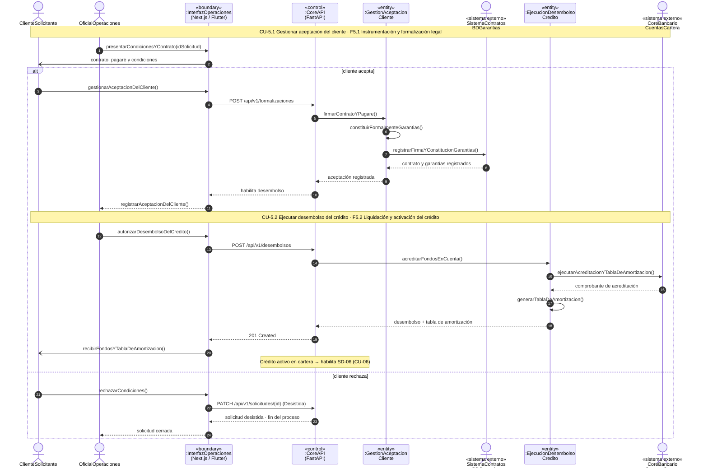

#### SD-06: Seguimiento y Cobranza (CU-06)
Participan AnalistaCarteraRiesgos, GestorCobranza, InterfazCartera (Streamlit / Next.js), CoreAPI (FastAPI con scheduler), MonitoreoCarteraActiva, BDMonitoreoCarteraAlertas, EjecucionGestionCobranza, SistemaCobranzaClienteDeudor, CalculoProvisionesContables y SistemaContableBDProvisiones.
* **CU-6.1 Monitorear cartera activa (F6.1, automático)**: el scheduler ejecuta `dispararMonitoreoProgramado()` y, en un fragmento `loop [por cada crédito activo · cierre diario]`, calcula el score de comportamiento (`idCredito`), obtiene el comportamiento de pago, emite alertas tempranas de deterioro y las publica para la supervisión del analista de cartera.
* **CU-6.2 Ejecutar gestión de cobranza (F6.2)**: fragmento `opt [existen alertas de deterioro]`. El analista asigna los casos (`POST /api/v1/cobranzas`) y el gestor ejecuta la gestión (`PUT /api/v1/cobranzas/{id}`): cobranza preventiva y temprana y, en el `opt «extend» [la mora persiste sobre el umbral]`, cobranza judicial; el SistemaCobranzaClienteDeudor actualiza el estado de la cartera.
* **CU-6.3 Calcular provisiones contables (F6.3, automático)**: CalculoProvisionesContables estima los parámetros PD, LGD y EAD, calcula la pérdida esperada (PD × LGD × EAD), registra las provisiones en el SistemaContableBDProvisiones y la CoreAPI publica el reporte de provisiones al analista.

**Figura 7.6.** SD-06: Etapa 6 — Seguimiento y cobranza

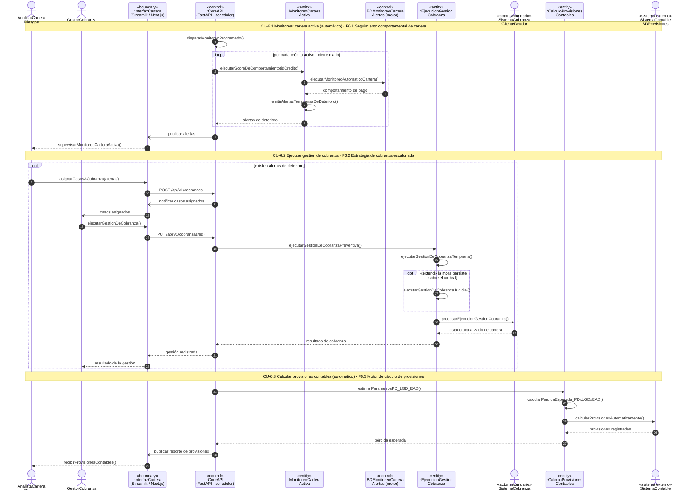

### 7.3. Concurrencia, Sincronización y Control del Flujo
Los diagramas expresan la concurrencia y las decisiones en tiempo de ejecución mediante fragmentos combinados y eventos. La Tabla 7.2 reúne todos los puntos de control del flujo, con su condición de guarda y el efecto en la ejecución.

**Tabla 7.2.** Fragmentos combinados y eventos que controlan el flujo en tiempo de ejecución

| **Diagrama** | **Fragmento / mecanismo** | **Condición (guarda)** | **Comportamiento en ejecución** |
| :--- | :--- | :--- | :--- |
| SD-01 | `alt` | [consentimiento otorgado] / [sin consentimiento LOPDP] | Registra la solicitud (201 Created, habilita KYC) o responde 403 · consentimiento requerido. |
| SD-01 | `alt` | [identidad válida y sin coincidencias PLA/FT] / [identidad no válida o coincidencia en listas] | 200 OK y habilita la recolección documental, o 422 con la solicitud bloqueada y derivada a Cumplimiento. |
| SD-01 | `opt «extend»` | [existen respaldos o garantías] | Ejecuta `registrarRespaldosYGarantias()`. |
| SD-02 | `par` | [buró de crédito] ∥ [central de riesgos SB/SEPS] | Ambas consultas externas corren en paralelo; ConsultaDatosExternos espera las dos respuestas antes de devolver el `idConsultaExterna`. |
| SD-02 | `opt «extend»` | [existen valores faltantes] | Ejecuta `imputarValoresFaltantes()` antes de normalizar. |
| SD-02 → SD-03 | Evento «DatosConsolidados» | Datos consolidados persistidos | Dispara `iniciarEvaluacionAutomatica(idSolicitud)` sin intervención del analista. |
| SD-03 | `break` | [no supera filtros knock-out] | Dictamen Rechazado (filtro de política) y notificación; no se calcula capacidad de pago ni score. |
| SD-04 | `opt «extend»` | [dictamen = Verificación (zona gris) o monto alto] | Revisión manual por el comité; el fallo reemplaza al dictamen de la matriz. |
| SD-04 | `alt` | [dictamen final = Aprobado] / [dictamen final = Rechazado] | Define tasa, plazo, cupo y garantías, o notifica el rechazo al solicitante. |
| SD-05 | `alt` | [cliente acepta] / [cliente rechaza] | Formalización y desembolso, o solicitud Desistida y fin del proceso. |
| SD-06 | `loop` (scheduler) | [por cada crédito activo · cierre diario] | Score de comportamiento y alertas tempranas por crédito. |
| SD-06 | `opt` / `opt «extend»` | [existen alertas de deterioro] / [la mora persiste sobre el umbral] | Cobranza preventiva y temprana; escala a cobranza judicial si la mora persiste. |
| SD-00 | `opt` y `loop` | [dictamen = Verificación o monto alto] · [periódico: cierre diario / mensual] | Resumen de los fragmentos de comité (SD-04) y de monitoreo periódico (SD-06). |

### 7.4. Interfaces de la CoreAPI Invocadas en los Flujos
Las interfaces (Next.js, Flutter y Streamlit) solo se comunican con la CoreAPI. La Tabla 7.3 lista los endpoints que aparecen en los diagramas, en el orden del flujo de valor.

**Tabla 7.3.** Endpoints REST de la CoreAPI (FastAPI) presentes en los diagramas de secuencia

| **Método y recurso** | **Diagrama** | **Invocado desde** | **Propósito y respuesta** |
| :--- | :--- | :--- | :--- |
| `POST /api/v1/solicitudes` | SD-01, SD-00 | InterfazCaptacion | Registra la solicitud previa verificación del consentimiento LOPDP → 201 Created · idSolicitud, o 403. |
| `POST /api/v1/solicitudes/{id}/kyc` | SD-01 | InterfazCaptacion | Valida cédula, biometría y listas PLA/FT → 200 OK, o 422 (bloqueada / derivada a Cumplimiento). |
| `POST /api/v1/solicitudes/{id}/documentos` | SD-01 | InterfazCaptacion | Carga documental y expediente digital → 201 Created. |
| `POST /api/v1/solicitudes/{id}/datos-internos` | SD-02 | InterfazAnalista | Recolecta historial, saldos y pagos del Core Bancario → datos internos recolectados. |
| `POST /api/v1/solicitudes/{id}/datos-externos` | SD-02 | InterfazAnalista | Verifica consentimiento, consulta buró y SB/SEPS en paralelo e integra los datos → datos consolidados. |
| `POST /api/v1/decisiones/{id}/comite` | SD-04, SD-00 | InterfazAnalista | Deriva el caso a revisión manual / comité. |
| `PUT /api/v1/decisiones/{id}/comite/fallo` | SD-04 | InterfazAnalista (Comité) | Registra el fallo del comité y el acta → dictamen final. |
| `PUT /api/v1/decisiones/{id}/condiciones` | SD-04, SD-00 | InterfazAnalista | Define tasa, plazo, cupo y garantías → condiciones confirmadas. |
| `POST /api/v1/formalizaciones` | SD-05 | InterfazOperaciones | Firma de contrato y pagaré y constitución de garantías → habilita desembolso. |
| `POST /api/v1/desembolsos` | SD-05, SD-00 | InterfazOperaciones | Acredita fondos y genera la tabla de amortización → 201 Created. |
| `PATCH /api/v1/solicitudes/{id}` | SD-05 | InterfazOperaciones | Marca la solicitud como Desistida cuando el cliente rechaza las condiciones. |
| `POST /api/v1/cobranzas` | SD-06 | InterfazCartera | Asigna casos con alertas de deterioro a cobranza. |
| `PUT /api/v1/cobranzas/{id}` | SD-06 | InterfazCartera | Registra la gestión de cobranza → resultado de la gestión. |

La evaluación y cálculo del score (SD-03), la evaluación en matriz (CU-4.1), el monitoreo de cartera (CU-6.1) y el cálculo de provisiones (CU-6.3) no exponen endpoints propios: se ejecutan dentro de la CoreAPI, disparados por el evento «DatosConsolidados», por la recepción del resultado de scoring o por el scheduler.

---

## 8. VISTA DE IMPLEMENTACIÓN

### 8.1. Visión General y Organización en System-Monorepo Estratificado
Para garantizar cohesión funcional, gobernabilidad técnica y despliegues seguros sin acoplamiento indebido con el núcleo bancario, el software se organiza mediante una estrategia de **System-Monorepo estratificado en 7 capas**: (1) Presentación, (2) Negocio, (3) Plataforma, (4) Infraestructura, (5) Datos, (6) Compartidos y (7) DevOps. Esta estructura articula los canales móviles (React Native) y web (Angular), el backend corporativo (Groovy), el consumo de APIs del Core Bancario (App Core) alojado en la Nube Privada de la cooperativa, el acceso desacoplado a la Base de Datos Oracle de Listas y la gestión centralizada de Web Services (WS) sobre la Nube Privada IaaS bajo el patrón **Enterprise Application Integration (EAI)**. Dado que la cooperativa opera exclusivamente con persistencia relacional (Oracle) y no maneja una base de datos no relacional (NoSQL), el componente de caché en memoria (Redis) se contempla estrictamente como un **módulo opcional de evolución**.

### 8.2. Análisis de las 7 Capas del System-Monorepo: Componentes, Artefactos Físicos y Responsabilidades
Cada capa del System-Monorepo agrupa componentes con responsabilidades arquitectónicas específicas y produce artefactos físicos independientes que se ensamblan y despliegan de forma controlada dentro de la Nube Privada IaaS de la cooperativa:

| **Capa del System-Monorepo** | **Componentes Lógicos y Tecnológicos** | **Artefactos Físicos Generados** | **Responsabilidad Arquitectónica** |
| :--- | :--- | :--- | :--- |
| **1. Presentación**<br>(`/apps`) | • App Móvil Socios (React Native)<br>• Portal Web SPA (Angular)<br>• Guards RBAC e Interceptores JWT | • Paquetes nativos `.apk` (Android) y `.ipa` (iOS)<br>• Bundle estático SPA Angular (`dist/`: HTML, JS, CSS)<br>• Módulos lazy-loaded por etapa (CU-01..CU-06) | Capturar solicitudes, presentar resultados de score/dictamen, gestionar bandeja de comité y cobranza, y consumir exclusivamente WS estandarizados en HTTPS/JSON sin contener lógica transaccional crítica. |
| **2. Negocio**<br>(`/services`) | • Backend Principal en Groovy (Controladores REST, Servicios, DTOs)<br>• Motor ML Scoring & RAG (Python: XGBoost/Scikit-Learn)<br>• Orquestador BPMN (6 Etapas) | • Artefactos ejecutables `.jar` / `.war` (JVM Groovy)<br>• Imágenes OCI/Docker del motor ML Scoring<br>• Definiciones `.bpmn` de flujos de aprobación y cobranza | Implementar las reglas crediticias, filtros knock-out, capacidad de pago, validación de DTOs, cálculo de PD/Score (0–1000) con explicabilidad RAG, y orquestar las 6 etapas del flujo de valor. |
| **3. Plataforma**<br>(`/platform`) | • Reverse Proxy / Balanceador (WAF)<br>• Identity Server (SSO, SAML2/OAuth2/JWT + LDAP/AD en Nube Privada)<br>• API Manager (WS IaaS) y Guardrail LOPDP<br>• ESB (App Core, Buró AVAL, Reg. Civil, PLA/FT) y Message Queue | • Políticas XML/YAML de API Manager y WAF<br>• Configuraciones de Realms/Roles SSO e Integración LDAP<br>• Flujos de mediación ESB y tópicos/colas de mensajería | Proveer seguridad transversal (autenticación, RBAC, cifrado y consentimiento LOPDP), gobierno de Web Services (WS), mediación de protocolos hacia las APIs del Core Bancario (App Core) y desacoplamiento asíncrono. |
| **4. Infraestructura**<br>(`/infra`) | • Nube Privada IaaS (Nodos, Subredes y Servicios Cooperativa)<br>• Orquestación de Contenedores<br>• Agentes de Monitoreo (Monitoring System) y Log Storage | • Manifiestos Dockerfiles, Docker Compose / Kubernetes YAML<br>• Plantillas IaC (Terraform/Ansible para Nube Privada IaaS)<br>• Configuraciones de agentes APM y recolectores de logs | Aprovisionar, aislar y escalar horizontalmente los entornos de ejecución de los WS en la Nube Privada IaaS, asegurando alta disponibilidad, segmentación de red privada y trazabilidad operativa. |
| **5. Datos**<br>(`/database`) | • Base de Datos Oracle de Listas (Persistencia Relacional Principal)<br>• Cache Server Redis [Opcional — sin BD NoSQL actual en PJL]<br>• Repositorio BI / Reporting y Auditoría LOPDP | • Scripts DDL/DML `.sql` de Listas Oracle (`LST_SOCIOS`, `LST_CARTERA_ACTIVA`, `LST_MORA_4M`)<br>• Modelos de reportes diarios y previsiones (PD×LGD×EAD)<br>• Esquemas opcionales de caché Redis | Garantizar persistencia relacional íntegra y acceso desacoplado de Web y Móvil a Oracle mediante Listas SQL controladas (protegiendo el Core Bancario) y cumplimiento auditable de la LOPDP. Redis queda opcional sin imponer dependencia NoSQL. |
| **6. Compartidos**<br>(`/shared`) | • Contratos OpenAPI / WS<br>• DTOs Transversales y Entidades de Seguridad<br>• Utilidades de Cifrado, Validación y Manejo de Errores | • Biblioteca JVM `shared-core-security.jar` (Groovy/Java)<br>• Paquete NPM interno `@pjl/shared-contracts` (TypeScript para Angular y React Native)<br>• Especificaciones `openapi-v1.yaml` | Evitar duplicación de código y divergencia de contratos entre Presentación, Negocio y Plataforma, centralizando DTOs, entidades de seguridad (Usuario, Rol, ConsentimientoLOPDP) y códigos de error. |
| **7. DevOps**<br>(`/.github` & `/devops`) | • Pipelines CI/CD DevSecOps<br>• Análisis Estático (SonarQube) y Pruebas Automatizadas<br>• Registro de Artefactos y Despliegue en Nube Privada IaaS | • Workflows YAML (`.github/workflows/ci-cd.yml`)<br>• Reportes de calidad/seguridad (SAST/DAST, cobertura)<br>• Scripts de release y rollback automatizado a IaaS | Automatizar compilación, pruebas unitarias/integración, verificación de reglas de seguridad/LOPDP y promoción controlada de artefactos físicos hacia los entornos de QA y producción en la Nube Privada IaaS. |

### 8.3. Diagrama de Componentes de Desarrollo e Interpretación (Arquitectura EAI)
El siguiente diagrama representa la interacción estática y de integración entre los componentes del System-Monorepo bajo el patrón Enterprise Application Integration (EAI), ubicando tanto los servicios base de la cooperativa (LDAP/AD, Core Bancario App Core y Fuentes Externas) como la gestión de Web Services (WS) dentro de la Nube Privada IaaS, conectando la persistencia principal a la Base de Datos Oracle de Listas y delimitando con borde punteado el componente opcional de caché (Redis):

**Figura 8.1.** Diagrama de Componentes de Desarrollo bajo Arquitectura EAI y System-Monorepo (Nube Privada IaaS Cooperativa PJL, Oracle DB de Listas y Cache Redis Opcional)

```mermaid
---
title: "VISTA DE IMPLEMENTACIÓN (MODELO 4+1 & EAI) — COOPERATIVA PADRE JULIÁN LORENTE (NUBE PRIVADA IaaS)"
config:
  layout: dagre
  look: classic
  flowchart:
    curve: linear
    nodeSpacing: 30
    rankSpacing: 45
    padding: 12
    wrappingWidth: 600
---
flowchart TB
  %% Colores como en la figura original: rojo = firewall/perímetro, ámbar = seguridad y autenticación,
  %% verde = servicios (presentación y negocio), azul = almacenamiento (Oracle de Listas), punteado = opcional (NoSQL).
  classDef fw fill:#fef2f2,stroke:#dc2626,color:#111
  classDef sec fill:#fefce8,stroke:#d97706,color:#111
  classDef svc fill:#f0fdf4,stroke:#15803d,color:#111
  classDef data fill:#eff6ff,stroke:#0369a1,color:#111
  classDef opt fill:#f8fafc,stroke:#0369a1,stroke-dasharray:5 4,color:#111
  classDef ext fill:#ffffff,stroke:#475569,color:#111
  UW["<b>Usuarios Web</b><br/>(Socios / Analistas — Angular)"]:::ext
  AM["<b>App Móvil Socios</b><br/>(React Native)"]:::ext
  PE["<b>Partners &amp; Servicios Externos</b><br/>(Buró AVAL · Reg. Civil · SB/SEPS)"]:::ext
  subgraph NPC["<i>Nube Privada / Cooperativa</i>"]
    direction TB
    LDAP["<b>LDAP / Active Directory</b><br/>Directorio de Usuarios y Roles<br/>(Nube Privada)"]:::ext
    CORE["<b>Core Bancario (App Core)</b><br/>APIs REST / WS Propietarios<br/>Cuentas · Cartera · Créditos"]:::ext
    FEX["<b>Fuentes Externas &amp;<br/>Sistemas Legados</b><br/>AVAL · SB/SEPS · Reg. Civil"]:::data
  end
  subgraph IAAS["<i>Nube Privada IaaS — Gestión de Web Services (WS) y Contenedores</i>"]
    direction TB
    RP["<b>Reverse Proxy / Balanceador de Carga</b><br/>(Firewall Perimetral TLS / WAF)"]:::fw
    IDS["<b>Identity Server (Seguridad)</b><br/>SSO · SAML2 / OAuth2 / JWT<br/>Políticas RBAC &amp; LOPDP"]:::sec
    SPA["<b>Front-end / Single Page App (Capa de Presentación)</b><br/>Web SPA: Angular · App Móvil: React Native<br/>Vistas · Módulos · Interceptores · DTOs Cliente"]:::svc
    APIM["<b>API Manager (WS en Nube Privada IaaS)</b><br/>Autenticación · Autorización · Caching · Rate Limit · Guardrail LOPDP"]:::sec
    subgraph NEG["Capa de Negocio y Orquestación (Servicios / Microservicios)"]
      direction TB
      ESB["<b>ESB / Integración</b><br/>Adaptadores App Core<br/>Buró AVAL · PLA/FT"]:::svc
      BE["<b>Backend Groovy &amp; Microservicio Scoring IA</b><br/>Groovy (Controladores · Servicios · DTOs · Seguridad)<br/>+ Motor ML Scoring Python (XGBoost / Explicabilidad RAG)"]:::svc
      BPS["<b>Business Process Server</b><br/>Orquestación 6 Etapas<br/>(CU-01 a CU-06 · Cobranza)"]:::svc
      MQ["<b>Message Queue</b><br/>Mensajería Asíncrona — Eventos «DatosConsolidados»,<br/>Notificaciones Cobranza, Protección de Carga"]:::data
    end
    DS["<b>Data Stores — Base de Datos Oracle (Listas)</b><br/>Base de Datos relacional de Listas para Web y Móvil<br/>(Socios · Solicitudes · Cartera · Auditoría LOPDP)"]:::data
    CACHE["<b>Cache Server (Redis — Opcional)</b><br/>Componente opcional<br/>(Sin BD NoSQL en PJL)<br/>Caché / Baja Latencia"]:::opt
    BI["<b>BI / Reporting</b><br/>Reportes Diarios de Cartera<br/>Previsiones PD × LGD × EAD<br/>Panel Analistas"]:::data
  end
  subgraph OPS["<i>Operación y Auditoría</i>"]
    direction TB
    MON["<b>Monitoring System</b><br/>Agentes APM<br/>Métricas WS IaaS<br/>Salud de Servicios"]:::ext
    LOG["<b>Log Storage<br/>Audit &amp; Analytics</b><br/>Logs Centralizados<br/>Trazabilidad Dictamen<br/>Auditoría LOPDP"]:::data
  end
  UW --> RP
  AM --> RP
  PE <--> RP
  RP --> IDS
  RP --> SPA
  IDS <-->|SSO / JWT| SPA
  LDAP <--> IDS
  APIM --> IDS
  SPA <--> APIM
  RP <-->|RESTful / WS| APIM
  CORE <-->|REST APIs| APIM
  CORE <-->|App Core| ESB
  APIM <--> ESB
  APIM <--> BE
  APIM <--> BPS
  ESB <--> MQ
  BE <--> MQ
  BPS <--> MQ
  MQ <-->|Listas SQL| DS
  MQ -.->|Opcional| CACHE
  MQ <--> BI
  FEX <-->|ETL / Listas| DS
  IAAS -->|Agentes| MON
  IAAS -->|Logs| LOG
  linkStyle 0,1,2,3,4 stroke:#dc2626,stroke-width:1.5px
  linkStyle 5,6,7,9 stroke:#d97706,stroke-width:1.5px
  linkStyle 8,12,13,14 stroke:#15803d,stroke-width:1.5px
  linkStyle 10,11 stroke:#475569,stroke-width:1.5px
  linkStyle 15,16,17,18,19,20,21 stroke:#0369a1,stroke-width:1.5px
  linkStyle 22,23 stroke:#475569,stroke-width:1.5px
  style NPC fill:#f8fafc,stroke:#1d4ed8,stroke-dasharray:6 4
  style IAAS fill:#eff6ff,stroke:#1d4ed8
  style NEG fill:transparent,stroke:#64748b,stroke-dasharray:6 4
  style OPS fill:#f8fafc,stroke:#64748b,stroke-dasharray:6 4
```

**Interpretación del Flujo de Interacción en el Diagrama de Componentes**
1. **Perímetro, Seguridad y Acceso de Clientes (Rojo y Amarillo)**: Toda solicitud proveniente de Usuarios Web (Angular), App Móvil (React Native) o socios externos (Buró AVAL, Registro Civil, SB/SEPS) atraviesa el Reverse Proxy / Balanceador. Las sesiones humanas se autentican vía SSO/JWT en el Identity Server (respaldado por el directorio LDAP/AD en la Nube Privada de la cooperativa) y cada llamada a Web Services (WS) es validada, autorizada y auditada en el API Manager.
2. **Procesamiento de Negocio, Integración App Core y Desacoplamiento (Verde y Azul)**: Desde el API Manager, el tráfico ingresa a la capa de servicios donde el Backend Groovy ejecuta controladores, validaciones de DTOs y lógica crediticia; el ESB media hacia las APIs del Core Bancario (App Core) en la Nube Privada de la cooperativa y hacia servicios externos; el Business Process Server coordina las 6 etapas; el microservicio Python calcula el score y la explicación RAG; y el Message Queue absorbe picos de carga mediante eventos asíncronos (notificaciones de cobranza y disparo automático de evaluación).
3. **Persistencia Relacional en Oracle de Listas, Caché Opcional y Observabilidad (Azul y Zona Derecha)**: Los servicios Web y Móvil consultan la Base de Datos Oracle de Listas (alimentada mediante flujos ETL y el Core) y nutren el módulo de BI/Reporting (previsiones PD×LGD×EAD). El Cache Server (Redis) aparece explicitado con línea discontinua como componente opcional, dado que la cooperativa no gestiona actualmente bases de datos NoSQL. En paralelo, agentes APM reportan métricas al Monitoring System y los eventos críticos se registran en Log Storage para auditoría LOPDP.

### 8.4. Principales Componentes de la Arquitectura EAI y sus Funciones
En correspondencia con el modelo de referencia Enterprise Application Integration (EAI) y el stack real de la Cooperativa Padre Julián Lorente, la siguiente tabla resume los componentes principales y su función específica:

| **Componente Principal** | **Capa del Monorepo** | **Función en la Arquitectura de la Cooperativa (PJL)** |
| :--- | :--- | :--- |
| **Reverse Proxy / Balancer** | 4. Infraestructura / 3. Plataforma (Firewall) | Actúa como firewall perimetral primario que restringe el acceso desde Internet e intranet hacia la subred privada IaaS donde reside el middleware. Provee balanceo de carga entre instancias de Web Services (WS) y componentes legados no contenerizados. |
| **Identity Server** | 3. Plataforma (Seguridad) | Implementa el inicio de sesión único (SSO / SAML2 / OAuth2 / JWT). Gestiona políticas de acceso, integra el directorio de usuarios (LDAP / Active Directory en la Nube Privada de la cooperativa) y aplica control de acceso basado en roles (RBAC). |
| **Front-end / Single Page App (Angular & React Native)** | 1. Presentación | Ofrece las interfaces desacopladas para la cooperativa: Portal Web SPA en Angular (gestión interna, comité y cobranza) y App Móvil en React Native (socios). Consumen únicamente APIs/WS estandarizados en HTTPS/JSON. |
| **API Manager (WS en Nube Privada IaaS)** | 3. Plataforma (Seguridad / Gobierno WS) | Autentica y autoriza cada solicitud de API desde cualquier cliente o dispositivo. Centraliza el registro de auditoría (LOPDP), el ciclo de vida, documentación y mocking de los Web Services (WS), caché de nivel API y estandarización de protocolos a HTTPS/JSON. |
| **Services / Microservices (Backend Groovy + ML Scoring)** | 2. Negocio | Alojados en contenedores aislados sobre la Nube Privada IaaS con escalamiento horizontal independiente. Incluye el Backend en Groovy (controladores, servicios, DTOs y entidades de seguridad) y el motor Python de scoring XGBoost y explicabilidad RAG. |
| **ESB & Conectores App Core** | 3. Plataforma / 2. Negocio | Bus de servicios empresariales que integra y transforma protocolos entre los microservicios de la nube IaaS, las APIs del Core Bancario (App Core en Nube Privada) y servicios externos (Buró AVAL, Registro Civil, listas PLA/FT y SB/SEPS). |
| **Business Process Server (BPMN)** | 2. Negocio (Orquestación) | Orquesta de extremo a extremo las 6 etapas del flujo de valor crediticio (Solicitud, Consolidación, Score, Decisión/Comité, Formalización/Desembolso y Seguimiento/Cobranza), coordinando pasos automáticos y tareas humanas. |
| **Message Queue** | 3. Plataforma (Mensajería) | Provee transporte asíncrono con entrega garantizada de mensajes (eventos «DatosConsolidados», notificaciones de cobranza y sinergia con el proyecto Chatbot PJL), protegiendo al Core Bancario y a los servicios externos frente a sobrecargas. |
| **Data Stores (Base de Datos Oracle de Listas)** | 5. Datos (Persistencia Relacional) | Persistencia corporativa principal sobre Base de Datos Oracle de Listas conectada a Web (Angular) y Móvil (React Native), aislando las tablas transaccionales del Core Bancario y soportando flujos ETL. |
| **Cache Server (Redis — Opcional)** | 5. Datos (Opcional / Sin NoSQL) | Componente opcional propuesto para aceleración de lecturas frecuentes o Feature Store en memoria. No es obligatorio para el despliegue inicial, ya que la cooperativa no opera actualmente una base de datos no relacional (NoSQL) y resuelve las consultas sobre Oracle de Listas. |
| **BI / Reporting, Monitoring & Log Storage** | 5. Datos / 4. Infraestructura | Genera reportes diarios de cartera y previsiones (PD × LGD × EAD), supervisa la salud de los WS en la Nube Privada IaaS mediante agentes (Monitoring System) y preserva trazabilidad auditable y consentimientos LOPDP (Log Storage). |

### 8.5. Relación de la Vista de Implementación con las Demás Vistas del Modelo 4+1 (Trazabilidad)
Dentro del modelo 4+1 de Kruchten, la Vista de Implementación (Desarrollo) materializa en módulos, paquetes y artefactos físicos las decisiones definidas en las vistas de Escenarios, Lógica y Procesos, y entrega los componentes desplegables que consume la Vista Física sobre la Nube Privada de la cooperativa:

| **Vista del Modelo 4+1** | **Elementos y Decisiones que Aporta** | **Materialización en la Vista de Implementación (System-Monorepo)** |
| :--- | :--- | :--- |
| **Vista de Escenarios (+1)**<br>Casos de Uso (CU-01 a CU-06) y Mapa de Capacidades | Define las 6 etapas del flujo de valor crediticio (Solicitud, Consolidación, Score AVAL/ML, Decisión, Formalización y Seguimiento/Cobranza con notificaciones y renovaciones). | Cada caso de uso se implementa como un módulo funcional dedicado en `/apps/web` (Angular), pantallas en `/apps/mobile` (React Native) y servicios/controladores en `/services/backend-groovy`, orquestados en `/services/orchestration-bpmn`. |
| **Vista Lógica**<br>Diagrama de Clases (DC-01..06) y Robustez (DR/ECB-01..06) | Establece los objetos Borde («boundary»), Control («control»), Entidad («entity»), Interfaces («interface») y Adaptadores del dominio crediticio. | Los «boundary» se materializan en `/apps` (Angular/React) y `/platform/api-manager-ws`; los «control» en controladores/servicios de `/services/backend-groovy` y `/services/ml-scoring-engine`; las «entity» en `/shared/common-dtos-utils` y `/database/oracle-listas`; y los adaptadores en `/platform/esb-integrations`. |
| **Vista de Procesos**<br>Diagramas de Secuencia (SD-00 a SD-06) | Describe la interacción temporal, llamadas REST/WS (POST/PUT/PATCH), validaciones LOPDP, consultas paralelas (`par`), cortes knock-out (`break`) y cierres periódicos (`loop`). | Las llamadas síncronas se implementan mediante endpoints REST en `/services/backend-groovy` gobernados por `/platform/api-manager-ws`; las validaciones de privacidad en Guardrail LOPDP (`/platform` y `/shared/security-entities`); y los eventos asíncronos/cierres diarios en `/platform/message-queue` y schedulers del backend. |
| **Vista Física (Despliegue)**<br>Topología en Nube Privada IaaS | Determina los nodos virtuales y segmentos de red dentro de la Nube Privada de la cooperativa donde se ejecutan App Core, LDAP/AD, Base de Datos Oracle de Listas y los Web Services (WS). | Los artefactos físicos construidos en `/devops` (`.jar` Groovy, contenedores ML, bundles SPA Angular, `.apk`/`.ipa` React Native, manifiestos `/infra/containers` y scripts `/database/oracle-listas`) se despliegan en los segmentos de la Nube Privada IaaS (manteniendo Redis como opción no obligatoria). |

---


## 9. VISTA DE DESPLIEGUE

### 9.1. Visión General
Fundamentado en el Microsoft Application Architecture Guide v2, el sistema adopta una arquitectura de contenedores Docker cloud-native. Para evitar acoplamientos innecesarios, se separan físicamente las topologías de despliegue de la Plataforma Web y de la Plataforma Móvil.

### 9.2. Diagrama de Despliegue

#### Topología de Despliegue Web (Web Application Archetype):
```text
┌────────────────────────────────────────────────────────────────────────────────────────┐
│ 1. BROWSER CLIENT TIER (Navegador del Usuario)                                         │
│    • Next.js App (React / TypeScript) + Tailwind CSS / Shadcn UI                      │
│    • Streamlit Analytics Dashboard (Interface de prueba UAT para Analistas)            │
└───────────────────────────────────────────┬────────────────────────────────────────────┘
                                            │ HTTPS / TLS 1.3 / WebSockets
┌───────────────────────────────────────────▼────────────────────────────────────────────┐
│ 2. WEB SERVER TIER (Capa de Servidor Frontend en Contenedor)                           │
│    • Node.js Container: Server-Side Rendering (SSR) & Static Site Generation (SSG)    │
│    • NGINX Reverse Proxy Container (SSL Termination & Ingress Enrutamiento)             │
└───────────────────────────────────────────┬────────────────────────────────────────────┘
                                            │ Red Privada Interna de Contenedores
┌───────────────────────────────────────────▼────────────────────────────────────────────┐
│ 3. APPLICATION & BUSINESS TIER (Capa de Servicios de Negocio y ML)                     │
│    • FastAPI Core API (Python)                                                         │
│    • Motor Analítico ML: Scikit-Learn / XGBoost (Inferencia de Scoring < 300 ms)       │
│    • Integración Agéntica: Servidores MCP (Model Context Protocol)                     │
└───────────────────────────────────────────┬────────────────────────────────────────────┘
                                            │ Consultas SQL / Feature Queries / Vectors
┌───────────────────────────────────────────▼────────────────────────────────────────────┐
│ 4. DATA TIER (Capa de Datos e Infraestructura)                                         │
│    • PostgreSQL (Base Relacional Transaccional ACID)                                   │
│    • Redis (Feature Store & Caché de Variables Alternativas Locales < 50 ms)           │
│    • Qdrant (Base Vectorial de Políticas Crediticias para RAG)                         │
└────────────────────────────────────────────────────────────────────────────────────────┘
```

#### Topología de Despliegue Móvil (Rich Mobile Client Archetype):
```text
┌────────────────────────────────────────────────────────────────────────────────────────┐
│ 1. HANDHELD MOBILE TIER (Dispositivo Móvil del Socio / Comerciante)                   │
│    • Flutter App (Dart AOT compilado a código máquina nativo ARM para iOS / Android)   │
│    • Almacenamiento Seguro Local: iOS Keychain / Android Keystore (Tokens JWT)         │
│    • Sensores & Hardware: Biometría (FaceID/Huella), Cámara (Escaneo de Documentos)    │
└───────────────────────────────────────────┬────────────────────────────────────────────┘
                                            │ HTTPS / REST API / TLS 1.3
┌───────────────────────────────────────────▼────────────────────────────────────────────┐
│ 2. API GATEWAY & SECURITY TIER (Puerta de Entrada Móvil)                               │
│    • NGINX API Gateway (Validación de Headers, Rate Limiting, Filtro Móvil)            │
│    • Agente Guardián LOPDP: Verificación de Consentimiento Firmado por el Socio        │
└───────────────────────────────────────────┬────────────────────────────────────────────┘
                                            │ Red Privada Interna de Contenedores
┌───────────────────────────────────────────▼────────────────────────────────────────────┐
│ 3. APPLICATION & BUSINESS TIER (Capa de Servicios de Negocio y ML)                     │
│    • FastAPI Core API (Python)                                                         │
│    • Motor Analítico ML: Scikit-Learn / XGBoost (Inferencia de Scoring)                │
└───────────────────────────────────────────┬────────────────────────────────────────────┘
                                            │ Consultas SQL / Feature Queries
┌───────────────────────────────────────────▼────────────────────────────────────────────┐
│ 4. DATA TIER (Capa de Datos e Infraestructura)                                         │
│    • PostgreSQL (Base Relacional Transaccional)                                        │
│    • Redis (Feature Store & Caché de Variables Alternativas Locales)                   │
└────────────────────────────────────────────────────────────────────────────────────────┘
```

---

## 10. VISTA DE DATOS

### 10.1. Visión General
El sistema combina tres tecnologías de persistencia especializadas bajo la norma ISO/IEC 25012 de Calidad de Datos: PostgreSQL para transacciones relacionales ACID, Redis para el almacenamiento de variables alternativas en memoria y Qdrant para la búsqueda semántica de políticas crediticias en el motor RAG.

### 10.2. Modelo de Datos
El modelo relacional vincula la entidad `tb_socio` con sus `tb_solicitud_credito`, sus registros de `tb_consentimiento_lopdp`, sus `tb_feature_vector_local` socioeconómicos y sus `tb_dictamen_scoring` finales.

### 10.3. Diccionarios de Datos

#### Tabla: tb_socio
| **Campo** | **Tipo de Dato** | **Null** | **Clave** | **Descripción** |
| :--- | :--- | :--- | :--- | :--- |
| id_socio | UUID | No | PK | Identificador único universal del socio. |
| identificacion | VARCHAR(13) | No | Unique | Cédula o RUC del comerciante. |
| nombres_completos | VARCHAR(150) | No | - | Nombres y apellidos anonimizables. |
| actividad_economica | VARCHAR(100) | No | - | Sector comercial (ej. Comercio local, Textil). |

#### Tabla: tb_dictamen_scoring
| **Campo** | **Tipo de Dato** | **Null** | **Clave** | **Descripción** |
| :--- | :--- | :--- | :--- | :--- |
| id_dictamen | UUID | No | PK | Identificador único del dictamen. |
| id_solicitud | UUID | No | FK | Referencia a la solicitud de crédito. |
| score_num | INTEGER | No | - | Puntaje de crédito calculado (0 - 1000). |
| veredicto | VARCHAR(30) | No | - | Aprobado, Rechazado o Sujeto a Verificación. |
| monto_sugerido | DECIMAL(10,2) | No | - | Límite de crédito sugerido por la IA. |

---

## 11. CALIDAD

### 11.1. Visión General
El producto de software se evalúa formalmente bajo el estándar ISO/IEC 25010 (SQuaRE) e incorpora los principios de diseño de aplicaciones nativas en nube recomendados por la Cloud Native Computing Foundation (CNCF).

### 11.2. Atributos de Calidad y Principios CNCF
* **Inmutabilidad de Contenedores**: Cada microservicio se empaqueta en una imagen Docker inmutable que no modifica su estado interno en ejecución.
* **Desacoplamiento y Resiliencia**: La caída del dashboard Streamlit no afecta la operación de la Core API de scoring ni el acceso a la base de datos.
* **Explicabilidad y Transparencia**: Los dictámenes generados por el algoritmo ML son interpretados por la Malla Agéntica RAG, eliminando el sesgo de "caja negra".

---

## 12. SEGURIDAD

### 12.1. Visión General
La arquitectura aplica principios de Seguridad por Diseño (Security by Design), asegurando cifrado TLS 1.3 en tránsito, AES-256 en reposo, autenticación JWT con firma RSA y agentes guardianes LOPDP en el pipeline CI/CD.

### 12.2. Seguridad de Aplicaciones Web OWASP (OWASP Top 10 Web 2021)
| **Riesgo OWASP Web** | **Descripción del Riesgo** | **Medida de Mitigación en la Arquitectura** |
| :--- | :--- | :--- |
| A01: Broken Access Control | Accesos no autorizados a datos de otros socios. | Validación de roles JWT (RBAC) e inspección de pertenencia en backend. |
| A02: Cryptographic Failures | Exposición de datos sensibles en tránsito o reposo. | Cifrado TLS 1.3 en red interna y AES-256 para columnas sensibles en PostgreSQL. |
| A03: Injection (SQL / Prompt) | Inyección de código SQL o manipulación del LLM. | Uso de ORM SQLAlchemy parametrizado y Guardrail Agents para prompts. |
| A05: Security Misconfiguration | Configuraciones por defecto inseguras. | Escaneo estático automatizado con SonarQube en GitHub Actions. |

### 12.3. Seguridad de Aplicaciones Móviles OWASP (OWASP Mobile Top 10 2024)
| **Riesgo OWASP Mobile** | **Descripción del Riesgo** | **Medida de Mitigación en la Arquitectura** |
| :--- | :--- | :--- |
| M01: Improper Credential Usage | Almacenamiento inseguro de tokens de sesión. | Uso exclusivo de iOS Keychain y Android Keystore encriptados por hardware. |
| M02: Insecure Communication | Intercepción de tráfico de red móvil. | SSL Pinning obligatorio en la app Flutter y certificado TLS 1.3 en NGINX Gateway. |
| M04: Insecure Authentication | Autenticación débil en dispositivos cliente. | Autenticación biométrica nativa (FaceID/Huella) combinada con OAuth2/JWT. |

---

## 13. INFORMACIÓN DE CONTACTO
Para soporte técnico, consultas sobre la arquitectura o auditorías de cumplimiento, comunicarse con:
* **Equipo de Desarrollo**: Antera Labs (UTPL / Proyecto Ascendere)
* **Líder Técnico & Arquitecto Principal**: Andrés (`ascardenas5@utol.edu.ec`)
* **Docente Responsable del Reto**: Armando Augusto Cabrera Silva (UTPL)
* **Empresa Cliente**: Cooperativa de Ahorro y Crédito Padre Julián Lorente (Loja, Ecuador)
