# Documento de Arquitectura de Software (SAD)

**Proyecto**: Sistema de Scoring de Crédito Basado en Analítica Predictiva y Variables Alternativas  
**Cliente / Empresa**: Cooperativa de Ahorro y Crédito Padre Julián Lorente  
**Docente Responsable**: Armando Augusto Cabrera Silva  
**Marco de Trabajo**: Aprendizaje Basado en Retos (CBL) - Proyecto Bimestral Ascendere  
**Estándar de Documentación**: ISO/IEC/IEEE 42010:2022 | Modelo 4+1 Vistas de Philippe Kruchten  
**Organización / Repositorio**: Antera Labs / UTPL (`Antera Labs / Proyecto-Ascendere`)  
**Versión**: 1.1.0 (Oficial)  
**Estado**: Aprobado para Desarrollo y Prototipado UAT  

---

### Control y Metadatos del Documento

#### Aprobador(es) del Documento:
| **Nombre del Aprobador** | **Rol** |
| :--- | :--- |
| Armando Augusto Cabrera Silva | Docente Responsable & Evaluador del Reto (UTPL) |
| Andrés | Arquitecto de Software Principal & Líder Técnico (Antera Labs) |

#### Revisores del Documento:
| **Nombre del Revisor** | **Rol** |
| :--- | :--- |
| Andrés | Arquitecto de Software & Gobernanza Cloud |
| Anthony | Desarrollador BackEnd Lead & Malla Agéntica MCP |
| Martín | Administrador de Base de Datos Lead (DBA & Feature Store) |
| Alberto | Oficial de Seguridad & DevSecOps Lead (LOPDP Guardrails) |
| Josué | Desarrollador FrontEnd Lead (Next.js, Flutter, Streamlit) |
| Ronald | Diseñador UX/UI Lead (Figma & Sistema de Diseño) |

#### Resumen de Cambios:
| **Versión** | **Fecha** | **Creado por** | **Descripción Corta de los Cambios** |
| :--- | :--- | :--- | :--- |
| 0.1 | 12/10/2026 | Andrés | Borrador inicial del DAS bajo modelo 4+1 vistas. |
| 0.5 | 15/10/2026 | Equipo Antera | Separación de arquetipos de infraestructura Web y Móvil. |
| 1.0.0 | 19/10/2026 | Andrés | Versión oficial adaptada a la Plantilla SAD ISO/IEC/IEEE 42010. |
| 1.1.0 | 02/11/2026 | Anthony | Actualización de la Vista de Casos de Uso (CU-01 a CU-06, mapa de capacidades ArchiMate) y de la Vista Lógica (diagramas de clases DC-00 a DC-06 y diccionario de clases). |

---

## 1. INTRODUCCIÓN

### 1.1. Propósito
Este Documento de Arquitectura de Software (SAD) proporciona una visión integral, rigurosa y formal de la estructura del sistema de Scoring de Crédito para la Cooperativa de Ahorro y Crédito Padre Julián Lorente. Utiliza el Modelo de 4+1 Vistas de Philippe Kruchten y cumple strictly con el estándar internacional ISO/IEC/IEEE 42010:2022. Su objetivo es transmitir las decisiones arquitectónicas significativas a las partes interesadas (docente evaluador, directivos de la cooperativa, analistas de crédito y equipo de desarrollo), garantizando la trazabilidad entre los requisitos de negocio y la implementación en software.

### 1.2. Alcance
El sistema abarca la automatización inteligente del proceso de evaluación de riesgo crediticio para créditos de consumo y microcréditos. Integra la ingesta de información proveniente de burós tradicionales con variables alternativas locales (comportamiento transaccional, estabilidad de actividad comercial y patrones socioeconómicos regionales del sur del Ecuador). Incluye la clasificación de riesgo en tiempo real, la emisión de dictámenes automáticos (Aprobado, Rechazado o Sujeto a Verificación), la recomendación de límites crediticios y una interfaz de explicabilidad agéntica para el analista humano, todo operando bajo el estricto cumplimiento de la Ley Orgánica de Protección de Datos Personales (LOPDP) del Ecuador.

### 1.3. Referencias
| **#** | **Documento / Estándar** | **Resumen de Contenidos y Relevancia** |
| :--- | :--- | :--- |
| [REF1] | ISO/IEC/IEEE 42010:2022 | Estándar internacional para la especificación y organización de Descripciones Arquitectónicas. |
| [REF2] | ISO/IEC 25010:2011 (SQuaRE) | Modelo de calidad del producto de software (Seguridad, Eficiencia, Mantenibilidad, Usabilidad). |
| [REF3] | Ley Orgánica de Protección de Datos Personales (LOPDP) | Marco legal del Ecuador para la custodia, consentimiento y tratamiento de datos personales. |
| [REF4] | Microsoft Application Architecture Guide v2 | Directrices para la separación estricta entre capas lógicas (Layers) y físicas (Tiers). |
| [REF5] | Ulrich Business Capability Method | Metodología ágil para la elicitación de requisitos basada en el mapa de capacidades del negocio. |
| [REF6] | OWASP Top 10 Web (2021) / Mobile (2024) | Estándar de seguridad para la mitigación de riesgos en aplicaciones web y móviles. |

### 1.4. Visión General del Contenido del Documento
A continuación, el documento detalla la representación arquitectónica, los objetivos y restricciones, la especificación de casos de uso significativos y la descomposición del sistema a través de las 4+1 Vistas de Kruchten (Lógica, Procesos, Implementación, Despliegue y Casos de Uso). Posteriormente, aborda la Vista de Datos, la evaluación de atributos de calidad basados en el estándar ISO 25010 y las medidas de seguridad transversales bajo las directrices OWASP Web y Mobile.

---

## 2. REPRESENTACIÓN ARQUITECTÓNICA
La arquitectura del sistema sigue un enfoque modular, multicapa y desacoplado, diseñado para soportar analítica predictiva e integración agéntica de IA. Se organiza bajo el patrón Borde-Control-Entidad (BCE) e integra los arquetipos de diseño del Microsoft Application Architecture Guide v2:
* **Capa de Presentación (Objetos Borde / Boundary)**: Clientes independientes adaptados a su entorno (App Móvil en Flutter, Portal Web en Next.js y Dashboard Analítico UAT en Streamlit).
* **Capa de Negocio y Analítica (Objetos Control / Control)**: Microservicios asíncronos en FastAPI, Motor de ML (Scikit-Learn/XGBoost) y Servidores del Model Context Protocol (MCP) para la Malla Agéntica.
* **Capa de Persistencia y Datos (Objetos Entidad / Entity)**: Esquema híbrido compuesto por PostgreSQL (ACID), Redis (Feature Store en memoria para variables alternativas) y Qdrant (Base Vectorial RAG).
* **Capa de Infraestructura y Despliegue**: Empaquetamiento inmutable en Contenedores Docker con despliegue físico desacoplado para web y móvil.

---

## 3. OBJETIVOS Y RESTRICCIONES ARQUITECTÓNICAS
| **Atributo de Calidad** | **Meta Arquitectónica (ASR)** | **Mecanismo / Táctica de Diseño** |
| :--- | :--- | :--- |
| Eficiencia en Tiempo | Inferencia de scoring predictivo en < 300 ms. | Lectura de variables desde Redis Feature Store y ejecución asíncrona en FastAPI. |
| Reducción de Tiempo | Reducir tiempo de colocación de crédito en un 40%. | Dictamen automático en tiempo real para el 80% de solicitudes viables. |
| Seguridad / LOPDP | Cumplimiento estricto de la LOPDP Ecuador. | Guardrail Agents que verifican el consentimiento informado previo a la consulta. |
| Disponibilidad | Disponibilidad del 99.9% en operación. | Despliegue de contenedores Docker con balanceo NGINX y reinicio automático. |
| Mantenibilidad | Modificación del modelo ML sin alterar APIs. | Desacoplamiento del motor predictivo mediante protocolo abierto MCP. |
| Portabilidad | Ejecución idéntica en desarrollo y producción. | Contenedores Docker inmutables y scripts declarativos de Terraform. |

---

## 4. VISTA DE CASOS DE USO

Los casos de uso del sistema se derivan directamente del Mapa de Capacidades y Flujo de Valor del proceso de evaluación e historial crediticio bancario, modelado en ArchiMate 3.2 (Value Stream + Capability) en 6 etapas de negocio (CU-01 a CU-06).

**Figura 4.0.** Vista General: Value Stream (Fases y Subfases) + Capability (Funcionalidades) — `modelo_score_crediticio_v2.archimate`

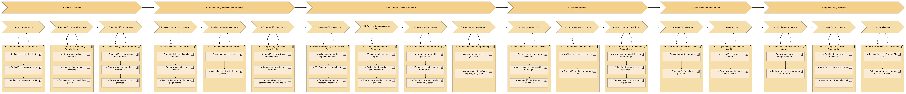

### 4.1. Especificación de Casos de Uso
| **Código** | **Caso de Uso Clave** | **Actor Principal** | **Impacto y Requisito Arquitectónico** |
| :--- | :--- | :--- | :--- |
| CU-01 | Solicitud y Captación | ClienteSolicitante (Cliente / Socio Solicitante), AsesorNegocios (Asesor de Negocios - Captación) | Casos base: CU-1.1 Recepción de solicitud, CU-1.2 Validación de identidad (KYC), CU-1.3 Recolección documental. Actores secundarios / motores: BDSolicitudes (Base de Datos de Solicitudes), ServicioBiometricoRegCivil (Servicio Biométrico y Registro Civil), OficialCumplimientoPLAFT (Oficial de Cumplimiento / Listas PLA-FT), RepositorioExpedienteDigital (Repositorio de Expediente Digital). |
| CU-02 | Recolección y Consolidación de Datos | AnalistaCreditoDatos (Analista de Crédito / Datos) | Casos base: CU-2.1 Recolectar datos internos, CU-2.2 Consultar datos externos, CU-2.3 Integrar y limpiar datos (Automático por el Sistema). Actores secundarios / motores: CoreBancarioDatosInternos (Core Bancario - BD Datos Internos), BuroCentralRiesgosSBSEPS (Buró de Crédito y Central de Riesgos SB/SEPS), MotorIntegracionDatos (Motor de Integración y BD de Datos Consolidados). |
| CU-03 | Evaluación y Cálculo del Score | AnalistaRiesgoCrediticio (Analista de Riesgo Crediticio — recibe y supervisa el resultado final calculado automáticamente por el sistema) | Casos base: CU-3.1 Aplicar filtros de política (Automático por el Sistema), CU-3.2 Analizar capacidad de pago (Automático por el Sistema), CU-3.3 Aplicar modelo de scoring (Automático por el Sistema con LLM y RAG), CU-3.4 Segmentar riesgo crediticio (Automático por el Sistema). Actores secundarios / motores: MotorReglasPoliticas (Motor de Reglas y BD de Políticas), MotorFinancieroCapacidad (Motor Financiero y BD de Capacidad de Pago), MotorScoringLLMRAG (Motor de Scoring Automático con LLM y RAG), MotorSegmentacionRiesgo (Motor de Segmentación y BD de Calificaciones de Riesgo). |
| CU-04 | Decisión Crediticia | AnalistaCredito (Analista de Crédito), ComiteCredito (Comité de Crédito / Jefe de Crédito) | Casos base: CU-4.1 Evaluar en matriz de decisión (Automático por el Sistema), CU-4.2 Realizar revisión manual / comité, CU-4.3 Definir condiciones crediticias. Actores secundarios / motores: MotorMatrizDecisionBDDictamenes (Motor de Matriz de Decisión - BD Dictámenes), BDResolucionesActasComite (BD de Resoluciones y Actas de Comité), BDTarifarioCondiciones (BD de Tarifario y Condiciones Crediticias). |
| CU-05 | Formalización y Desembolso | ClienteSolicitante (Cliente / Socio Solicitante), OficialOperaciones (Oficial de Operaciones / Tesorería) | Casos base: CU-5.1 Gestionar aceptación del cliente, CU-5.2 Ejecutar desembolso del crédito. Actores secundarios / motores: SistemaContratosBDGarantias (Sistema de Contratos y BD de Garantías Legales), CoreBancarioCuentasCartera (Core Bancario - BD Cuentas y Cartera Activa). |
| CU-06 | Seguimiento y Cobranza | AnalistaCarteraRiesgos (Analista de Cartera y Riesgos), GestorCobranza (Gestor de Cobranza) | Casos base: CU-6.1 Monitorear cartera activa (Automático por el Sistema), CU-6.2 Ejecutar gestión de cobranza, CU-6.3 Calcular provisiones contables (Automático por el Sistema). Actores secundarios / motores: BDMonitoreoCarteraAlertas (BD de Monitoreo de Cartera y Motor de Alertas), SistemaCobranzaClienteDeudor (Cliente / Socio Deudor y Sistema de Cobranza), SistemaContableBDProvisiones (Sistema Contable y BD de Provisiones). |

#### CU-01: Solicitud y Captación

| **Campo** | **Contenido** |
| :--- | :--- |
| **ID del Caso de Uso** | CU-01 |
| **Límite del Sistema** | CU-01 — Sistema de Originación y Captación Crediticia — Etapa 1: Solicitud y Captación |
| **Actor Principal** | ClienteSolicitante (Cliente / Socio Solicitante), AsesorNegocios (Asesor de Negocios - Captación) |
| **Actor Secundario / Motores del Sistema** | BDSolicitudes (Base de Datos de Solicitudes), ServicioBiometricoRegCivil (Servicio Biométrico y Registro Civil), OficialCumplimientoPLAFT (Oficial de Cumplimiento / Listas PLA-FT), RepositorioExpedienteDigital (Repositorio de Expediente Digital) |
| **Casos de Uso Base y Subcasos** | • CU-1.1 Recepción de solicitud: «include» Registro de datos del cliente, «include» Definición de monto y plazo, «include» Registro de destino del crédito<br> • CU-1.2 Validación de identidad (KYC): «include» Verificación de cédula de identidad, «include» Validación biométrica del solicitante, «include» Consulta en listas restrictivas (PLA/FT)<br> • CU-1.3 Recolección documental: «include» Recolección de ingresos y roles de pago, «include» Recepción de declaraciones tributarias, «extend» Registro de respaldos y garantías |
| **Prioridad** | Alta (Must) |

**Descripción**

Primera etapa del flujo de valor de evaluación crediticia bancaria en la que el ClienteSolicitante y el AsesorNegocios realizan el caso de uso CU-1.1 Recepción de solicitud (registro de datos del cliente, definición de monto y plazo y registro de destino del crédito) registrando la información en la BDSolicitudes. A continuación, se ejecuta el caso de uso CU-1.2 Validación de identidad (KYC) mediante la verificación de cédula de identidad y la validación biométrica del solicitante en el ServicioBiometricoRegCivil, junto con la consulta en listas restrictivas (PLA/FT) por el OficialCumplimientoPLAFT. Finalmente, se ejecuta el caso de uso CU-1.3 Recolección documental realizando la recolección de ingresos y roles de pago, la recepción de declaraciones tributarias y el registro de respaldos y garantías en el RepositorioExpedienteDigital.

**Precondiciones**

- El ClienteSolicitante acude o ingresa al canal de atención bancaria para presentar su solicitud junto al AsesorNegocios.

- La BDSolicitudes, el ServicioBiometricoRegCivil, el OficialCumplimientoPLAFT y el RepositorioExpedienteDigital deben encontrarse operativos.

**Flujo Principal (Escenario de Éxito)**

| **Paso** | **Flujo de Interacción (Cadena de Entidades y Subcasos del Flujo de Valor)**                                                                                                                                                                    |
|----------|-------------------------------------------------------------------------------------------------------------------------------------------------------------------------------------------------------------------------------------------------|
| **1**    | El ClienteSolicitante inicia el caso de uso recepción de solicitud proporcionando la información para el registro de datos del cliente, la definición de monto y plazo y el registro de destino del crédito ante el AsesorNegocios.             |
| **2**    | El AsesorNegocios ejecuta la recepción de solicitud completando el registro de datos del cliente, la definición de monto y plazo y el registro de destino del crédito en la BDSolicitudes.                                                      |
| **3**    | La BDSolicitudes almacena el registro de datos del cliente, la definición de monto y plazo y el registro de destino del crédito y habilita el caso de uso validación de identidad (KYC) al AsesorNegocios.                                      |
| **4**    | El AsesorNegocios inicia el caso de uso validación de identidad (KYC) solicitando la verificación de cédula de identidad y la validación biométrica del solicitante en el ServicioBiometricoRegCivil.                                           |
| **5**    | El ServicioBiometricoRegCivil procesa automáticamente la verificación de cédula de identidad y la validación biométrica del solicitante y remite la validación de identidad (KYC) al OficialCumplimientoPLAFT.                                  |
| **6**    | El OficialCumplimientoPLAFT completa la validación de identidad (KYC) realizando la consulta en listas restrictivas (PLA/FT) y habilita el caso de uso recolección documental al ClienteSolicitante.                                            |
| **7**    | El ClienteSolicitante realiza el caso de uso recolección documental entregando la recolección de ingresos y roles de pago, la recepción de declaraciones tributarias y el registro de respaldos y garantías en el RepositorioExpedienteDigital. |

**Postcondiciones**

- Queda registrada la recepción de solicitud con el registro de datos del cliente, la definición de monto y plazo y el registro de destino del crédito en la BDSolicitudes (CU-1.1).

- Queda completada la validación de identidad (KYC) mediante la verificación de cédula de identidad, la validación biométrica del solicitante y la consulta en listas restrictivas (PLA/FT) (CU-1.2).

- Queda almacenada la recolección documental con ingresos y roles de pago, declaraciones tributarias y respaldos y garantías en el RepositorioExpedienteDigital (CU-1.3).

#### CU-02: Recolección y Consolidación de Datos

| **Campo** | **Contenido** |
| :--- | :--- |
| **ID del Caso de Uso** | CU-02 |
| **Límite del Sistema** | CU-02 — Sistema de Recolección y Consolidación de Datos — Etapa 2: Recolección y Consolidación |
| **Actor Principal** | AnalistaCreditoDatos (Analista de Crédito / Datos) |
| **Actor Secundario / Motores del Sistema** | CoreBancarioDatosInternos (Core Bancario - BD Datos Internos), BuroCentralRiesgosSBSEPS (Buró de Crédito y Central de Riesgos SB/SEPS), MotorIntegracionDatos (Motor de Integración y BD de Datos Consolidados) |
| **Casos de Uso Base y Subcasos** | • CU-2.1 Recolectar datos internos: «include» Consulta de historial con la entidad, «include» Evaluación de saldos y ahorros, «include» Análisis de comportamiento de pago interno<br> • CU-2.2 Consultar datos externos: «include» Consulta a buró de crédito, «include» Consulta a central de riesgos (SB/SEPS)<br> • CU-2.3 Integrar y limpiar datos (Automático por el Sistema): «include» Depuración de registros e inconsistencias, «extend» Imputación de valores faltantes, «include» Normalización y estandarización de variables |
| **Prioridad** | Alta (Must) |

**Descripción**

Segunda etapa del flujo de valor del historial crediticio bancario en la cual el AnalistaCreditoDatos solicita el caso de uso CU-2.1 Recolectar datos internos (consulta de historial con la entidad, evaluación de saldos y ahorros y análisis de comportamiento de pago interno) en el CoreBancarioDatosInternos, y el caso de uso CU-2.2 Consultar datos externos (consulta a buró de crédito y consulta a central de riesgos SB/SEPS) en el BuroCentralRiesgosSBSEPS. Con ambas fuentes históricas del solicitante, el MotorIntegracionDatos ejecuta automáticamente por el sistema el caso de uso CU-2.3 Integrar y limpiar datos realizando la depuración de registros e inconsistencias, la imputación de valores faltantes y la normalización y estandarización de variables.

**Precondiciones**

- Deben haberse completado la recepción de solicitud, la validación de identidad (KYC) y la recolección documental del CU-01.

- El CoreBancarioDatosInternos, el BuroCentralRiesgosSBSEPS y el MotorIntegracionDatos deben encontrarse operativos.

**Flujo Principal (Escenario de Éxito)**

| **Paso** | **Flujo de Interacción (Cadena de Entidades y Subcasos del Flujo de Valor)**                                                                                                                                                                                                                                    |
|----------|-----------------------------------------------------------------------------------------------------------------------------------------------------------------------------------------------------------------------------------------------------------------------------------------------------------------|
| **1**    | El AnalistaCreditoDatos inicia el caso de uso recolectar datos internos solicitando la consulta de historial con la entidad, la evaluación de saldos y ahorros y el análisis de comportamiento de pago interno en el CoreBancarioDatosInternos.                                                                 |
| **2**    | El CoreBancarioDatosInternos procesa automáticamente la consulta de historial con la entidad, la evaluación de saldos y ahorros y el análisis de comportamiento de pago interno y entrega los datos internos recolectados al AnalistaCreditoDatos.                                                              |
| **3**    | El AnalistaCreditoDatos inicia el caso de uso consultar datos externos ejecutando la consulta a buró de crédito y la consulta a central de riesgos (SB/SEPS) en el BuroCentralRiesgosSBSEPS.                                                                                                                    |
| **4**    | El BuroCentralRiesgosSBSEPS procesa la consulta a buró de crédito y la consulta a central de riesgos (SB/SEPS) y transfiere los antecedentes externos junto con los datos internos al MotorIntegracionDatos.                                                                                                    |
| **5**    | El MotorIntegracionDatos ejecuta automáticamente por el sistema el caso de uso integrar y limpiar datos realizando la depuración de registros e inconsistencias, la imputación de valores faltantes y la normalización y estandarización de variables y entrega los datos consolidados al AnalistaCreditoDatos. |

**Postcondiciones**

- Queda completado el caso de uso CU-2.1 Recolectar datos internos (consulta de historial con la entidad, evaluación de saldos y ahorros y análisis de comportamiento de pago interno) en el CoreBancarioDatosInternos.

- Queda completado el caso de uso CU-2.2 Consultar datos externos (consulta a buró de crédito y consulta a central de riesgos SB/SEPS) en el BuroCentralRiesgosSBSEPS.

- El sistema deja ejecutado automáticamente el caso de uso CU-2.3 Integrar y limpiar datos (depuración de registros e inconsistencias, imputación de valores faltantes y normalización y estandarización de variables) en el MotorIntegracionDatos.

#### CU-03: Evaluación y Cálculo del Score

| **Campo** | **Contenido** |
| :--- | :--- |
| **ID del Caso de Uso** | CU-03 |
| **Límite del Sistema** | CU-03 — Sistema de Evaluación y Cálculo del Score — Etapa 3: Evaluación y Cálculo del Score |
| **Actor Principal** | AnalistaRiesgoCrediticio (Analista de Riesgo Crediticio — recibe y supervisa el resultado final calculado automáticamente por el sistema) |
| **Actor Secundario / Motores del Sistema** | MotorReglasPoliticas (Motor de Reglas y BD de Políticas), MotorFinancieroCapacidad (Motor Financiero y BD de Capacidad de Pago), MotorScoringLLMRAG (Motor de Scoring Automático con LLM y RAG), MotorSegmentacionRiesgo (Motor de Segmentación y BD de Calificaciones de Riesgo) |
| **Casos de Uso Base y Subcasos** | • CU-3.1 Aplicar filtros de política (Automático por el Sistema): «include» Validación de edad y capacidad mínima, «include» Verificación de mora vigente, «include» Control de umbral de sobreendeudamiento<br> • CU-3.2 Analizar capacidad de pago (Automático por el Sistema): «include» Cálculo de ratio cuota / ingreso, «include» Evaluación de nivel de endeudamiento, «include» Determinación de flujo de caja disponible<br> • CU-3.3 Aplicar modelo de scoring (Automático por el Sistema con LLM y RAG): «include» Inferencia automática mediante LLM y RAG, «include» Cálculo de probabilidad de default (PD), «include» Transformación a puntaje crediticio (Score)<br> • CU-3.4 Segmentar riesgo crediticio (Automático por el Sistema): «include» Evaluación de puntos de corte (cut-offs), «include» Asignación a categoría de riesgo (A, B, C, D, E) |
| **Prioridad** | Alta (Must) |

**Descripción**

Tercera etapa del flujo de valor en la cual el inicio y cálculo de toda la evaluación y del modelo de scoring es realizado de manera completamente automática por el sistema, sin que el AnalistaRiesgoCrediticio inicie ni calcule manualmente el modelo. El MotorReglasPoliticas inicia automáticamente el caso de uso CU-3.1 Aplicar filtros de política (validación de edad y capacidad mínima, verificación de mora vigente y control de umbral de sobreendeudamiento) y encadena el expediente hacia el MotorFinancieroCapacidad para ejecutar automáticamente el caso de uso CU-3.2 Analizar capacidad de pago (cálculo de ratio cuota / ingreso, evaluación de nivel de endeudamiento y determinación de flujo de caja disponible). Seguidamente, el MotorScoringLLMRAG ejecuta automáticamente el caso de uso CU-3.3 Aplicar modelo de scoring mediante el modelo LLM y RAG (inferencia automática mediante LLM y RAG, cálculo de probabilidad de default PD y transformación a puntaje crediticio Score) y transfiere el puntaje al MotorSegmentacionRiesgo, el cual ejecuta automáticamente el caso de uso CU-3.4 Segmentar riesgo crediticio (evaluación de puntos de corte cut-offs y asignación a categoría de riesgo A, B, C, D, E) y entrega el resultado final calculado al AnalistaRiesgoCrediticio.

**Precondiciones**

- Los datos internos y externos del solicitante deben encontrarse integrados y limpios tras el CU-02.

- El MotorReglasPoliticas, el MotorFinancieroCapacidad, el MotorScoringLLMRAG y el MotorSegmentacionRiesgo deben encontrarse operativos.

**Flujo Principal (Escenario de Éxito)**

| **Paso** | **Flujo de Interacción (Cadena de Entidades y Subcasos del Flujo de Valor)**                                                                                                                                                                                                                                           |
|----------|------------------------------------------------------------------------------------------------------------------------------------------------------------------------------------------------------------------------------------------------------------------------------------------------------------------------|
| **1**    | El MotorReglasPoliticas inicia y ejecuta automáticamente por el sistema el caso de uso aplicar filtros de política realizando la validación de edad y capacidad mínima, la verificación de mora vigente y el control de umbral de sobreendeudamiento y transfiere el expediente aprobado al MotorFinancieroCapacidad.  |
| **2**    | El MotorFinancieroCapacidad ejecuta automáticamente por el sistema el caso de uso analizar capacidad de pago realizando el cálculo de ratio cuota / ingreso, la evaluación de nivel de endeudamiento y la determinación de flujo de caja disponible y envía los indicadores calculados al MotorScoringLLMRAG.          |
| **3**    | El MotorScoringLLMRAG ejecuta automáticamente por el sistema el caso de uso aplicar modelo de scoring realizando la inferencia automática mediante LLM y RAG, el cálculo de probabilidad de default (PD) y la transformación a puntaje crediticio (Score) y transfiere el puntaje obtenido al MotorSegmentacionRiesgo. |
| **4**    | El MotorSegmentacionRiesgo ejecuta automáticamente por el sistema el caso de uso segmentar riesgo crediticio mediante la evaluación de puntos de corte (cut-offs) y la asignación a categoría de riesgo (A, B, C, D, E) y entrega el puntaje y la calificación calculados al AnalistaRiesgoCrediticio.                 |

**Postcondiciones**

- El MotorReglasPoliticas deja ejecutado automáticamente el caso de uso CU-3.1 Aplicar filtros de política (validación de edad y capacidad mínima, verificación de mora vigente y control de umbral de sobreendeudamiento).

- El MotorFinancieroCapacidad deja calculado automáticamente el caso de uso CU-3.2 Analizar capacidad de pago (ratio cuota / ingreso, nivel de endeudamiento y flujo de caja disponible).

- El MotorScoringLLMRAG deja calculado automáticamente con el modelo LLM y RAG el caso de uso CU-3.3 Aplicar modelo de scoring (PD y Score) y el MotorSegmentacionRiesgo entrega la categoría de riesgo (A, B, C, D, E) al AnalistaRiesgoCrediticio (CU-3.4).

#### CU-04: Decisión Crediticia

| **Campo** | **Contenido** |
| :--- | :--- |
| **ID del Caso de Uso** | CU-04 |
| **Límite del Sistema** | CU-04 — Sistema de Dictamen y Comité de Crédito — Etapa 4: Decisión Crediticia |
| **Actor Principal** | AnalistaCredito (Analista de Crédito), ComiteCredito (Comité de Crédito / Jefe de Crédito) |
| **Actor Secundario / Motores del Sistema** | MotorMatrizDecisionBDDictamenes (Motor de Matriz de Decisión - BD Dictámenes), BDResolucionesActasComite (BD de Resoluciones y Actas de Comité), BDTarifarioCondiciones (BD de Tarifario y Condiciones Crediticias) |
| **Casos de Uso Base y Subcasos** | • CU-4.1 Evaluar en matriz de decisión (Automático por el Sistema): «include» Cruce de score vs. monto solicitado, «include» Contrastación contra política de riesgo, «include» Generación de dictamen automático<br> • CU-4.2 Realizar revisión manual / comité: «extend» Análisis de casos en zona gris, «extend» Evaluación y fallo para montos altos<br> • CU-4.3 Definir condiciones crediticias: «include» Asignación de tasa de interés según riesgo, «include» Definición de plazo y cupo aprobado, «include» Establecimiento de garantías requeridas |
| **Prioridad** | Alta (Must) |

**Descripción**

Cuarta etapa del flujo de valor en la que el MotorMatrizDecisionBDDictamenes ejecuta automáticamente por el sistema el caso de uso CU-4.1 Evaluar en matriz de decisión (cruce de score vs. monto solicitado, contrastación contra política de riesgo y generación de dictamen automático) y entrega el resultado al AnalistaCredito. Cuando la solicitud se ubica en zona gris o corresponde a un monto alto, el AnalistaCredito la deriva al ComiteCredito para ejecutar el caso de uso CU-4.2 Realizar revisión manual / comité (análisis de casos en zona gris y evaluación y fallo para montos altos), registrándose el fallo en la BDResolucionesActasComite. Finalmente, se ejecuta el caso de uso CU-4.3 Definir condiciones crediticias (asignación de tasa de interés según riesgo, definición de plazo y cupo aprobado y establecimiento de garantías requeridas) en la BDTarifarioCondiciones.

**Precondiciones**

- El sistema debe haber calculado automáticamente el puntaje crediticio y la segmentación de riesgo (A, B, C, D, E) en el CU-03.

- El MotorMatrizDecisionBDDictamenes, la BDResolucionesActasComite y la BDTarifarioCondiciones deben encontrarse operativos.

**Flujo Principal (Escenario de Éxito)**

| **Paso** | **Flujo de Interacción (Cadena de Entidades y Subcasos del Flujo de Valor)**                                                                                                                                                                                                                           |
|----------|--------------------------------------------------------------------------------------------------------------------------------------------------------------------------------------------------------------------------------------------------------------------------------------------------------|
| **1**    | El MotorMatrizDecisionBDDictamenes ejecuta automáticamente por el sistema el caso de uso evaluar en matriz de decisión realizando el cruce de score vs. monto solicitado, la contrastación contra política de riesgo y la generación de dictamen automático y entrega el resultado al AnalistaCredito. |
| **2**    | El AnalistaCredito revisa el dictamen emitido por la matriz y, en operaciones de zona gris o montos altos, inicia el caso de uso realizar revisión manual / comité solicitando el análisis de casos en zona gris y la evaluación y fallo para montos altos al ComiteCredito.                           |
| **3**    | El ComiteCredito ejecuta el caso de uso realizar revisión manual / comité completando el análisis de casos en zona gris y la evaluación y fallo para montos altos en la BDResolucionesActasComite.                                                                                                     |
| **4**    | La BDResolucionesActasComite almacena el análisis de casos en zona gris y la evaluación y fallo para montos altos y confirma la autorización al AnalistaCredito.                                                                                                                                       |
| **5**    | El AnalistaCredito inicia el caso de uso definir condiciones crediticias ejecutando la asignación de tasa de interés según riesgo, la definición de plazo y cupo aprobado y el establecimiento de garantías requeridas en la BDTarifarioCondiciones.                                                   |
| **6**    | La BDTarifarioCondiciones procesa la asignación de tasa de interés según riesgo, la definición de plazo y cupo aprobado y el establecimiento de garantías requeridas y confirma las condiciones crediticias al AnalistaCredito.                                                                        |

**Postcondiciones**

- El MotorMatrizDecisionBDDictamenes deja ejecutado automáticamente el caso de uso CU-4.1 Evaluar en matriz de decisión (cruce de score vs. monto solicitado, contrastación contra política de riesgo y generación de dictamen automático).

- Para casos en zona gris o montos altos, queda registrado el caso de uso CU-4.2 Realizar revisión manual / comité en la BDResolucionesActasComite.

- Queda completado el caso de uso CU-4.3 Definir condiciones crediticias (asignación de tasa de interés según riesgo, definición de plazo y cupo aprobado y establecimiento de garantías requeridas) en la BDTarifarioCondiciones.

#### CU-05: Formalización y Desembolso

| **Campo** | **Contenido** |
| :--- | :--- |
| **ID del Caso de Uso** | CU-05 |
| **Límite del Sistema** | CU-05 — Sistema de Formalización y Desembolso — Etapa 5: Formalización y Desembolso |
| **Actor Principal** | ClienteSolicitante (Cliente / Socio Solicitante), OficialOperaciones (Oficial de Operaciones / Tesorería) |
| **Actor Secundario / Motores del Sistema** | SistemaContratosBDGarantias (Sistema de Contratos y BD de Garantías Legales), CoreBancarioCuentasCartera (Core Bancario - BD Cuentas y Cartera Activa) |
| **Casos de Uso Base y Subcasos** | • CU-5.1 Gestionar aceptación del cliente: «include» Firma de contrato y pagaré, «include» Constitución formal de garantías<br> • CU-5.2 Ejecutar desembolso del crédito: «include» Acreditación de fondos en cuenta, «include» Generación de tabla de amortización |
| **Prioridad** | Alta (Must) |

**Descripción**

Quinta etapa del flujo de valor donde el ClienteSolicitante y el OficialOperaciones ejecutan el caso de uso CU-5.1 Gestionar aceptación del cliente realizando la firma de contrato y pagaré y la constitución formal de garantías en el SistemaContratosBDGarantias. Posteriormente, el OficialOperaciones autoriza el caso de uso CU-5.2 Ejecutar desembolso del crédito en el CoreBancarioCuentasCartera, el cual realiza automáticamente la acreditación de fondos en cuenta y la generación de tabla de amortización.

**Precondiciones**

- Deben haberse completado la evaluación en matriz de decisión, la revisión manual / comité (cuando aplique) y la definición de condiciones crediticias del CU-04.

- El SistemaContratosBDGarantias y el CoreBancarioCuentasCartera deben encontrarse operativos.

**Flujo Principal (Escenario de Éxito)**

| **Paso** | **Flujo de Interacción (Cadena de Entidades y Subcasos del Flujo de Valor)**                                                                                                                                              |
|----------|---------------------------------------------------------------------------------------------------------------------------------------------------------------------------------------------------------------------------|
| **1**    | El ClienteSolicitante inicia el caso de uso gestionar aceptación del cliente realizando la firma de contrato y pagaré y la constitución formal de garantías junto al OficialOperaciones.                                  |
| **2**    | El OficialOperaciones procesa el caso de uso gestionar aceptación del cliente registrando la firma de contrato y pagaré y la constitución formal de garantías en el SistemaContratosBDGarantias.                          |
| **3**    | El SistemaContratosBDGarantias confirma el registro de la firma de contrato y pagaré y la constitución formal de garantías y habilita el caso de uso ejecutar desembolso del crédito al OficialOperaciones.               |
| **4**    | El OficialOperaciones inicia el caso de uso ejecutar desembolso del crédito autorizando la operación en el CoreBancarioCuentasCartera.                                                                                    |
| **5**    | El CoreBancarioCuentasCartera ejecuta automáticamente por el sistema la acreditación de fondos en cuenta y la generación de tabla de amortización y entrega el desembolso y el cronograma de pagos al ClienteSolicitante. |

**Postcondiciones**

- Queda registrado el caso de uso CU-5.1 Gestionar aceptación del cliente (firma de contrato y pagaré y constitución formal de garantías) en el SistemaContratosBDGarantias.

- El CoreBancarioCuentasCartera deja ejecutado automáticamente el caso de uso CU-5.2 Ejecutar desembolso del crédito (acreditación de fondos en cuenta y generación de tabla de amortización).

#### CU-06: Seguimiento y Cobranza

| **Campo** | **Contenido** |
| :--- | :--- |
| **ID del Caso de Uso** | CU-06 |
| **Límite del Sistema** | CU-06 — Sistema de Seguimiento, Cobranza y Provisiones — Etapa 6: Seguimiento y Cobranza |
| **Actor Principal** | AnalistaCarteraRiesgos (Analista de Cartera y Riesgos), GestorCobranza (Gestor de Cobranza) |
| **Actor Secundario / Motores del Sistema** | BDMonitoreoCarteraAlertas (BD de Monitoreo de Cartera y Motor de Alertas), SistemaCobranzaClienteDeudor (Cliente / Socio Deudor y Sistema de Cobranza), SistemaContableBDProvisiones (Sistema Contable y BD de Provisiones) |
| **Casos de Uso Base y Subcasos** | • CU-6.1 Monitorear cartera activa (Automático por el Sistema): «include» Ejecución de score de comportamiento, «include» Emisión de alertas tempranas de deterioro<br> • CU-6.2 Ejecutar gestión de cobranza: «include» Gestión de cobranza preventiva, «include» Gestión de cobranza temprana, «extend» Gestión de cobranza judicial<br> • CU-6.3 Calcular provisiones contables (Automático por el Sistema): «include» Estimación de parámetros PD, LGD y EAD, «include» Cálculo de pérdida esperada (PD × LGD × EAD) |
| **Prioridad** | Alta (Must) |

**Descripción**

Sexta etapa del flujo de valor en la cual la BDMonitoreoCarteraAlertas ejecuta automáticamente por el sistema el caso de uso CU-6.1 Monitorear cartera activa (ejecución de score de comportamiento y emisión de alertas tempranas de deterioro) y reporta las alertas al AnalistaCarteraRiesgos. Con base en dicho monitoreo, el AnalistaCarteraRiesgos deriva los casos al GestorCobranza, quien ejecuta el caso de uso CU-6.2 Ejecutar gestión de cobranza aplicando la gestión de cobranza preventiva, la gestión de cobranza temprana y la gestión de cobranza judicial en el SistemaCobranzaClienteDeudor. Finalmente, el SistemaContableBDProvisiones ejecuta automáticamente por el sistema el caso de uso CU-6.3 Calcular provisiones contables realizando la estimación de parámetros PD, LGD y EAD y el cálculo de pérdida esperada (PD × LGD × EAD) y entrega el reporte contable al AnalistaCarteraRiesgos.

**Precondiciones**

- El crédito debe haber sido desembolsado y encontrarse activo en cartera tras el CU-05.

- La BDMonitoreoCarteraAlertas, el SistemaCobranzaClienteDeudor y el SistemaContableBDProvisiones deben encontrarse operativos.

**Flujo Principal (Escenario de Éxito)**

| **Paso** | **Flujo de Interacción (Cadena de Entidades y Subcasos del Flujo de Valor)**                                                                                                                                                                                                  |
|----------|-------------------------------------------------------------------------------------------------------------------------------------------------------------------------------------------------------------------------------------------------------------------------------|
| **1**    | La BDMonitoreoCarteraAlertas ejecuta automáticamente por el sistema el caso de uso monitorear cartera activa realizando la ejecución de score de comportamiento y la emisión de alertas tempranas de deterioro y entrega los resultados al AnalistaCarteraRiesgos.            |
| **2**    | El AnalistaCarteraRiesgos revisa las alertas emitidas por el sistema en el monitoreo de cartera activa y asigna los casos identificados al GestorCobranza.                                                                                                                    |
| **3**    | El GestorCobranza ejecuta el caso de uso ejecutar gestión de cobranza aplicando la gestión de cobranza preventiva, la gestión de cobranza temprana y la gestión de cobranza judicial en el SistemaCobranzaClienteDeudor.                                                      |
| **4**    | El SistemaCobranzaClienteDeudor procesa el resultado de la gestión de cobranza preventiva, la gestión de cobranza temprana y la gestión de cobranza judicial y transfiere el estado actualizado de la cartera al SistemaContableBDProvisiones.                                |
| **5**    | El SistemaContableBDProvisiones ejecuta automáticamente por el sistema el caso de uso calcular provisiones contables realizando la estimación de parámetros PD, LGD y EAD y el cálculo de pérdida esperada (PD × LGD × EAD) y entrega el resultado al AnalistaCarteraRiesgos. |

**Postcondiciones**

- La BDMonitoreoCarteraAlertas deja ejecutado automáticamente el caso de uso CU-6.1 Monitorear cartera activa (ejecución de score de comportamiento y emisión de alertas tempranas de deterioro).

- Queda ejecutado el caso de uso CU-6.2 Ejecutar gestión de cobranza (gestión de cobranza preventiva, gestión de cobranza temprana y gestión de cobranza judicial) en el SistemaCobranzaClienteDeudor.

- El SistemaContableBDProvisiones deja ejecutado automáticamente el caso de uso CU-6.3 Calcular provisiones contables (estimación de parámetros PD, LGD y EAD y cálculo de pérdida esperada PD × LGD × EAD).

### 4.2. Diagramas de Casos de Uso

**Figura 4.1.** CU-01: Solicitud y Captación

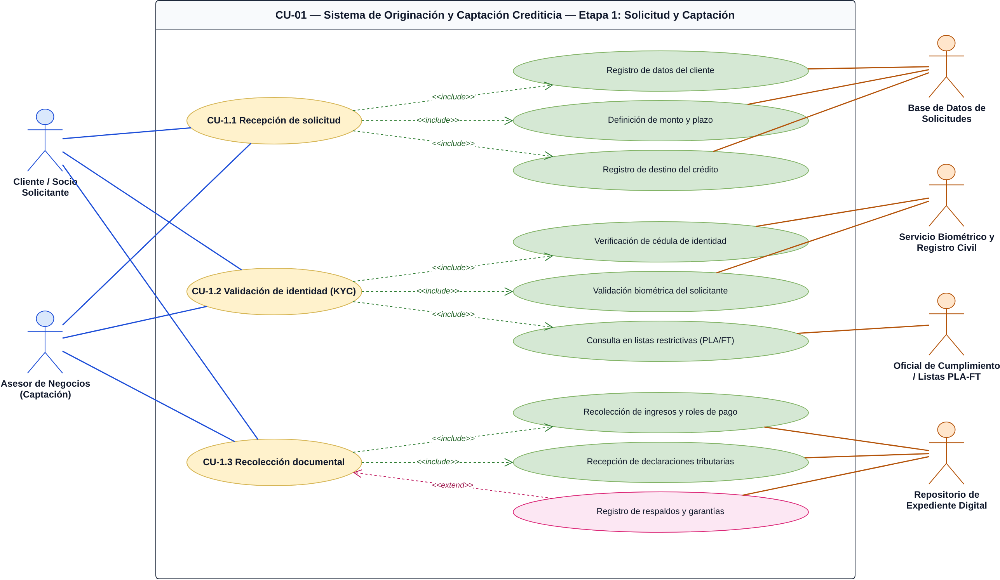

**Figura 4.2.** CU-02: Recolección y Consolidación de Datos

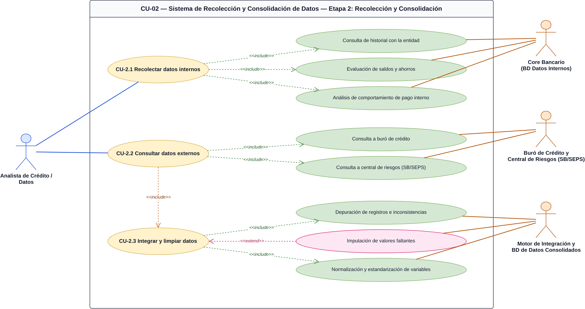

**Figura 4.3.** CU-03: Evaluación y Cálculo del Score

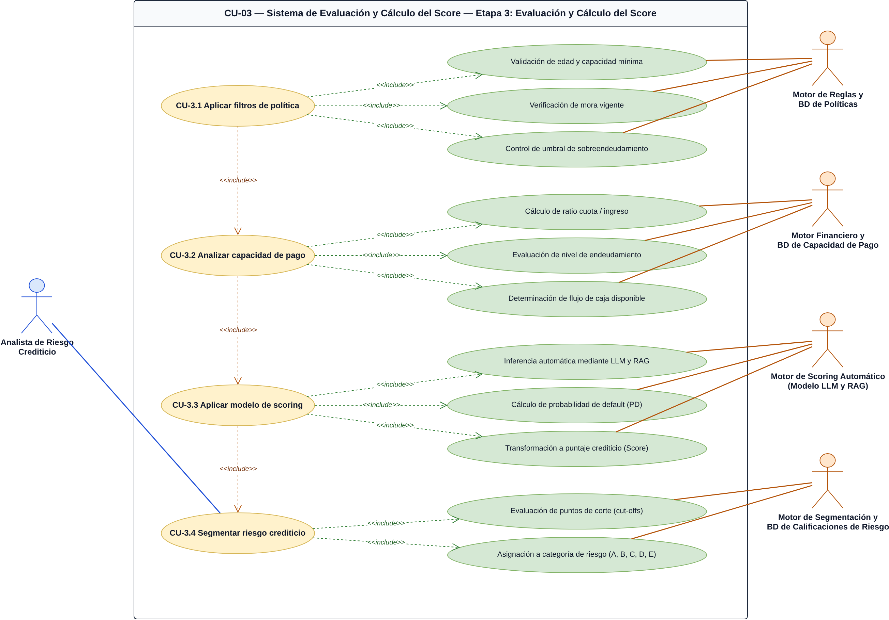

**Figura 4.4.** CU-04: Decisión Crediticia

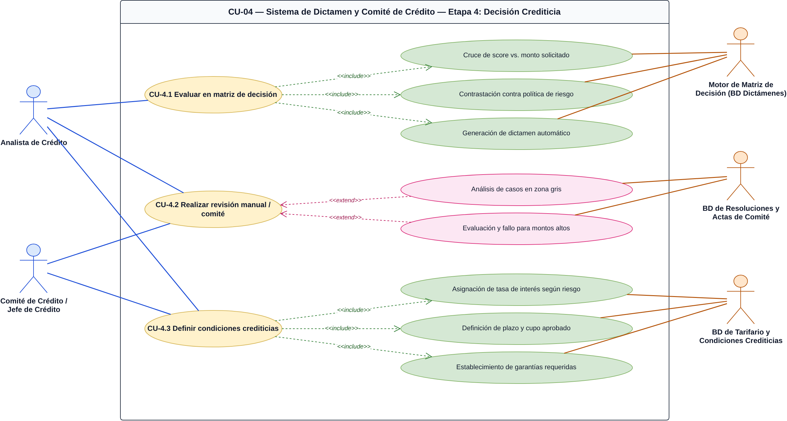

**Figura 4.5.** CU-05: Formalización y Desembolso

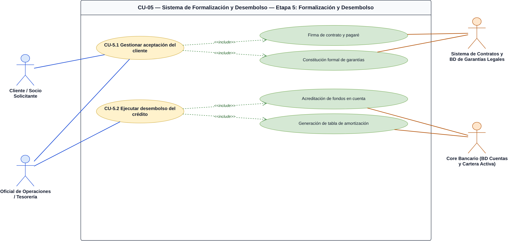

**Figura 4.6.** CU-06: Seguimiento y Cobranza

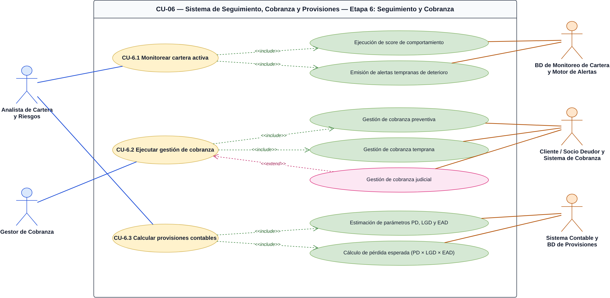

---

## 6. VISTA LÓGICA

### 6.1. Visión General
La Vista Lógica representa la descomposición funcional del sistema en componentes de software y sus abstracciones de dominio. Aplica el patrón Borde-Control-Entidad (BCE) para garantizar que las responsabilidades de interfaz, lógica de cálculo e ingesta de datos permanezcan desacopladas.

### 6.2. Diagrama de Clases

**Figura 6.0.** DC-00: Diagrama de Clases General Integrado (6 Etapas)

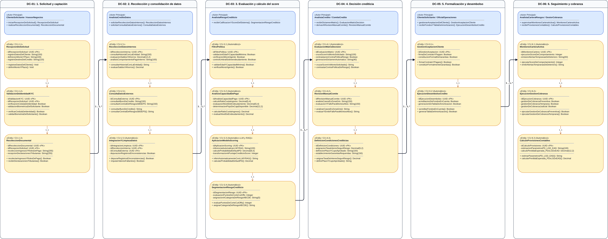

**Figura 6.1.** DC-01: 1. Solicitud y captación

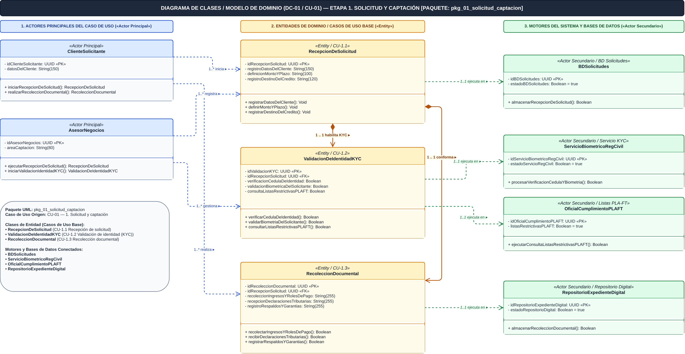

**Figura 6.2.** DC-02: 2. Recolección y consolidación de datos

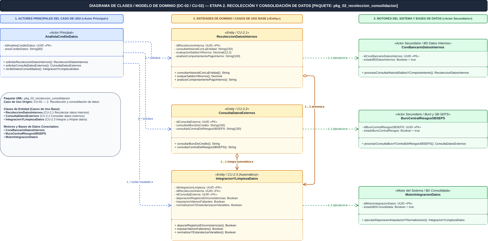

**Figura 6.3.** DC-03: 3. Evaluación y cálculo del score

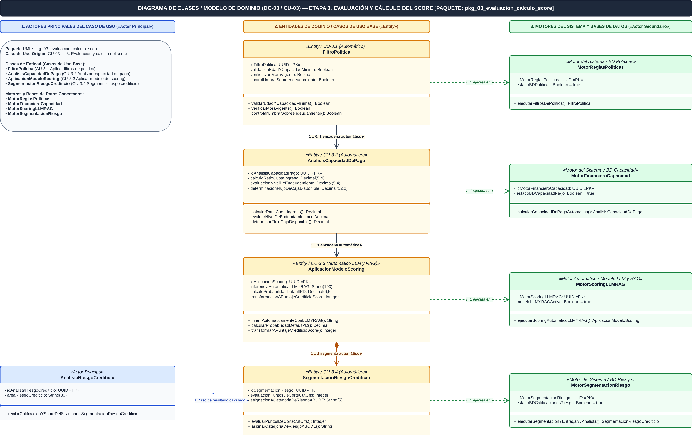

**Figura 6.4.** DC-04: 4. Decisión crediticia

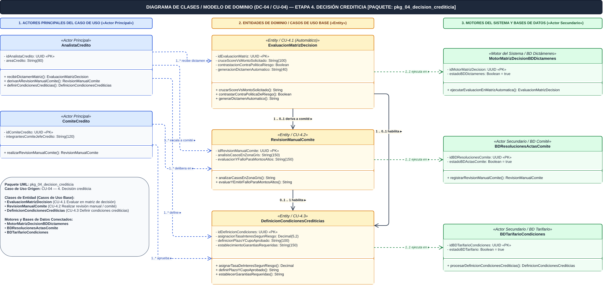

**Figura 6.5.** DC-05: 5. Formalización y desembolso

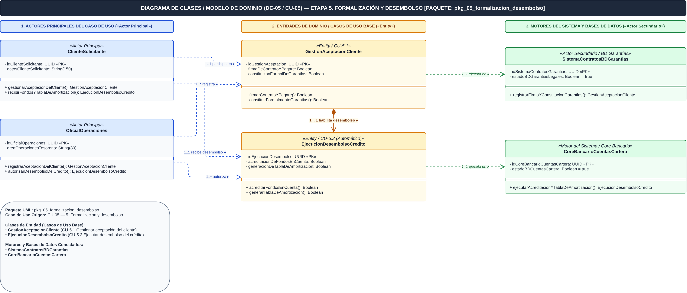

**Figura 6.6.** DC-06: 6. Seguimiento y cobranza

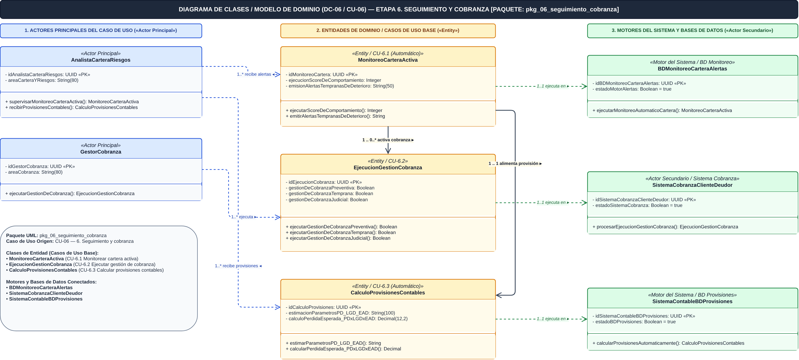

### 6.3. Diccionario de Clases
Modelo de dominio estandarizado en **5 columnas uniformes (`Entidad`, `Atributos`, `Operación`, `Tipo de relación`, `Entidad relacionada`)** para las **6 etapas del flujo de valor crediticio (`CU-01` a `CU-06`)**, reflejando en `DC-03` el cálculo automático de scoring con **LLM y RAG**.

#### Etapa 1: Solicitud y Captación (`DC-01` / `CU-01`)

| Entidad | Atributos | Operación | Tipo de relación | Entidad relacionada |
| :--- | :--- | :--- | :--- | :--- |
| **ClienteSolicitante**<br>`«Actor Principal»` | `- idClienteSolicitante: UUID «PK»`<br>`- datosDelCliente: String(150)` | `+ iniciarRecepcionDeSolicitud(): RecepcionDeSolicitud`<br>`+ realizarRecoleccionDocumental(): RecoleccionDocumental` | • Asociación (`1 .. 1..* inicia ▸`)<br>• Asociación (`1 .. 1..* realiza ▸`) | • `RecepcionDeSolicitud`<br>• `RecoleccionDocumental` |
| **AsesorNegocios**<br>`«Actor Principal»` | `- idAsesorNegocios: UUID «PK»`<br>`- areaCaptacion: String(80)` | `+ ejecutarRecepcionDeSolicitud(): RecepcionDeSolicitud`<br>`+ iniciarValidacionIdentidadKYC(): ValidacionDeIdentidadKYC` | • Asociación (`1 .. 1..* registra ▸`)<br>• Asociación (`1 .. 1..* gestiona ▸`) | • `RecepcionDeSolicitud`<br>• `ValidacionDeIdentidadKYC` |
| **RecepcionDeSolicitud**<br>`«Entity / CU-1.1»` | `- idRecepcionSolicitud: UUID «PK»`<br>`- registroDatosDelCliente: String(150)`<br>`- definicionMontoYPlazo: String(100)`<br>`- registroDestinoDelCredito: String(120)` | `+ registrarDatosDelCliente(): Void`<br>`+ definirMontoYPlazo(): Void`<br>`+ registrarDestinoDelCredito(): Void` | • Asociación (`1 .. 1 ejecuta en ▸`)<br>• Composición (`1 .. 1 habilita KYC ▸`)<br>• Composición (`1 .. 1 conforma ▸`) | • `BDSolicitudes`<br>• `ValidacionDeIdentidadKYC`<br>• `RecoleccionDocumental` |
| **ValidacionDeIdentidadKYC**<br>`«Entity / CU-1.2»` | `- idValidacionKYC: UUID «PK»`<br>`- idRecepcionSolicitud: UUID «FK»`<br>`- verificacionCedulaDeIdentidad: Boolean`<br>`- validacionBiometricaDelSolicitante: Boolean`<br>`- consultaListasRestrictivasPLAFT: Boolean` | `+ verificarCedulaDeIdentidad(): Boolean`<br>`+ validarBiometriaDelSolicitante(): Boolean`<br>`+ consultarListasRestrictivasPLAFT(): Boolean` | • Asociación (`1 .. 1 ejecuta en ▸`)<br>• Asociación (`1 .. 1 ejecuta en ▸`) | • `ServicioBiometricoRegCivil`<br>• `OficialCumplimientoPLAFT` |
| **RecoleccionDocumental**<br>`«Entity / CU-1.3»` | `- idRecoleccionDocumental: UUID «PK»`<br>`- idRecepcionSolicitud: UUID «FK»`<br>`- recoleccionIngresosYRolesDePago: String(255)`<br>`- recepcionDeclaracionesTributarias: String(255)`<br>`- registroRespaldosYGarantias: String(255)` | `+ recolectarIngresosYRolesDePago(): Boolean`<br>`+ recibirDeclaracionesTributarias(): Boolean`<br>`+ registrarRespaldosYGarantias(): Boolean` | • Asociación (`1 .. 1 ejecuta en ▸`) | • `RepositorioExpedienteDigital` |
| **BDSolicitudes**<br>`«Actor Secundario / BD Solicitudes»` | `- idBDSolicitudes: UUID «PK»`<br>`- estadoBDSolicitudes: Boolean = true` | `+ almacenarRecepcionDeSolicitud(): Boolean` | • Asociación entrante (`1 .. 1..* custodia`) | • `RecepcionDeSolicitud` |
| **ServicioBiometricoRegCivil**<br>`«Actor Secundario / Servicio KYC»` | `- idServicioBiometricoRegCivil: UUID «PK»`<br>`- estadoServicioRegCivil: Boolean = true` | `+ procesarVerificacionCedulaYBiometria(): Boolean` | • Asociación entrante (`1 .. 1..* valida`) | • `ValidacionDeIdentidadKYC` |
| **OficialCumplimientoPLAFT**<br>`«Actor Secundario / Listas PLA-FT»` | `- idOficialCumplimientoPLAFT: UUID «PK»`<br>`- listasRestrictivasPLAFT: Boolean = true` | `+ ejecutarConsultaListasRestrictivasPLAFT(): Boolean` | • Asociación entrante (`1 .. 1..* controla`) | • `ValidacionDeIdentidadKYC` |
| **RepositorioExpedienteDigital**<br>`«Actor Secundario / Repositorio Digital»` | `- idRepositorioExpedienteDigital: UUID «PK»`<br>`- estadoRepositorioDigital: Boolean = true` | `+ almacenarRecoleccionDocumental(): Boolean` | • Asociación entrante (`1 .. 1..* almacena`) | • `RecoleccionDocumental` |

#### Etapa 2: Recolección y Consolidación de Datos (`DC-02` / `CU-02`)

| Entidad | Atributos | Operación | Tipo de relación | Entidad relacionada |
| :--- | :--- | :--- | :--- | :--- |
| **AnalistaCreditoDatos**<br>`«Actor Principal»` | `- idAnalistaCreditoDatos: UUID «PK»`<br>`- areaCreditoDatos: String(80)` | `+ solicitarRecoleccionDatosInternos(): RecoleccionDatosInternos`<br>`+ solicitarConsultaDatosExternos(): ConsultaDatosExternos`<br>`+ recibirDatosConsolidados(): IntegracionYLimpiezaDatos` | • Asociación (`1 .. 1..* solicita ▸`)<br>• Asociación (`1 .. 1..* solicita ▸`)<br>• Asociación (`1 .. 1..* recibe resultado ◂`) | • `RecoleccionDatosInternos`<br>• `ConsultaDatosExternos`<br>• `IntegracionYLimpiezaDatos` |
| **RecoleccionDatosInternos**<br>`«Entity / CU-2.1»` | `- idRecoleccionInterna: UUID «PK»`<br>`- consultaHistorialConLaEntidad: String(150)`<br>`- evaluacionSaldosYAhorros: Decimal(12,2)`<br>`- analisisComportamientoPagoInterno: String(100)` | `+ consultarHistorialConLaEntidad(): String`<br>`+ evaluarSaldosYAhorros(): Decimal`<br>`+ analizarComportamientoPagoInterno(): String` | • Asociación (`1 .. 1 ejecuta en ▸`)<br>• Agregación (`1 .. 1 alimenta ▸`) | • `CoreBancarioDatosInternos`<br>• `IntegracionYLimpiezaDatos` |
| **ConsultaDatosExternos**<br>`«Entity / CU-2.2»` | `- idConsultaExterna: UUID «PK»`<br>`- consultaABuroDeCredito: String(150)`<br>`- consultaACentralDeRiesgosSBSEPS: String(150)` | `+ consultarBuroDeCredito(): String`<br>`+ consultarCentralDeRiesgosSBSEPS(): String` | • Asociación (`1 .. 1 ejecuta en ▸`)<br>• Agregación (`1 .. 1 integra automático ▸`) | • `BuroCentralRiesgosSBSEPS`<br>• `IntegracionYLimpiezaDatos` |
| **IntegracionYLimpiezaDatos**<br>`«Entity / CU-2.3 (Automático)»` | `- idIntegracionLimpieza: UUID «PK»`<br>`- idRecoleccionInterna: UUID «FK»`<br>`- idConsultaExterna: UUID «FK»`<br>`- depuracionRegistrosEInconsistencias: Boolean`<br>`- imputacionValoresFaltantes: Boolean`<br>`- normalizacionYEstandarizacionVariables: Boolean` | `+ depurarRegistrosEInconsistencias(): Boolean`<br>`+ imputarValoresFaltantes(): Boolean`<br>`+ normalizarYEstandarizarVariables(): Boolean` | • Agregación entrante (`1 .. 1 integra`)<br>• Asociación (`1 .. 1 ejecuta en ▸`) | • `RecoleccionDatosInternos` / `ConsultaDatosExternos`<br>• `MotorIntegracionDatos` |
| **CoreBancarioDatosInternos**<br>`«Actor Secundario / BD Datos Internos»` | `- idCoreBancarioDatosInternos: UUID «PK»`<br>`- estadoBDDatosInternos: Boolean = true` | `+ procesarConsultaHistorialSaldosYComportamiento(): RecoleccionDatosInternos` | • Asociación entrante (`1 .. 1..* provee`) | • `RecoleccionDatosInternos` |
| **BuroCentralRiesgosSBSEPS**<br>`«Actor Secundario / Buró y SB-SEPS»` | `- idBuroCentralRiesgosSBSEPS: UUID «PK»`<br>`- estadoBuroCentralRiesgos: Boolean = true` | `+ procesarConsultaBuroYCentralDeRiesgosSBSEPS(): ConsultaDatosExternos` | • Asociación entrante (`1 .. 1..* provee`) | • `ConsultaDatosExternos` |
| **MotorIntegracionDatos**<br>`«Motor del Sistema / BD Consolidada»` | `- idMotorIntegracionDatos: UUID «PK»`<br>`- estadoBDConsolidada: Boolean = true` | `+ ejecutarDepuracionImputacionYNormalizacion(): IntegracionYLimpiezaDatos` | • Asociación entrante (`1 .. 1..* consolida`) | • `IntegracionYLimpiezaDatos` |

#### Etapa 3: Evaluación y Cálculo del Score (`DC-03` / `CU-03`)

| Entidad | Atributos | Operación | Tipo de relación | Entidad relacionada |
| :--- | :--- | :--- | :--- | :--- |
| **AnalistaRiesgoCrediticio**<br>`«Actor Principal»` | `- idAnalistaRiesgoCrediticio: UUID «PK»`<br>`- areaRiesgoCrediticio: String(80)` | `+ recibirCalificacionYScoreDelSistema(): SegmentacionRiesgoCrediticio` | • Asociación (`1 .. 1..* recibe resultado calculado ◂`) | • `SegmentacionRiesgoCrediticio` |
| **FiltroPolitica**<br>`«Entity / CU-3.1 (Automático)»` | `- idFiltroPolitica: UUID «PK»`<br>`- validacionEdadYCapacidadMinima: Boolean`<br>`- verificacionMoraVigente: Boolean`<br>`- controlUmbralSobreendeudamiento: Boolean` | `+ validarEdadYCapacidadMinima(): Boolean`<br>`+ verificarMoraVigente(): Boolean`<br>`+ controlarUmbralSobreendeudamiento(): Boolean` | • Asociación (`1 .. 1 ejecuta en ▸`)<br>• Asociación (`1 .. 0..1 encadena automático ▸`) | • `MotorReglasPoliticas`<br>• `AnalisisCapacidadDePago` |
| **AnalisisCapacidadDePago**<br>`«Entity / CU-3.2 (Automático)»` | `- idAnalisisCapacidadPago: UUID «PK»`<br>`- calculoRatioCuotaIngreso: Decimal(5,4)`<br>`- evaluacionNivelDeEndeudamiento: Decimal(5,4)`<br>`- determinacionFlujoDeCajaDisponible: Decimal(12,2)` | `+ calcularRatioCuotaIngreso(): Decimal`<br>`+ evaluarNivelDeEndeudamiento(): Decimal`<br>`+ determinarFlujoCajaDisponible(): Decimal` | • Asociación (`1 .. 1 ejecuta en ▸`)<br>• Asociación (`1 .. 1 encadena automático ▸`) | • `MotorFinancieroCapacidad`<br>• `AplicacionModeloScoring` |
| **AplicacionModeloScoring**<br>`«Entity / CU-3.3 (Automático LLM y RAG)»` | `- idAplicacionScoring: UUID «PK»`<br>`- inferenciaAutomaticaLLMYRAG: String(100)`<br>`- calculoProbabilidadDefaultPD: Decimal(6,5)`<br>`- transformacionAPuntajeCrediticioScore: Integer` | `+ inferirAutomaticamenteConLLMYRAG(): String`<br>`+ calcularProbabilidadDefaultPD(): Decimal`<br>`+ transformarAPuntajeCrediticioScore(): Integer` | • Asociación (`1 .. 1 ejecuta en ▸`)<br>• Composición (`1 .. 1 segmenta automático ▸`) | • `MotorScoringLLMRAG`<br>• `SegmentacionRiesgoCrediticio` |
| **SegmentacionRiesgoCrediticio**<br>`«Entity / CU-3.4 (Automático)»` | `- idSegmentacionRiesgo: UUID «PK»`<br>`- evaluacionPuntosDeCorteCutOffs: Integer`<br>`- asignacionACategoriaDeRiesgoABCDE: String(5)` | `+ evaluarPuntosDeCorteCutOffs(): Integer`<br>`+ asignarCategoriaDeRiesgoABCDE(): String` | • Asociación (`1 .. 1 ejecuta en ▸`)<br>• Asociación (`1 .. 1..* entrega resultado a ▸`) | • `MotorSegmentacionRiesgo`<br>• `AnalistaRiesgoCrediticio` |
| **MotorReglasPoliticas**<br>`«Motor del Sistema / BD Políticas»` | `- idMotorReglasPoliticas: UUID «PK»`<br>`- estadoBDPoliticas: Boolean = true` | `+ ejecutarFiltrosDePolitica(): FiltroPolitica` | • Asociación entrante (`1 .. 1..* evalúa`) | • `FiltroPolitica` |
| **MotorFinancieroCapacidad**<br>`«Motor del Sistema / BD Capacidad»` | `- idMotorFinancieroCapacidad: UUID «PK»`<br>`- estadoBDCapacidadPago: Boolean = true` | `+ calcularCapacidadDePagoAutomatica(): AnalisisCapacidadDePago` | • Asociación entrante (`1 .. 1..* calcula`) | • `AnalisisCapacidadDePago` |
| **MotorScoringLLMRAG**<br>`«Motor Automático / Modelo LLM y RAG»` | `- idMotorScoringLLMRAG: UUID «PK»`<br>`- modeloLLMYRAGActivo: Boolean = true` | `+ ejecutarScoringAutomaticoLLMYRAG(): AplicacionModeloScoring` | • Asociación entrante (`1 .. 1..* calcula`) | • `AplicacionModeloScoring` |
| **MotorSegmentacionRiesgo**<br>`«Motor del Sistema / BD Riesgo»` | `- idMotorSegmentacionRiesgo: UUID «PK»`<br>`- estadoBDCalificacionesRiesgo: Boolean = true` | `+ ejecutarSegmentacionYEntregarAlAnalista(): SegmentacionRiesgoCrediticio` | • Asociación entrante (`1 .. 1..* clasifica`) | • `SegmentacionRiesgoCrediticio` |

#### Etapa 4: Decisión Crediticia (`DC-04` / `CU-04`)

| Entidad | Atributos | Operación | Tipo de relación | Entidad relacionada |
| :--- | :--- | :--- | :--- | :--- |
| **AnalistaCredito**<br>`«Actor Principal»` | `- idAnalistaCredito: UUID «PK»`<br>`- areaCredito: String(80)` | `+ recibirDictamenMatriz(): EvaluacionMatrizDecision`<br>`+ derivarARevisionManualComite(): RevisionManualComite`<br>`+ definirCondicionesCrediticias(): DefinicionCondicionesCrediticias` | • Asociación (`1 .. 1..* recibe dictamen ◂`)<br>• Asociación (`1 .. 1..* escala a comité ▸`)<br>• Asociación (`1 .. 1..* define ▸`) | • `EvaluacionMatrizDecision`<br>• `RevisionManualComite`<br>• `DefinicionCondicionesCrediticias` |
| **ComiteCredito**<br>`«Actor Principal»` | `- idComiteCredito: UUID «PK»`<br>`- integrantesComiteJefeCredito: String(120)` | `+ realizarRevisionManualComite(): RevisionManualComite` | • Asociación (`1 .. 1..* delibera en ▸`)<br>• Asociación (`1 .. 1..* aprueba ▸`) | • `RevisionManualComite`<br>• `DefinicionCondicionesCrediticias` |
| **EvaluacionMatrizDecision**<br>`«Entity / CU-4.1 (Automático)»` | `- idEvaluacionMatriz: UUID «PK»`<br>`- cruceScoreVsMontoSolicitado: String(100)`<br>`- contrastacionContraPoliticaRiesgo: Boolean`<br>`- generacionDictamenAutomatico: String(40)` | `+ cruzarScoreVsMontoSolicitado(): String`<br>`+ contrastarContraPoliticaDeRiesgo(): Boolean`<br>`+ generarDictamenAutomatico(): String` | • Asociación (`1 .. 1 ejecuta en ▸`)<br>• Asociación (`1 .. 0..1 deriva a comité ▸`)<br>• Asociación (`1 .. 0..1 habilita ▸`) | • `MotorMatrizDecisionBDDictamenes`<br>• `RevisionManualComite`<br>• `DefinicionCondicionesCrediticias` |
| **RevisionManualComite**<br>`«Entity / CU-4.2»` | `- idRevisionManualComite: UUID «PK»`<br>`- analisisCasosEnZonaGris: String(150)`<br>`- evaluacionYFalloParaMontosAltos: String(150)` | `+ analizarCasosEnZonaGris(): String`<br>`+ evaluarYEmitirFalloParaMontosAltos(): String` | • Asociación (`1 .. 1 ejecuta en ▸`)<br>• Asociación (`0..1 .. 1 habilita ▸`) | • `BDResolucionesActasComite`<br>• `DefinicionCondicionesCrediticias` |
| **DefinicionCondicionesCrediticias**<br>`«Entity / CU-4.3»` | `- idDefinicionCondiciones: UUID «PK»`<br>`- asignacionTasaInteresSegunRiesgo: Decimal(5,2)`<br>`- definicionPlazoYCupoAprobado: String(100)`<br>`- establecimientoGarantiasRequeridas: String(150)` | `+ asignarTasaDeInteresSegunRiesgo(): Decimal`<br>`+ definirPlazoYCupoAprobado(): String`<br>`+ establecerGarantiasRequeridas(): String` | • Asociación (`1 .. 1 ejecuta en ▸`) | • `BDTarifarioCondiciones` |

#### Etapa 5: Formalización y Desembolso (`DC-05` / `CU-05`)

| Entidad | Atributos | Operación | Tipo de relación | Entidad relacionada |
| :--- | :--- | :--- | :--- | :--- |
| **ClienteSolicitante**<br>`«Actor Principal»` | `- idClienteSolicitante: UUID «PK»`<br>`- datosClienteSolicitante: String(150)` | `+ gestionarAceptacionDelCliente(): GestionAceptacionCliente`<br>`+ recibirFondosYTablaDeAmortizacion(): EjecucionDesembolsoCredito` | • Asociación (`1 .. 1 participa en ▸`)<br>• Asociación (`1 .. 1 recibe desembolso ◂`) | • `GestionAceptacionCliente`<br>• `EjecucionDesembolsoCredito` |
| **OficialOperaciones**<br>`«Actor Principal»` | `- idOficialOperaciones: UUID «PK»`<br>`- areaOperacionesTesoreria: String(80)` | `+ registrarAceptacionDelCliente(): GestionAceptacionCliente`<br>`+ autorizarDesembolsoDelCredito(): EjecucionDesembolsoCredito` | • Asociación (`1 .. 1..* registra ▸`)<br>• Asociación (`1 .. 1..* autoriza ▸`) | • `GestionAceptacionCliente`<br>• `EjecucionDesembolsoCredito` |
| **GestionAceptacionCliente**<br>`«Entity / CU-5.1»` | `- idGestionAceptacion: UUID «PK»`<br>`- firmaDeContratoYPagare: Boolean`<br>`- constitucionFormalDeGarantias: Boolean` | `+ firmarContratoYPagare(): Boolean`<br>`+ constituirFormalmenteGarantias(): Boolean` | • Asociación (`1 .. 1 ejecuta en ▸`)<br>• Composición (`1 .. 1 habilita desembolso ▸`) | • `SistemaContratosBDGarantias`<br>• `EjecucionDesembolsoCredito` |
| **EjecucionDesembolsoCredito**<br>`«Entity / CU-5.2 (Automático)»` | `- idEjecucionDesembolso: UUID «PK»`<br>`- acreditacionDeFondosEnCuenta: Boolean`<br>`- generacionDeTablaDeAmortizacion: Boolean` | `+ acreditarFondosEnCuenta(): Boolean`<br>`+ generarTablaDeAmortizacion(): Boolean` | • Asociación (`1 .. 1 ejecuta en ▸`) | • `CoreBancarioCuentasCartera` |

#### Etapa 6: Seguimiento y Cobranza (`DC-06` / `CU-06`)

| Entidad | Atributos | Operación | Tipo de relación | Entidad relacionada |
| :--- | :--- | :--- | :--- | :--- |
| **AnalistaCarteraRiesgos**<br>`«Actor Principal»` | `- idAnalistaCarteraRiesgos: UUID «PK»`<br>`- areaCarteraYRiesgos: String(80)` | `+ supervisarMonitoreoCarteraActiva(): MonitoreoCarteraActiva`<br>`+ recibirProvisionesContables(): CalculoProvisionesContables` | • Asociación (`1 .. 1..* recibe alertas ◂`)<br>• Asociación (`1 .. 1..* recibe provisiones ◂`) | • `MonitoreoCarteraActiva`<br>• `CalculoProvisionesContables` |
| **GestorCobranza**<br>`«Actor Principal»` | `- idGestorCobranza: UUID «PK»`<br>`- areaCobranza: String(80)` | `+ ejecutarGestionDeCobranza(): EjecucionGestionCobranza` | • Asociación (`1 .. 1..* ejecuta ▸`) | • `EjecucionGestionCobranza` |
| **MonitoreoCarteraActiva**<br>`«Entity / CU-6.1 (Automático)»` | `- idMonitoreoCartera: UUID «PK»`<br>`- ejecucionScoreDeComportamiento: Integer`<br>`- emisionAlertasTempranasDeDeterioro: String(50)` | `+ ejecutarScoreDeComportamiento(): Integer`<br>`+ emitirAlertasTempranasDeDeterioro(): String` | • Asociación (`1 .. 1 ejecuta en ▸`)<br>• Asociación (`1 .. 0..* activa cobranza ▸`)<br>• Asociación (`1 .. 1 alimenta provisión ▸`) | • `BDMonitoreoCarteraAlertas`<br>• `EjecucionGestionCobranza`<br>• `CalculoProvisionesContables` |
| **EjecucionGestionCobranza**<br>`«Entity / CU-6.2»` | `- idEjecucionCobranza: UUID «PK»`<br>`- gestionDeCobranzaPreventiva: Boolean`<br>`- gestionDeCobranzaTemprana: Boolean`<br>`- gestionDeCobranzaJudicial: Boolean` | `+ ejecutarGestionDeCobranzaPreventiva(): Boolean`<br>`+ ejecutarGestionDeCobranzaTemprana(): Boolean`<br>`+ ejecutarGestionDeCobranzaJudicial(): Boolean` | • Asociación (`1 .. 1 ejecuta en ▸`) | • `SistemaCobranzaClienteDeudor` |
| **CalculoProvisionesContables**<br>`«Entity / CU-6.3 (Automático)»` | `- idCalculoProvisiones: UUID «PK»`<br>`- estimacionParametrosPD_LGD_EAD: String(100)`<br>`- calculoPerdidaEsperada_PDxLGDxEAD: Decimal(12,2)` | `+ estimarParametrosPD_LGD_EAD(): String`<br>`+ calcularPerdidaEsperada_PDxLGDxEAD(): Decimal` | • Asociación (`1 .. 1 ejecuta en ▸`) | • `SistemaContableBDProvisiones` |

---

## 7. VISTA DE PROCESOS

### 7.1. Visión General
La Vista de Procesos aborda el comportamiento dinámico en tiempo de ejecución, la concurrencia y la sincronización de tareas asíncronas durante el ciclo de vida del otorgamiento de crédito.

### 7.2. Procesos y Flujos Clave (Diagramas de Secuencia)
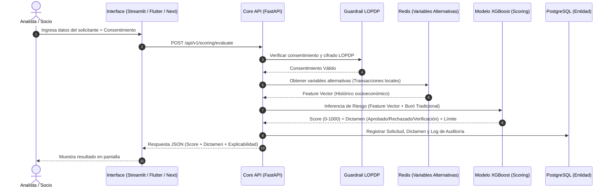

---

## 8. VISTA DE IMPLEMENTACIÓN

### 8.1. Visión General
Esta vista describe la organización estática de los componentes de código fuente, bibliotecas y módulos en el monorepo de GitHub de Antera Labs (`Antera Labs / Proyecto-Ascendere`).

### 8.2. Estructura de Componentes de Desarrollo
* **Frontend Clients**: Aplicación móvil Flutter (`/apps/mobile`), aplicación web Next.js (`/apps/web`) y tablero analítico Streamlit (`/apps/dashboard-uat`).
* **Backend Core & AI Services**: Microservicios en FastAPI (`/services/core-api`), motor de ML en Python (`/services/ml-scoring-engine`) y servidores del protocolo MCP (`/services/mcp-servers`).
* **Data & Infrastructure**: Scripts de migración DDL SQL (`/database/migrations`), esquemas de Feature Store (`/database/feature-store`) y manifiestos Docker/Terraform (`/infra`).

### 8.3. Estructura Detallada del Repositorio
```text
/
├── .github/workflows/          # Pipelines CI/CD DevSecOps (SonarQube + LOPDP)
├── docs/                      # Documentación del Proyecto (SAD.md)
├── apps/
│   ├── mobile/                # App Móvil Socios en Flutter (iOS/Android)
│   ├── web/                   # Portal Web en Next.js + Tailwind CSS
│   └── dashboard-uat/         # Dashboard Analítico para Analistas en Streamlit
├── services/
│   ├── core-api/              # Microservicios en FastAPI / Python
│   ├── ml-scoring-engine/     # Modelos de Machine Learning (Scikit-Learn / XGBoost)
│   └── mcp-servers/           # Servidores MCP de Integración de IA
├── database/
│   ├── migrations/            # Scripts DDL PostgreSQL (Socios, Créditos, Auditoría)
│   └── feature-store/         # Esquemas Redis para Variables Alternativas Locales
└── infra/
    ├── docker/                # Dockerfiles y Docker Compose
    └── terraform/             # Scripts de Infraestructura como Código (IaC)
```

### 8.4. Diagrama de Componentes de Desarrollo
Los componentes de software interactúan mediante interfaces bien definidas: los clientes de frontend consumen endpoints REST expuestos por FastAPI; la Core API invoca las funciones del motor predictivo XGBoost vía llamadas locales en Python e integra la Malla Agéntica mediante conectores del protocolo MCP; la capa de persistencia abstrae el acceso a PostgreSQL y Redis mediante controladores SQLAlchemy y Redis-Py.

---

## 9. VISTA DE DESPLIEGUE

### 9.1. Visión General
Fundamentado en el Microsoft Application Architecture Guide v2, el sistema adopta una arquitectura de contenedores Docker cloud-native. Para evitar acoplamientos innecesarios, se separan físicamente las topologías de despliegue de la Plataforma Web y de la Plataforma Móvil.

### 9.2. Diagrama de Despliegue

#### Topología de Despliegue Web (Web Application Archetype):
```text
┌────────────────────────────────────────────────────────────────────────────────────────┐
│ 1. BROWSER CLIENT TIER (Navegador del Usuario)                                         │
│    • Next.js App (React / TypeScript) + Tailwind CSS / Shadcn UI                      │
│    • Streamlit Analytics Dashboard (Interface de prueba UAT para Analistas)            │
└───────────────────────────────────────────┬────────────────────────────────────────────┘
                                            │ HTTPS / TLS 1.3 / WebSockets
┌───────────────────────────────────────────▼────────────────────────────────────────────┐
│ 2. WEB SERVER TIER (Capa de Servidor Frontend en Contenedor)                           │
│    • Node.js Container: Server-Side Rendering (SSR) & Static Site Generation (SSG)    │
│    • NGINX Reverse Proxy Container (SSL Termination & Ingress Enrutamiento)             │
└───────────────────────────────────────────┬────────────────────────────────────────────┘
                                            │ Red Privada Interna de Contenedores
┌───────────────────────────────────────────▼────────────────────────────────────────────┐
│ 3. APPLICATION & BUSINESS TIER (Capa de Servicios de Negocio y ML)                     │
│    • FastAPI Core API (Python)                                                         │
│    • Motor Analítico ML: Scikit-Learn / XGBoost (Inferencia de Scoring < 300 ms)       │
│    • Integración Agéntica: Servidores MCP (Model Context Protocol)                     │
└───────────────────────────────────────────┬────────────────────────────────────────────┘
                                            │ Consultas SQL / Feature Queries / Vectors
┌───────────────────────────────────────────▼────────────────────────────────────────────┐
│ 4. DATA TIER (Capa de Datos e Infraestructura)                                         │
│    • PostgreSQL (Base Relacional Transaccional ACID)                                   │
│    • Redis (Feature Store & Caché de Variables Alternativas Locales < 50 ms)           │
│    • Qdrant (Base Vectorial de Políticas Crediticias para RAG)                         │
└────────────────────────────────────────────────────────────────────────────────────────┘
```

#### Topología de Despliegue Móvil (Rich Mobile Client Archetype):
```text
┌────────────────────────────────────────────────────────────────────────────────────────┐
│ 1. HANDHELD MOBILE TIER (Dispositivo Móvil del Socio / Comerciante)                   │
│    • Flutter App (Dart AOT compilado a código máquina nativo ARM para iOS / Android)   │
│    • Almacenamiento Seguro Local: iOS Keychain / Android Keystore (Tokens JWT)         │
│    • Sensores & Hardware: Biometría (FaceID/Huella), Cámara (Escaneo de Documentos)    │
└───────────────────────────────────────────┬────────────────────────────────────────────┘
                                            │ HTTPS / REST API / TLS 1.3
┌───────────────────────────────────────────▼────────────────────────────────────────────┐
│ 2. API GATEWAY & SECURITY TIER (Puerta de Entrada Móvil)                               │
│    • NGINX API Gateway (Validación de Headers, Rate Limiting, Filtro Móvil)            │
│    • Agente Guardián LOPDP: Verificación de Consentimiento Firmado por el Socio        │
└───────────────────────────────────────────┬────────────────────────────────────────────┘
                                            │ Red Privada Interna de Contenedores
┌───────────────────────────────────────────▼────────────────────────────────────────────┐
│ 3. APPLICATION & BUSINESS TIER (Capa de Servicios de Negocio y ML)                     │
│    • FastAPI Core API (Python)                                                         │
│    • Motor Analítico ML: Scikit-Learn / XGBoost (Inferencia de Scoring)                │
└───────────────────────────────────────────┬────────────────────────────────────────────┘
                                            │ Consultas SQL / Feature Queries
┌───────────────────────────────────────────▼────────────────────────────────────────────┐
│ 4. DATA TIER (Capa de Datos e Infraestructura)                                         │
│    • PostgreSQL (Base Relacional Transaccional)                                        │
│    • Redis (Feature Store & Caché de Variables Alternativas Locales)                   │
└────────────────────────────────────────────────────────────────────────────────────────┘
```

---

## 10. VISTA DE DATOS

### 10.1. Visión General
El sistema combina tres tecnologías de persistencia especializadas bajo la norma ISO/IEC 25012 de Calidad de Datos: PostgreSQL para transacciones relacionales ACID, Redis para el almacenamiento de variables alternativas en memoria y Qdrant para la búsqueda semántica de políticas crediticias en el motor RAG.

### 10.2. Modelo de Datos
El modelo relacional vincula la entidad `tb_socio` con sus `tb_solicitud_credito`, sus registros de `tb_consentimiento_lopdp`, sus `tb_feature_vector_local` socioeconómicos y sus `tb_dictamen_scoring` finales.

### 10.3. Diccionarios de Datos

#### Tabla: tb_socio
| **Campo** | **Tipo de Dato** | **Null** | **Clave** | **Descripción** |
| :--- | :--- | :--- | :--- | :--- |
| id_socio | UUID | No | PK | Identificador único universal del socio. |
| identificacion | VARCHAR(13) | No | Unique | Cédula o RUC del comerciante. |
| nombres_completos | VARCHAR(150) | No | - | Nombres y apellidos anonimizables. |
| actividad_economica | VARCHAR(100) | No | - | Sector comercial (ej. Comercio local, Textil). |

#### Tabla: tb_dictamen_scoring
| **Campo** | **Tipo de Dato** | **Null** | **Clave** | **Descripción** |
| :--- | :--- | :--- | :--- | :--- |
| id_dictamen | UUID | No | PK | Identificador único del dictamen. |
| id_solicitud | UUID | No | FK | Referencia a la solicitud de crédito. |
| score_num | INTEGER | No | - | Puntaje de crédito calculado (0 - 1000). |
| veredicto | VARCHAR(30) | No | - | Aprobado, Rechazado o Sujeto a Verificación. |
| monto_sugerido | DECIMAL(10,2) | No | - | Límite de crédito sugerido por la IA. |

---

## 11. CALIDAD

### 11.1. Visión General
El producto de software se evalúa formalmente bajo el estándar ISO/IEC 25010 (SQuaRE) e incorpora los principios de diseño de aplicaciones nativas en nube recomendados por la Cloud Native Computing Foundation (CNCF).

### 11.2. Atributos de Calidad y Principios CNCF
* **Inmutabilidad de Contenedores**: Cada microservicio se empaqueta en una imagen Docker inmutable que no modifica su estado interno en ejecución.
* **Desacoplamiento y Resiliencia**: La caída del dashboard Streamlit no afecta la operación de la Core API de scoring ni el acceso a la base de datos.
* **Explicabilidad y Transparencia**: Los dictámenes generados por el algoritmo ML son interpretados por la Malla Agéntica RAG, eliminando el sesgo de "caja negra".

---

## 12. SEGURIDAD

### 12.1. Visión General
La arquitectura aplica principios de Seguridad por Diseño (Security by Design), asegurando cifrado TLS 1.3 en tránsito, AES-256 en reposo, autenticación JWT con firma RSA y agentes guardianes LOPDP en el pipeline CI/CD.

### 12.2. Seguridad de Aplicaciones Web OWASP (OWASP Top 10 Web 2021)
| **Riesgo OWASP Web** | **Descripción del Riesgo** | **Medida de Mitigación en la Arquitectura** |
| :--- | :--- | :--- |
| A01: Broken Access Control | Accesos no autorizados a datos de otros socios. | Validación de roles JWT (RBAC) e inspección de pertenencia en backend. |
| A02: Cryptographic Failures | Exposición de datos sensibles en tránsito o reposo. | Cifrado TLS 1.3 en red interna y AES-256 para columnas sensibles en PostgreSQL. |
| A03: Injection (SQL / Prompt) | Inyección de código SQL o manipulación del LLM. | Uso de ORM SQLAlchemy parametrizado y Guardrail Agents para prompts. |
| A05: Security Misconfiguration | Configuraciones por defecto inseguras. | Escaneo estático automatizado con SonarQube en GitHub Actions. |

### 12.3. Seguridad de Aplicaciones Móviles OWASP (OWASP Mobile Top 10 2024)
| **Riesgo OWASP Mobile** | **Descripción del Riesgo** | **Medida de Mitigación en la Arquitectura** |
| :--- | :--- | :--- |
| M01: Improper Credential Usage | Almacenamiento inseguro de tokens de sesión. | Uso exclusivo de iOS Keychain y Android Keystore encriptados por hardware. |
| M02: Insecure Communication | Intercepción de tráfico de red móvil. | SSL Pinning obligatorio en la app Flutter y certificado TLS 1.3 en NGINX Gateway. |
| M04: Insecure Authentication | Autenticación débil en dispositivos cliente. | Autenticación biométrica nativa (FaceID/Huella) combinada con OAuth2/JWT. |

---

## 13. INFORMACIÓN DE CONTACTO
Para soporte técnico, consultas sobre la arquitectura o auditorías de cumplimiento, comunicarse con:
* **Equipo de Desarrollo**: Antera Labs (UTPL / Proyecto Ascendere)
* **Líder Técnico & Arquitecto Principal**: Andrés (`ascardenas5@utol.edu.ec`)
* **Docente Responsable del Reto**: Armando Augusto Cabrera Silva (UTPL)
* **Empresa Cliente**: Cooperativa de Ahorro y Crédito Padre Julián Lorente (Loja, Ecuador)
