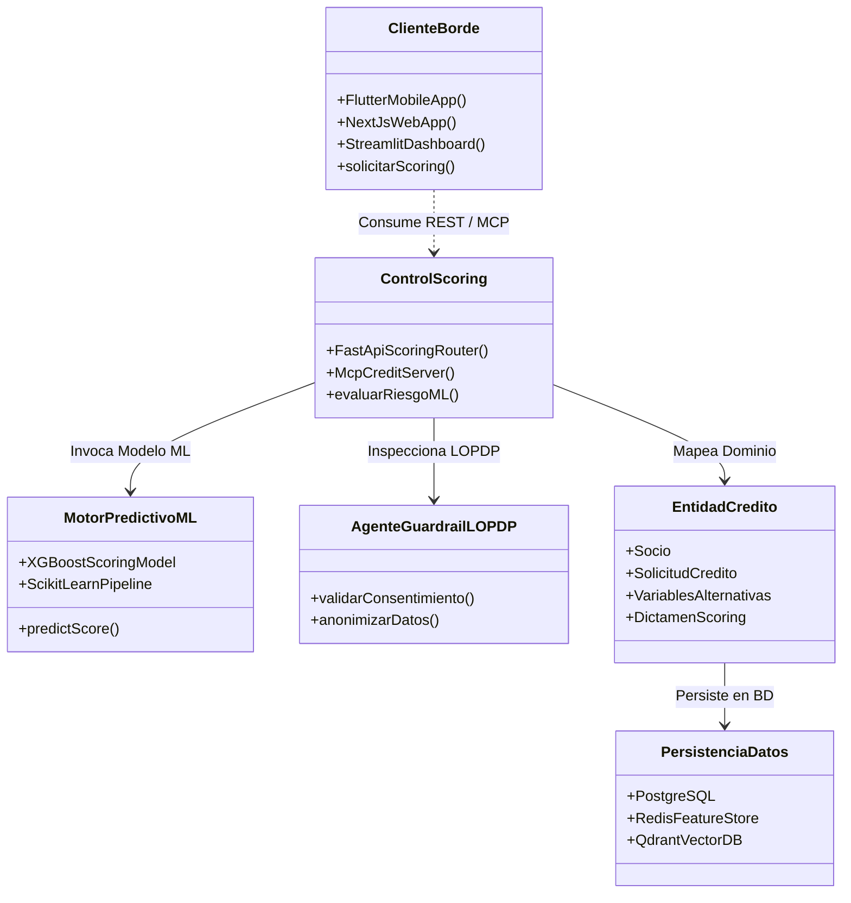
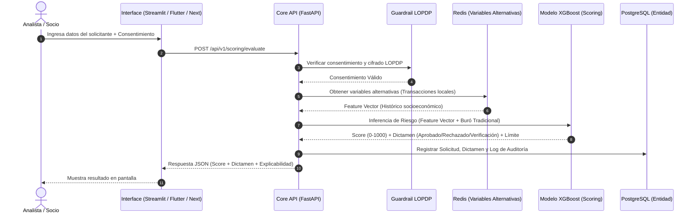

# Documento de Arquitectura de Software (SAD)

**Proyecto**: Sistema de Scoring de Crédito Basado en Analítica Predictiva y Variables Alternativas  
**Cliente / Empresa**: Cooperativa de Ahorro y Crédito Padre Julián Lorente  
**Docente Responsable**: Armando Augusto Cabrera Silva  
**Marco de Trabajo**: Aprendizaje Basado en Retos (CBL) - Proyecto Bimestral Ascendere  
**Estándar de Documentación**: ISO/IEC/IEEE 42010:2022 | Modelo 4+1 Vistas de Philippe Kruchten  
**Organización / Repositorio**: Antera Labs / UTPL (`Antera Labs / Proyecto-Ascendere`)  
**Versión**: 1.0.0 (Oficial)  
**Estado**: Aprobado para Desarrollo y Prototipado UAT  

---

### Control y Metadatos del Documento

#### Aprobador(es) del Documento:
| **Nombre del Aprobador** | **Rol** |
| :--- | :--- |
| Armando Augusto Cabrera Silva | Docente Responsable & Evaluador del Reto (UTPL) |
| Andrés | Arquitecto de Software Principal & Líder Técnico (Antera Labs) |

#### Revisores del Documento:
| **Nombre del Revisor** | **Rol** |
| :--- | :--- |
| Andrés | Arquitecto de Software & Gobernanza Cloud |
| Anthony | Desarrollador BackEnd Lead & Malla Agéntica MCP |
| Martín | Administrador de Base de Datos Lead (DBA & Feature Store) |
| Alberto | Oficial de Seguridad & DevSecOps Lead (LOPDP Guardrails) |
| Josué | Desarrollador FrontEnd Lead (Next.js, Flutter, Streamlit) |
| Ronald | Diseñador UX/UI Lead (Figma & Sistema de Diseño) |

#### Resumen de Cambios:
| **Versión** | **Fecha** | **Creado por** | **Descripción Corta de los Cambios** |
| :--- | :--- | :--- | :--- |
| 0.1 | 12/10/2026 | Andrés | Borrador inicial del DAS bajo modelo 4+1 vistas. |
| 0.5 | 15/10/2026 | Equipo Antera | Separación de arquetipos de infraestructura Web y Móvil. |
| 1.0.0 | 19/10/2026 | Andrés | Versión oficial adaptada a la Plantilla SAD ISO/IEC/IEEE 42010. |

---

## 1. INTRODUCCIÓN

### 1.1. Propósito
Este Documento de Arquitectura de Software (SAD) proporciona una visión integral, rigurosa y formal de la estructura del sistema de Scoring de Crédito para la Cooperativa de Ahorro y Crédito Padre Julián Lorente. Utiliza el Modelo de 4+1 Vistas de Philippe Kruchten y cumple strictly con el estándar internacional ISO/IEC/IEEE 42010:2022. Su objetivo es transmitir las decisiones arquitectónicas significativas a las partes interesadas (docente evaluador, directivos de la cooperativa, analistas de crédito y equipo de desarrollo), garantizando la trazabilidad entre los requisitos de negocio y la implementación en software.

### 1.2. Alcance
El sistema abarca la automatización inteligente del proceso de evaluación de riesgo crediticio para créditos de consumo y microcréditos. Integra la ingesta de información proveniente de burós tradicionales con variables alternativas locales (comportamiento transaccional, estabilidad de actividad comercial y patrones socioeconómicos regionales del sur del Ecuador). Incluye la clasificación de riesgo en tiempo real, la emisión de dictámenes automáticos (Aprobado, Rechazado o Sujeto a Verificación), la recomendación de límites crediticios y una interfaz de explicabilidad agéntica para el analista humano, todo operando bajo el estricto cumplimiento de la Ley Orgánica de Protección de Datos Personales (LOPDP) del Ecuador.

### 1.3. Referencias
| **#** | **Documento / Estándar** | **Resumen de Contenidos y Relevancia** |
| :--- | :--- | :--- |
| [REF1] | ISO/IEC/IEEE 42010:2022 | Estándar internacional para la especificación y organización de Descripciones Arquitectónicas. |
| [REF2] | ISO/IEC 25010:2011 (SQuaRE) | Modelo de calidad del producto de software (Seguridad, Eficiencia, Mantenibilidad, Usabilidad). |
| [REF3] | Ley Orgánica de Protección de Datos Personales (LOPDP) | Marco legal del Ecuador para la custodia, consentimiento y tratamiento de datos personales. |
| [REF4] | Microsoft Application Architecture Guide v2 | Directrices para la separación estricta entre capas lógicas (Layers) y físicas (Tiers). |
| [REF5] | Ulrich Business Capability Method | Metodología ágil para la elicitación de requisitos basada en el mapa de capacidades del negocio. |
| [REF6] | OWASP Top 10 Web (2021) / Mobile (2024) | Estándar de seguridad para la mitigación de riesgos en aplicaciones web y móviles. |

### 1.4. Visión General del Contenido del Documento
A continuación, el documento detalla la representación arquitectónica, los objetivos y restricciones, la especificación de casos de uso significativos y la descomposición del sistema a través de las 4+1 Vistas de Kruchten (Lógica, Procesos, Implementación, Despliegue y Casos de Uso). Posteriormente, aborda la Vista de Datos, la evaluación de atributos de calidad basados en el estándar ISO 25010 y las medidas de seguridad transversales bajo las directrices OWASP Web y Mobile.

---

## 2. REPRESENTACIÓN ARQUITECTÓNICA
La arquitectura del sistema sigue un enfoque modular, multicapa y desacoplado, diseñado para soportar analítica predictiva e integración agéntica de IA. Se organiza bajo el patrón Borde-Control-Entidad (BCE) e integra los arquetipos de diseño del Microsoft Application Architecture Guide v2:
* **Capa de Presentación (Objetos Borde / Boundary)**: Clientes independientes adaptados a su entorno (App Móvil en Flutter, Portal Web en Next.js y Dashboard Analítico UAT en Streamlit).
* **Capa de Negocio y Analítica (Objetos Control / Control)**: Microservicios asíncronos en FastAPI, Motor de ML (Scikit-Learn/XGBoost) y Servidores del Model Context Protocol (MCP) para la Malla Agéntica.
* **Capa de Persistencia y Datos (Objetos Entidad / Entity)**: Esquema híbrido compuesto por PostgreSQL (ACID), Redis (Feature Store en memoria para variables alternativas) y Qdrant (Base Vectorial RAG).
* **Capa de Infraestructura y Despliegue**: Empaquetamiento inmutable en Contenedores Docker con despliegue físico desacoplado para web y móvil.

---

## 3. OBJETIVOS Y RESTRICCIONES ARQUITECTÓNICAS
| **Atributo de Calidad** | **Meta Arquitectónica (ASR)** | **Mecanismo / Táctica de Diseño** |
| :--- | :--- | :--- |
| Eficiencia en Tiempo | Inferencia de scoring predictivo en < 300 ms. | Lectura de variables desde Redis Feature Store y ejecución asíncrona en FastAPI. |
| Reducción de Tiempo | Reducir tiempo de colocación de crédito en un 40%. | Dictamen automático en tiempo real para el 80% de solicitudes viables. |
| Seguridad / LOPDP | Cumplimiento estricto de la LOPDP Ecuador. | Guardrail Agents que verifican el consentimiento informado previo a la consulta. |
| Disponibilidad | Disponibilidad del 99.9% en operación. | Despliegue de contenedores Docker con balanceo NGINX y reinicio automático. |
| Mantenibilidad | Modificación del modelo ML sin alterar APIs. | Desacoplamiento del motor predictivo mediante protocolo abierto MCP. |
| Portabilidad | Ejecución idéntica en desarrollo y producción. | Contenedores Docker inmutables y scripts declarativos de Terraform. |

---

## 4. VISTA DE CASOS DE USO

### 4.1. Especificación de Casos de Uso
| **Código** | **Caso de Uso Clave** | **Actor Principal** | **Impacto y Requisito Arquitectónico** |
| :--- | :--- | :--- | :--- |
| UC-01 | Registro de Solicitud y Consentimiento LOPDP | Socio / Comerciante | Captura de firma digital y validación del permiso legal por el Guardrail Agent. |
| UC-02 | Ingesta Híbrida de Variables Alternativas | Sistema Core API | Consulta simultánea a buró tradicional y lectura de Redis Feature Store (< 50 ms). |
| UC-03 | Evaluación Predictiva de Scoring ML | Motor XGBoost | Ejecución de inferencia de riesgo y cálculo de probabilidad de mora en < 300 ms. |
| UC-04 | Dictamen Automático y Condiciones | Motor de Reglas | Clasificación (Aprobado/Rechazado/Verificación) y cálculo de tasa/monto/plazo. |
| UC-05 | Explicabilidad en Dashboard UAT | Analista de Crédito | Visualización en Streamlit del dictamen con justificación agéntica vía RAG. |
| UC-06 | Auditoría de Transacción LOPDP | Oficial de Cumplimiento | Registro inmutable de trazabilidad de consulta en PostgreSQL. |

---

## 6. VISTA LÓGICA

### 6.1. Visión General
La Vista Lógica representa la descomposición funcional del sistema en componentes de software y sus abstracciones de dominio. Aplica el patrón Borde-Control-Entidad (BCE) para garantizar que las responsabilidades de interfaz, lógica de cálculo e ingesta de datos permanezcan desacopladas.

### 6.2. Diagrama de Clases


### 6.3. Diccionario de Clases
| **Nombre de Clase** | **Tipo BCE** | **Atributos Principales** | **Responsabilidad en el Sistema** |
| :--- | :--- | :--- | :--- |
| Socio | Entidad | id_socio, identificacion, nombres, actividad_economica | Representa al comerciante o solicitante en el sistema. |
| SolicitudCredito | Entidad | id_solicitud, monto_solicitado, plazo_meses, estado | Mantiene el estado del trámite crediticio. |
| ConsentimientoLOPDP | Entidad | id_consentimiento, fecha_firma, hash_firma, estado_vigente | Respaldo legal del permiso de tratamiento de datos. |
| FeatureVectorLocal | Entidad | id_vector, f_transacciones_mes, f_estabilidad_local, f_buro | Variables socioeconómicas consolidadas para la IA. |
| DictamenScoring | Entidad | id_dictamen, score_num, veredicto, limite_sugerido, tasa | Resultado numérico y cualitativo de la evaluación. |
| GuardrailLopdpAgent | Control | apiKey, policyRules, auditLogger | Valida el consentimiento informado antes de consultar datos. |
| XGBoostPredictiveEngine | Control | modelWeights, featureScaler, thresholdConfig | Ejecuta la inferencia de Machine Learning en tiempo real. |
| StreamlitDashboard | Borde | sessionState, userRoles, renderComponents | Interfaz interactiva de validación UAT para analistas. |

---

## 7. VISTA DE PROCESOS

### 7.1. Visión General
La Vista de Procesos aborda el comportamiento dinámico en tiempo de ejecución, la concurrencia y la sincronización de tareas asíncronas durante el ciclo de vida del otorgamiento de crédito.

### 7.2. Procesos y Flujos Clave (Diagramas de Secuencia)


---

## 8. VISTA DE IMPLEMENTACIÓN

### 8.1. Visión General
Esta vista describe la organización estática de los componentes de código fuente, bibliotecas y módulos en el monorepo de GitHub de Antera Labs (`Antera Labs / Proyecto-Ascendere`).

### 8.2. Estructura de Componentes de Desarrollo
* **Frontend Clients**: Aplicación móvil Flutter (`/apps/mobile`), aplicación web Next.js (`/apps/web`) y tablero analítico Streamlit (`/apps/dashboard-uat`).
* **Backend Core & AI Services**: Microservicios en FastAPI (`/services/core-api`), motor de ML en Python (`/services/ml-scoring-engine`) y servidores del protocolo MCP (`/services/mcp-servers`).
* **Data & Infrastructure**: Scripts de migración DDL SQL (`/database/migrations`), esquemas de Feature Store (`/database/feature-store`) y manifiestos Docker/Terraform (`/infra`).

### 8.3. Estructura Detallada del Repositorio
```text
/
├── .github/workflows/          # Pipelines CI/CD DevSecOps (SonarQube + LOPDP)
├── docs/                      # Documentación del Proyecto (SAD.md)
├── apps/
│   ├── mobile/                # App Móvil Socios en Flutter (iOS/Android)
│   ├── web/                   # Portal Web en Next.js + Tailwind CSS
│   └── dashboard-uat/         # Dashboard Analítico para Analistas en Streamlit
├── services/
│   ├── core-api/              # Microservicios en FastAPI / Python
│   ├── ml-scoring-engine/     # Modelos de Machine Learning (Scikit-Learn / XGBoost)
│   └── mcp-servers/           # Servidores MCP de Integración de IA
├── database/
│   ├── migrations/            # Scripts DDL PostgreSQL (Socios, Créditos, Auditoría)
│   └── feature-store/         # Esquemas Redis para Variables Alternativas Locales
└── infra/
    ├── docker/                # Dockerfiles y Docker Compose
    └── terraform/             # Scripts de Infraestructura como Código (IaC)
```

### 8.4. Diagrama de Componentes de Desarrollo
Los componentes de software interactúan mediante interfaces bien definidas: los clientes de frontend consumen endpoints REST expuestos por FastAPI; la Core API invoca las funciones del motor predictivo XGBoost vía llamadas locales en Python e integra la Malla Agéntica mediante conectores del protocolo MCP; la capa de persistencia abstrae el acceso a PostgreSQL y Redis mediante controladores SQLAlchemy y Redis-Py.

---

## 9. VISTA DE DESPLIEGUE

### 9.1. Visión General
Fundamentado en el Microsoft Application Architecture Guide v2, el sistema adopta una arquitectura de contenedores Docker cloud-native. Para evitar acoplamientos innecesarios, se separan físicamente las topologías de despliegue de la Plataforma Web y de la Plataforma Móvil.

### 9.2. Diagrama de Despliegue

#### Topología de Despliegue Web (Web Application Archetype):
```text
┌────────────────────────────────────────────────────────────────────────────────────────┐
│ 1. BROWSER CLIENT TIER (Navegador del Usuario)                                         │
│    • Next.js App (React / TypeScript) + Tailwind CSS / Shadcn UI                      │
│    • Streamlit Analytics Dashboard (Interface de prueba UAT para Analistas)            │
└───────────────────────────────────────────┬────────────────────────────────────────────┘
                                            │ HTTPS / TLS 1.3 / WebSockets
┌───────────────────────────────────────────▼────────────────────────────────────────────┐
│ 2. WEB SERVER TIER (Capa de Servidor Frontend en Contenedor)                           │
│    • Node.js Container: Server-Side Rendering (SSR) & Static Site Generation (SSG)    │
│    • NGINX Reverse Proxy Container (SSL Termination & Ingress Enrutamiento)             │
└───────────────────────────────────────────┬────────────────────────────────────────────┘
                                            │ Red Privada Interna de Contenedores
┌───────────────────────────────────────────▼────────────────────────────────────────────┐
│ 3. APPLICATION & BUSINESS TIER (Capa de Servicios de Negocio y ML)                     │
│    • FastAPI Core API (Python)                                                         │
│    • Motor Analítico ML: Scikit-Learn / XGBoost (Inferencia de Scoring < 300 ms)       │
│    • Integración Agéntica: Servidores MCP (Model Context Protocol)                     │
└───────────────────────────────────────────┬────────────────────────────────────────────┘
                                            │ Consultas SQL / Feature Queries / Vectors
┌───────────────────────────────────────────▼────────────────────────────────────────────┐
│ 4. DATA TIER (Capa de Datos e Infraestructura)                                         │
│    • PostgreSQL (Base Relacional Transaccional ACID)                                   │
│    • Redis (Feature Store & Caché de Variables Alternativas Locales < 50 ms)           │
│    • Qdrant (Base Vectorial de Políticas Crediticias para RAG)                         │
└────────────────────────────────────────────────────────────────────────────────────────┘
```

#### Topología de Despliegue Móvil (Rich Mobile Client Archetype):
```text
┌────────────────────────────────────────────────────────────────────────────────────────┐
│ 1. HANDHELD MOBILE TIER (Dispositivo Móvil del Socio / Comerciante)                   │
│    • Flutter App (Dart AOT compilado a código máquina nativo ARM para iOS / Android)   │
│    • Almacenamiento Seguro Local: iOS Keychain / Android Keystore (Tokens JWT)         │
│    • Sensores & Hardware: Biometría (FaceID/Huella), Cámara (Escaneo de Documentos)    │
└───────────────────────────────────────────┬────────────────────────────────────────────┘
                                            │ HTTPS / REST API / TLS 1.3
┌───────────────────────────────────────────▼────────────────────────────────────────────┐
│ 2. API GATEWAY & SECURITY TIER (Puerta de Entrada Móvil)                               │
│    • NGINX API Gateway (Validación de Headers, Rate Limiting, Filtro Móvil)            │
│    • Agente Guardián LOPDP: Verificación de Consentimiento Firmado por el Socio        │
└───────────────────────────────────────────┬────────────────────────────────────────────┘
                                            │ Red Privada Interna de Contenedores
┌───────────────────────────────────────────▼────────────────────────────────────────────┐
│ 3. APPLICATION & BUSINESS TIER (Capa de Servicios de Negocio y ML)                     │
│    • FastAPI Core API (Python)                                                         │
│    • Motor Analítico ML: Scikit-Learn / XGBoost (Inferencia de Scoring)                │
└───────────────────────────────────────────┬────────────────────────────────────────────┘
                                            │ Consultas SQL / Feature Queries
┌───────────────────────────────────────────▼────────────────────────────────────────────┐
│ 4. DATA TIER (Capa de Datos e Infraestructura)                                         │
│    • PostgreSQL (Base Relacional Transaccional)                                        │
│    • Redis (Feature Store & Caché de Variables Alternativas Locales)                   │
└────────────────────────────────────────────────────────────────────────────────────────┘
```

---

## 10. VISTA DE DATOS

### 10.1. Visión General
El sistema combina tres tecnologías de persistencia especializadas bajo la norma ISO/IEC 25012 de Calidad de Datos: PostgreSQL para transacciones relacionales ACID, Redis para el almacenamiento de variables alternativas en memoria y Qdrant para la búsqueda semántica de políticas crediticias en el motor RAG.

### 10.2. Modelo de Datos
El modelo relacional vincula la entidad `tb_socio` con sus `tb_solicitud_credito`, sus registros de `tb_consentimiento_lopdp`, sus `tb_feature_vector_local` socioeconómicos y sus `tb_dictamen_scoring` finales.

### 10.3. Diccionarios de Datos

#### Tabla: tb_socio
| **Campo** | **Tipo de Dato** | **Null** | **Clave** | **Descripción** |
| :--- | :--- | :--- | :--- | :--- |
| id_socio | UUID | No | PK | Identificador único universal del socio. |
| identificacion | VARCHAR(13) | No | Unique | Cédula o RUC del comerciante. |
| nombres_completos | VARCHAR(150) | No | - | Nombres y apellidos anonimizables. |
| actividad_economica | VARCHAR(100) | No | - | Sector comercial (ej. Comercio local, Textil). |

#### Tabla: tb_dictamen_scoring
| **Campo** | **Tipo de Dato** | **Null** | **Clave** | **Descripción** |
| :--- | :--- | :--- | :--- | :--- |
| id_dictamen | UUID | No | PK | Identificador único del dictamen. |
| id_solicitud | UUID | No | FK | Referencia a la solicitud de crédito. |
| score_num | INTEGER | No | - | Puntaje de crédito calculado (0 - 1000). |
| veredicto | VARCHAR(30) | No | - | Aprobado, Rechazado o Sujeto a Verificación. |
| monto_sugerido | DECIMAL(10,2) | No | - | Límite de crédito sugerido por la IA. |

---

## 11. CALIDAD

### 11.1. Visión General
El producto de software se evalúa formalmente bajo el estándar ISO/IEC 25010 (SQuaRE) e incorpora los principios de diseño de aplicaciones nativas en nube recomendados por la Cloud Native Computing Foundation (CNCF).

### 11.2. Atributos de Calidad y Principios CNCF
* **Inmutabilidad de Contenedores**: Cada microservicio se empaqueta en una imagen Docker inmutable que no modifica su estado interno en ejecución.
* **Desacoplamiento y Resiliencia**: La caída del dashboard Streamlit no afecta la operación de la Core API de scoring ni el acceso a la base de datos.
* **Explicabilidad y Transparencia**: Los dictámenes generados por el algoritmo ML son interpretados por la Malla Agéntica RAG, eliminando el sesgo de "caja negra".

---

## 12. SEGURIDAD

### 12.1. Visión General
La arquitectura aplica principios de Seguridad por Diseño (Security by Design), asegurando cifrado TLS 1.3 en tránsito, AES-256 en reposo, autenticación JWT con firma RSA y agentes guardianes LOPDP en el pipeline CI/CD.

### 12.2. Seguridad de Aplicaciones Web OWASP (OWASP Top 10 Web 2021)
| **Riesgo OWASP Web** | **Descripción del Riesgo** | **Medida de Mitigación en la Arquitectura** |
| :--- | :--- | :--- |
| A01: Broken Access Control | Accesos no autorizados a datos de otros socios. | Validación de roles JWT (RBAC) e inspección de pertenencia en backend. |
| A02: Cryptographic Failures | Exposición de datos sensibles en tránsito o reposo. | Cifrado TLS 1.3 en red interna y AES-256 para columnas sensibles en PostgreSQL. |
| A03: Injection (SQL / Prompt) | Inyección de código SQL o manipulación del LLM. | Uso de ORM SQLAlchemy parametrizado y Guardrail Agents para prompts. |
| A05: Security Misconfiguration | Configuraciones por defecto inseguras. | Escaneo estático automatizado con SonarQube en GitHub Actions. |

### 12.3. Seguridad de Aplicaciones Móviles OWASP (OWASP Mobile Top 10 2024)
| **Riesgo OWASP Mobile** | **Descripción del Riesgo** | **Medida de Mitigación en la Arquitectura** |
| :--- | :--- | :--- |
| M01: Improper Credential Usage | Almacenamiento inseguro de tokens de sesión. | Uso exclusivo de iOS Keychain y Android Keystore encriptados por hardware. |
| M02: Insecure Communication | Intercepción de tráfico de red móvil. | SSL Pinning obligatorio en la app Flutter y certificado TLS 1.3 en NGINX Gateway. |
| M04: Insecure Authentication | Autenticación débil en dispositivos cliente. | Autenticación biométrica nativa (FaceID/Huella) combinada con OAuth2/JWT. |

---

## 13. INFORMACIÓN DE CONTACTO
Para soporte técnico, consultas sobre la arquitectura o auditorías de cumplimiento, comunicarse con:
* **Equipo de Desarrollo**: Antera Labs (UTPL / Proyecto Ascendere)
* **Líder Técnico & Arquitecto Principal**: Andrés (`ascardenas5@utol.edu.ec`)
* **Docente Responsable del Reto**: Armando Augusto Cabrera Silva (UTPL)
* **Empresa Cliente**: Cooperativa de Ahorro y Crédito Padre Julián Lorente (Loja, Ecuador)
